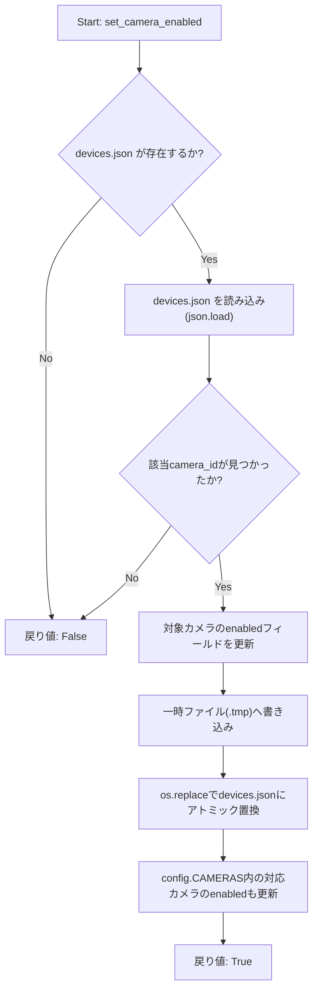

## 1. 解析メタ情報

| 項目 | 内容 |
| --- | --- |
| 対象ファイル | `camera_service.py` |
| 言語 | Python |
| 解析対象 | 提供されたコードのみ |
| 推測・補完 | 一切なし |

## 関連ドキュメント

- [config.md](./config.md) — `NVR_RECORD_DIR`、`CAMERAS`、`DEVICES_JSON_PATH`設定を提供する。
- [camera_router.md](./camera_router.md) — 呼び出し元。本ファイルの各関数がどのHTTPエンドポイントから、どのようなエラーハンドリングと共に呼び出されているかが確認できる（`PUT /settings/{camera_id}`が`set_camera_enabled`を呼び出す）。**（Issue #551で追加）** `get_camera_config_or_none`はルーター側の新設ヘルパー`_require_camera`から呼び出される。
- [camera_monitor.md](./camera_monitor.md) — 同様のONVIF/WSDL動的探索ロジック（`find_wsdl_path`）を持つ姉妹モジュール（動体検知監視用）。
- [logger.md](./logger.md) — `setup_logging`の実装元。
- [record_playlist_service.md](./record_playlist_service.md) — **（Issue #1091で追加）** 以前本ファイルにあった録画VOD生成（ffmpeg による HLS(.ts) 化）を置き換えた、NAS 上の録画 MP4 を直接参照するプレイリストの組み立て。

## 2. ファイルの概要

* ONVIF対応カメラのRTSP URL取得、ffmpegを用いたライブHLSストリーミング配信、録画の開始時刻の取得（`get_record_start_offset`）、および`devices.json`へのカメラ有効/無効設定の永続化を担うサービス層モジュールである（録画VODのプレイリストは Issue #1091 以降 [record_playlist_service.md](./record_playlist_service.md) が担う）。
* RTSP URLはONVIFカメラへの問い合わせ結果（またはカメラ設定に直接指定された`rtsp_url`）をメモリ上のキャッシュ(`_rtsp_cache`)に保持する。
* ライブ配信は`subprocess.Popen`で起動したffmpegプロセスをカメラID単位で管理辞書(`_active_processes`)に登録し、同一キーでの多重起動を防止する。
* 根拠: [モジュール冒頭のコメントと定数定義] (行番号: 24 / 抜粋: "# /tmp (RAM) から物理ストレージ（プロジェクト直下のdataディレクトリ）へ変更")

* RTSP URLに含まれる認証情報をログ出力する際は、`urlparse`でnetloc部分のみを安全に再構築する`_mask_rtsp_url_for_log`関数でマスクする。パスワードが空文字の場合に`str.replace('', '***')`が文字列の全文字間へ`***`を挿入して破壊するという以前の不具合を修正したものである。
* 根拠: [_mask_rtsp_url_for_log関数のDocstring] (参照: _mask_rtsp_url_for_log / 抜粋: "パスワードが空文字の場合、str.replace('', '***')は文字列の全文字間に")

* ライブ配信ffmpegプロセス起動時には`-hide_banner`/`-loglevel error`オプションを付与し、認証情報込みのRTSP URLがffmpeg自身の起動バナー経由でログファイルに平文出力されるのを防止する。また`ffmpeg.log`は`os.chmod`で`0o600`（所有者のみ読み書き可）に設定し、他ローカルユーザーからの閲覧を防ぐ。
* **（Issue #882で追加）** 生存中のライブffmpegでも、`stream.m3u8`の更新時刻（無ければ`_live_started_at`の起動時刻）から`HLS_LIVE_STALL_SECONDS`（30秒）を超えて更新が止まっていれば、ハングとみなして`kill`し再起動する（`_is_live_stalled`）。`-timeout`で検知できない停止への備え。起動前には前回の`stream.m3u8`/`.ts`も削除する（`_remove_stale_live_outputs`）。
* 根拠: [ffmpegコマンドとchmod] (行番号: 310, 329 / 抜粋: "\"-hide_banner\",", "os.chmod(log_path, FFMPEG_LOG_FILE_MODE)")

* **（Issue #439で追加）** ライブ配信の起動(`start_hls_stream`)に加え、`_active_processes`/`_rtsp_cache`のグローバル辞書への読み書き自体も、モジュールレベルの`_state_lock`で保護される。
* 根拠: `_state_lock = threading.Lock()`

* `start_hls_stream`で開いたffmpegログファイルのハンドルは、`subprocess.Popen`呼び出し後に`finally`ブロックで親プロセス側から明示的に`close()`される（子プロセスは`dup()`済みのfdを保持するため親側は不要であり、以前はプロセス再起動のたびにファイルハンドルがリークしていた）。
* 根拠: [ログファイルクローズ] (参照: _start_hls_stream_locked / 抜粋: "log_file.close()")

* **（Issue #1091で削除）** 以前は本ファイルが、過去日の録画再生のたびに ffmpeg で丸1日分の mp4 を HLS(.ts) 化して SD カードへ書き出す録画VOD生成（Issue #1088 の同時1本・空き容量確認・キャッシュ上限を含む）を担っていた。この処理は全て削除し、録画VODのプレイリストは [record_playlist_service.md](./record_playlist_service.md) が NAS 上の fragmented MP4 を直接参照して組み立てる。
* 根拠: [撤去の注記] (行番号: 27〜28 / 抜粋: "# Issue #1091: 録画VODは NAS 上の fragmented MP4 をバイト範囲で直接参照するプレイリスト\n# (services/record_playlist_service.py)で配信し、ffmpeg による HLS(.ts) 化は廃止した。")

* `set_camera_enabled`は`devices.json`上の該当カメラの`enabled`フラグを更新し、`config.CAMERAS`にも反映する。ここで更新されるのは**サーバープロセス内の**`config.CAMERAS`だけだが、別プロセスの`monitors/camera_monitor.py`は監視ループごとに`devices.json`を読み直す（`is_camera_enabled`、Issue #652）ため、`devices.json`への書き込みを通じて無効化・再有効化が数十秒以内に伝播する。書き込みは一時ファイル(`.tmp`)への書き込み後に`os.replace`でアトミックに置き換える方式であり、書き込み途中のクラッシュ・電源断による`devices.json`破損を防ぐ。
* 根拠: [set_camera_enabled関数] (参照: set_camera_enabled / 抜粋: "tmp_path = f\"{config.DEVICES_JSON_PATH}.tmp\"")

## 3. 外部依存関係

### インポート一覧

| 名称 | 種類 | 用途 | 根拠 |
| --- | --- | --- | --- |
| `contextlib` | 標準ライブラリ | `_live_stream_lock`をジェネレータベースのコンテキストマネージャとして定義する(`@contextlib.contextmanager`) | 根拠: [import文] (行番号: 1 / 抜粋: "import contextlib") |
| `core.utils.RefCountedLockRegistry`（Issue #661 で追加） | ローカルモジュール | `_live_stream_locks`の実体。参照カウント付きロックのレジストリを`core/utils.py`側へ一本化した | 根拠: [import文] (行番号: 14 / 抜粋: "from core.utils import RefCountedLockRegistry") |
| `json` | 標準ライブラリ | `devices.json`の読み込み・書き込み（`set_camera_enabled`） | 根拠: [import文] (行番号: 2 / 抜粋: "import json") |
| `os` | 標準ライブラリ | パス操作、`os.chmod`によるパーミッション変更、`os.replace`によるアトミックなファイル置換 | 根拠: [import文] (行番号: 3 / 抜粋: "import os") |
| `subprocess` | 標準ライブラリ | ffmpegプロセスの起動(`Popen`)と型ヒント(`subprocess.Popen`) | 根拠: [import文] (行番号: 4 / 抜粋: "import subprocess") |
| `threading` | 標準ライブラリ | `_active_processes`/`_rtsp_cache`を保護する`_state_lock` | 根拠: [import文] (行番号: 5 / 抜粋: "import threading") |
| `time` | 標準ライブラリ | ライブ配信の停滞判定・停止待ち | 根拠: [import文] (行番号: 6 / 抜粋: "import time") |
| `urllib.parse` | 標準ライブラリ | RTSP URIのパース(`urlparse`)、認証情報のURLエンコード(`quote`)、ログ用マスク処理 | 根拠: [import文] (行番号: 7 / 抜粋: "import urllib.parse") |
| `glob` | 標準ライブラリ | 日付パターンに一致するmp4ファイルの検索(`get_record_start_offset`) | 根拠: [import文] (行番号: 8 / 抜粋: "import glob") |
| `datetime.datetime` | 標準ライブラリ | ファイル名中の時刻文字列のパース(`get_record_start_offset`) | 根拠: [import文] (行番号: 9 / 抜粋: "from datetime import datetime") |
| `typing.Optional`, `Dict`, `Any` | 標準ライブラリ | 型ヒント | 根拠: [import文] (行番号: 10 / 抜粋: "from typing import Optional, Dict, Any") |
| `core.logger.setup_logging` | 内部モジュール | ロガーインスタンスの生成 | 根拠: [import文] (行番号: 13 / 抜粋: "from core.logger import setup_logging") |
| `config` | 内部モジュール | NVR録画保存ディレクトリ(`NVR_RECORD_DIR`)、`devices.json`のパス(`DEVICES_JSON_PATH`)、カメラ設定一覧(`CAMERAS`)の参照・更新 | 根拠: `nvr_base_dir = config.NVR_RECORD_DIR` |
| `onvif.ONVIFCamera` | 外部ライブラリ（任意依存） | ONVIFカメラへの接続、メディアプロファイル取得、ストリームURI取得。インポート失敗時は`Any`にフォールバック | 根拠: [try-exceptインポート] (行番号: 18〜21 / 抜粋: "try:\n    from onvif import ONVIFCamera\nexcept ImportError:\n    ONVIFCamera = Any") |

### ブラックボックスとなる外部要素

| 名称 | 理由 | 根拠 |
| --- | --- | --- |
| `ONVIFCamera` (onvifライブラリ) | `create_media_service`, `GetProfiles`, `create_type`, `GetStreamUri` 等のメソッドの内部実装・通信プロトコル詳細は本ファイルからは不明。 | 根拠: [ONVIFCameraの利用箇所] (行番号: 165 / 抜粋: "mycam = ONVIFCamera(cam_conf['ip'], cam_conf.get('port', 80), cam_conf['user'], cam_conf.get('pass', ''), wsdl_dir=wsdl_path)") |
| `config` | `config.NVR_RECORD_DIR`の値、`config.DEVICES_JSON_PATH`が指す実際のファイルパス、`config.CAMERAS`の実データがどのように設定されているか（環境変数、設定ファイル等）が本ファイルからは不明。 | 根拠: [config参照] (参照: get_record_start_offset / 抜粋: "nvr_base_dir = config.NVR_RECORD_DIR") |
| `setup_logging` | 生成されるロガーの出力先・フォーマット・ログレベルの詳細が不明。 | 根拠: [ロガー生成] (行番号: 22 / 抜粋: "logger = setup_logging(\"camera_service\")") |
| `ffmpeg` / `nice` (外部コマンド) | `subprocess.Popen`で起動される外部コマンドの内部動作・エラー時の終了コード仕様は本ファイルの管理対象外。 | 根拠: [Popen呼び出し] (行番号: 265, 451 / 抜粋: "\"nice\", \"-n\", str(FFMPEG_NICE_LEVEL),")（Issue #451でnice値をハードコード文字列から`FFMPEG_NICE_LEVEL`定数へ変更） |
| `devices.json` (外部ファイル) | `set_camera_enabled`が読み書きする対象であり、既存カメラエントリの正確なJSON構造・件数は本ファイルからは不明。 | 根拠: [devices.json読み書き] (行番号: 418 / 抜粋: "if not os.path.exists(config.DEVICES_JSON_PATH):") |

## 4. 主要要素の定義（関数 / エンドポイント / コンポーネント）

### `_state_lock`（Issue #439で追加）

* **役割**: `_active_processes`（ライブ配信プロセス）・`_rtsp_cache`（RTSP URLキャッシュ）のモジュールレベル辞書を保護するグローバルロック（以前は VOD プロセスの `_active_vod_processes` も保護していたが、Issue #1091 で VOD 生成ごと撤去）。FastAPIの同期エンドポイント（スレッドプール実行）から複数スレッドで同時に読み書きされうるため、個々のdict操作自体はGILにより原子的でも「チェックしてから更新する」までの一連の操作は原子的でなかったことへの対応として追加された。
* 根拠: [変数定義とコメント] (行番号: 77 / 抜粋: "# 読み書きの一連の操作をこのLockで保護する。\n_state_lock = threading.Lock()")

* **引数/リクエスト**: 該当なし
* **戻り値/レスポンス**: 該当なし
* **副作用**: なし（`threading.Lock`インスタンスの生成のみ）
* **エラーハンドリング**: なし

### `_live_stream_lock`（コンテキストマネージャ。Issue #661 で `core.utils.RefCountedLockRegistry` へ統合）

* **役割**: `cam_id` 単位で排他制御を行うコンテキストマネージャ。同一キーへの同時リクエストで「実行中でない」というチェックと ffmpeg 起動・登録までを不可分な区間にし、ffmpeg の二重起動と同一ファイルへの書き込み競合を防ぐ（`start_hls_stream` の check-then-act 競合対策）。**（Issue #661 で修正）** 以前はこのファイル内に `_RefCountedLock` クラスと、それを使う2つのほぼ同一なコンテキストマネージャ実装（`_vod_generation_lock`/`_live_stream_lock`）があったが、`core/utils.py` の `RefCountedLockRegistry` と同じ実装だったため一本化した。**（Issue #1091）** 録画VOD生成用の `_vod_generation_lock` は生成処理ごと削除した。
* 根拠: `def _live_stream_lock(cam_id: str):`、`_live_stream_locks = RefCountedLockRegistry()`

* **引数/リクエスト**: `_live_stream_lock(cam_id: str)`
* **戻り値/レスポンス**: なし（`@contextlib.contextmanager` によるジェネレータベースのコンテキストマネージャ）
* **副作用**: レジストリ（`_live_stream_locks`）へのエントリ登録（未登録時のみ）、`ref_count` の増減、`ref_count` が 0 に戻った場合のエントリ削除、実ロックの獲得・解放。いずれも `RefCountedLockRegistry.acquire` が行う。
* 根拠: `with _live_stream_locks.acquire(cam_id):`
* **エラーハンドリング**: なし（`RefCountedLockRegistry.acquire` の `try`/`finally` により、例外時も `ref_count` の減算と条件付き削除は必ず実行される）

### `_mask_rtsp_url_for_log`

* **役割**: RTSP URLに含まれる認証情報(user:pass)をログ出力用にマスクする。`urlparse`でnetloc部分のみを`***@host`（パスワードなし）または`***:***@host`（パスワードあり）に置換して再構築する。ユーザー名・パスワードのいずれも含まれないURLはそのまま返す。
* 根拠: [関数定義とDocstring] (行番号: 125〜129 / 抜粋: "'***'を挿入して破壊する(Pythonの仕様)ため、urlparseでnetloc部分のみ")

* **引数/リクエスト**: `url: str`
* 根拠: [引数定義] (行番号: 125 / 抜粋: "def _mask_rtsp_url_for_log(url: str) -> str:")

* **戻り値/レスポンス**: `str`（マスク済みURL。パース処理中に例外が発生した場合は固定文字列`"***"`）
* 根拠: [各return文] (行番号: 171, 176, 178 / 抜粋: "return parsed._replace(netloc=masked_netloc).geturl()")

* **副作用**: なし

* **エラーハンドリング**: `urlparse`等での例外を`except Exception:`で包括的に捕捉し、固定文字列`"***"`を返す（フェイルセーフ）。
* 根拠: [try-exceptブロック] (参照: _mask_rtsp_url_for_log / 抜粋: "except Exception:\n        return \"***\"")

### `init_output_dir`

* **役割**: `base_dir/camera_id` のディレクトリを作成（既存の場合はそのまま）し、そのパスを返す。
* 根拠: [関数定義] (行番号: 142〜145 / 抜粋: "def init_output_dir(base_dir: str, camera_id: str) -> str:")

* **引数/リクエスト**: `base_dir: str`, `camera_id: str`
* 根拠: [引数定義] (行番号: 142 / 抜粋: "def init_output_dir(base_dir: str, camera_id: str) -> str:")

* **戻り値/レスポンス**: `str`（作成済みディレクトリの絶対/相対パス）
* 根拠: [戻り値] (行番号: 145 / 抜粋: "return cam_dir")

* **副作用**: ディレクトリ作成(`os.makedirs`, `exist_ok=True`)。
* 根拠: [makedirs呼び出し] (行番号: 144 / 抜粋: "os.makedirs(cam_dir, exist_ok=True)")

* **エラーハンドリング**: なし（`os.makedirs`が権限エラー等で例外を送出した場合、呼び出し元に伝播する）

### `find_wsdl_path`（Issue #661 で core/onvif_utils.py へ移動）

* **役割**: `sys.path` 上の各ディレクトリを走査し、`onvif/wsdl` または `wsdl` サブディレクトリ内に `devicemgmt.wsdl` が存在するパスを探索して返す。**実体は本ファイルには無く、`core/onvif_utils.py` から import している**(以前は `monitors/camera_monitor.py` と同一実装が重複していた)。
* 根拠: `from core.onvif_utils import find_wsdl_path` (行番号: 13)
* 詳細: [onvif_utils.md](./onvif_utils.md)

### `get_rtsp_url`

* **役割**: カメラのRTSP URLを取得する。キャッシュ(`_rtsp_cache`)、設定内の直接指定(`rtsp_url`)、ONVIF経由の動的取得の順に解決を試み、ONVIF取得時は認証情報をURLエンコードして埋め込んだURIを構築する。**（Issue #439で修正）** `_rtsp_cache`への読み書きはいずれも`_state_lock`を保持した状態で行うよう修正された。ただし低速なONVIFネットワーク通信自体（`ONVIFCamera`接続からストリームURI取得まで）は`_state_lock`を保持したままでは行わず、通信完了後にロックを取得してキャッシュへ書き込む設計になっている（ロック保持中に外部通信でブロックし他スレッドを長時間待たせないため）。
* 根拠: [関数定義] (行番号: 148〜189 / 抜粋: "def get_rtsp_url(cam_conf: Dict[str, Any]) -> str:")、[キャッシュ読み取り] (参照: get_rtsp_url / 抜粋: "with _state_lock:\n        cached = _rtsp_cache.get(cam_id)\n    if cached:\n        return cached")、[ONVIF通信外でのキャッシュ書込] (参照: get_rtsp_url / 抜粋: "with _state_lock:\n            _rtsp_cache[cam_id] = auth_uri\n        return auth_uri")

* **引数/リクエスト**: `cam_conf: Dict[str, Any]`（カメラ設定辞書。`id`, `ip`, `user`, `pass`, `port`, `rtsp_url`等のキーを想定）
* 根拠: [引数定義] (行番号: 148 / 抜粋: "def get_rtsp_url(cam_conf: Dict[str, Any]) -> str:")

* **戻り値/レスポンス**: `str`（RTSP URL文字列。キャッシュヒット時・直接指定時はそのまま、ONVIF取得時は認証情報埋め込み済みURI）
* 根拠: [各return文] (行番号: 202, 207, 235 / 抜粋: "return auth_uri")

* **副作用**: `_state_lock`保持下での`_rtsp_cache`の読み取り・書き込み（キャッシュ登録）、ONVIFカメラへのネットワーク接続（`_state_lock`は保持しない）、取得失敗時のエラーログ出力。
* 根拠: [キャッシュ登録とエラーログ] (行番号: 205〜206, 233〜234, 237 / 抜粋: "with _state_lock:\n            _rtsp_cache[cam_id] = cam_conf[\"rtsp_url\"]")

* **エラーハンドリング**: WSDLパスが見つからない場合は`FileNotFoundError`を送出。ONVIF通信等で例外が発生した場合はエラーログを出力したうえで例外を再送出(`raise`)する（呼び出し元での処理が必要）。
* 根拠: [try-exceptブロック] (行番号: 212, 236〜238 / 抜粋: "except Exception as e:\n        logger.error(f\"❌ [{cam_conf['name']}] ONVIF経由のRTSP URL取得に失敗: {e}\")\n        raise")

### `start_hls_stream`（Issue #439で薄いラッパーに分割）

* **(2026-11-12 UX改善)** 呼ばれるたびに`touch_live(cam_id)`で「視聴中」として記録する(プレイヤーはプレイリストを数秒おきに取り直すため、視聴が続く限り下記の自動停止に掛からない)。`_start_hls_stream_locked`はffmpegを起動・登録した直後に`_ensure_idle_reaper()`を呼ぶ。

* **役割**: 指定カメラのライブHLSストリーミング起動を、`cam_id`単位の`_live_stream_lock`で排他制御しつつ、実際の処理を担う内部関数`_start_hls_stream_locked`へ委譲する薄いラッパー。**（Issue #439で修正）** 以前は本関数自体が「実行中チェック→ffmpeg起動・登録」の全ロジックを直接持っており、同一`cam_id`への同時リクエストで両方が「実行中でない」と判定しffmpegを二重起動しうる check-then-act 競合があった。現在はロック取得と実処理を分離している。
* 根拠: [関数定義] (行番号: 263〜271 / 抜粋: "def start_hls_stream(cam_conf: Dict[str, Any]) -> str:\n    cam_id = cam_conf['id']\n    # #439: 同一cam_idへの同時リクエストで「実行中でないチェック→ffmpeg起動・登録」が\n    # 競合しないよう、cam_id単位でこの一連の処理全体を排他する。\n    with _live_stream_lock(cam_id):\n        return _start_hls_stream_locked(cam_conf, cam_id)")

* **引数/リクエスト**: `cam_conf: Dict[str, Any]`
* 根拠: [引数定義] (行番号: 263 / 抜粋: "def start_hls_stream(cam_conf: Dict[str, Any]) -> str:")

* **戻り値/レスポンス**: `str`（`_start_hls_stream_locked`の戻り値をそのまま返す）
* 根拠: [戻り値] (行番号: 271 / 抜粋: "return _start_hls_stream_locked(cam_conf, cam_id)")

* **副作用**: `cam_id`の抽出、`_live_stream_lock(cam_id)`によるロックの取得・解放（`with`文）。
* 根拠: [ロック取得] (行番号: 184 / 抜粋: "with _live_stream_lock(cam_id):")

* **エラーハンドリング**: なし（内部実装`_start_hls_stream_locked`に委譲）

### `FFMPEG_RTSP_TIMEOUT_USEC`（不具合修正で新設）

* **役割**: ライブHLS配信のffmpeg RTSP入力に設定するソケットI/Oタイムアウト(マイクロ秒、既定15秒)。実機で駐車場カメラをタップすると、ライブ映像ではなく固まった時点の古い映像が配信され続ける不具合を確認した。原因はffmpegのRTSP入力にioタイムアウトが既定で設定されておらず、TCP接続は張れるが応答が返らない種類のネットワーク不調に遭遇すると、ffmpegプロセスがエラーも出さず無期限にハングすること。`_start_hls_stream_locked`の`existing.poll() is None`チェックはOSプロセスの生死しか見ないため、ハングしたプロセスを「配信中」と誤認して再起動されず、固まった時点の映像を配信し続けてしまっていた。この定数をRTSP/tcpプロトコル自身のオプションである`-timeout`としてffmpegコマンドに渡し、応答が無ければffmpeg自身が終了するようにすることで、次のリクエストで新しいプロセスが起動されるようにする。**汎用オプションの`-rw_timeout`は`async:`プロトコル専用でRTSP/tcpの読み取りには効かない**ことを、疎通不能なホストに対するffmpeg実行(`-rw_timeout`では無期限にハングし続け、`-timeout`だけが指定通りに機能することを確認)で検証済み。
* 根拠: `FFMPEG_RTSP_TIMEOUT_USEC = 15_000_000` (行番号: 56)、`"-timeout", str(FFMPEG_RTSP_TIMEOUT_USEC),` (行番号: 277)

### `_remove_stale_live_outputs`（Issue #882で新設）

* **役割**: ライブHLSの出力ディレクトリから、前回のffmpegが残した`stream.m3u8`・セグメント(`*.ts`)・書きかけの`*.m3u8.tmp`を削除する。ffmpegは`-hls_flags delete_segments`でも終了時に最後のプレイリストと直近のセグメントをディスクに残す(正常終了なら`#EXT-X-ENDLIST`付きになりVOD扱いで再生される)。新しいffmpegを起動してもプレイリストが書き換わるのは最初のセグメントを書き終えた後のため、それまでの間に`routers/camera_router.py`の`get_live_stream`(プレイリストが存在すれば即返す待機ループ)が古いプレイリストを返し、前回終了時点(例: 前日22時)の映像がライブとして再生されていた。`_start_hls_stream_locked`がffmpegを新規起動する直前にこれを呼ぶことで、ルーターが返すのは新しいffmpegが書いたプレイリストだけになる。`ffmpeg.log`は対象外(直後に`open(..., "w")`で作り直される)。
* 根拠: [関数定義] (行番号: 274 / 抜粋: "def _remove_stale_live_outputs(cam_dir: str) -> None:")

* **引数/リクエスト**: `cam_dir: str`（`init_output_dir(HLS_LIVE_DIR, cam_id)`が返すカメラ別ディレクトリ）
* 根拠: [引数定義] (行番号: 274 / 抜粋: "def _remove_stale_live_outputs(cam_dir: str) -> None:")

* **戻り値/レスポンス**: `None`
* 根拠: [関数定義] (行番号: 274 / 抜粋: "def _remove_stale_live_outputs(cam_dir: str) -> None:")

* **副作用**: `cam_dir`直下の`stream.m3u8`・`*.ts`・`*.m3u8.tmp`の削除。
* 根拠: [削除対象の判定] (行番号: 289 / 抜粋: "if name == \"stream.m3u8\" or name.endswith((\".ts\", \".m3u8.tmp\")):")

* **エラーハンドリング**: ディレクトリの列挙に失敗した場合(`OSError`)は何もせず戻る。個々のファイル削除で`FileNotFoundError`は無視し、それ以外の`OSError`は警告ログを出して残りの削除を続ける(古いファイルの削除失敗で配信の起動そのものを止めない)。
* 根拠: [例外処理] (行番号: 292-295 / 抜粋: "except FileNotFoundError:\n                pass\n            except OSError as e:\n                logger.warning(f\"⚠️ 古いライブHLSファイルの削除に失敗: {name}: {e}\")")

### `_start_hls_stream_locked`（Issue #439で`start_hls_stream`から分離）

* **役割**: 指定カメラのライブHLSストリーミングをffmpegプロセスとして起動する実処理。既に同一カメラIDのプロセスが実行中であれば新規起動せず既存のプレイリストパスを返す。ffmpegログファイルは`chmod 0o600`（所有者のみ読み書き可）で作成し、起動バナー経由の認証情報露出を防ぐため`-hide_banner`/`-loglevel error`オプションを付与する。呼び出し元`start_hls_stream`が取得した`cam_id`単位のロック内で実行されることを前提とする。**（不具合修正）** RTSP入力(`-i`)の直前に`-timeout`(`FFMPEG_RTSP_TIMEOUT_USEC`)を追加した。**（Issue #882で修正）** ffmpegを新規起動する(既存プロセスが無い、または終了済みの)場合は、起動前に`_remove_stale_live_outputs`で前回の`stream.m3u8`・`*.ts`を削除する。既存プロセスが実行中の場合はその出力を消さずにプレイリストパスを返す。
* 根拠: [古い出力の削除呼び出し] (行番号: 342 / 抜粋: "_remove_stale_live_outputs(cam_dir)")
* 根拠: [関数定義] (行番号: 313〜383 / 抜粋: "def _start_hls_stream_locked(cam_conf: Dict[str, Any], cam_id: str) -> str:")、`"-timeout", str(FFMPEG_RTSP_TIMEOUT_USEC),` (行番号: 277)

* **引数/リクエスト**: `cam_conf: Dict[str, Any]`, `cam_id: str`
* 根拠: [引数定義] (行番号: 313 / 抜粋: "def _start_hls_stream_locked(cam_conf: Dict[str, Any], cam_id: str) -> str:")

* **戻り値/レスポンス**: `str`（プレイリストファイルのパス。RTSP URL取得に失敗した場合は空文字列`""`）
* 根拠: [各return文] (行番号: 255, 259〜260, 305 / 抜粋: "except Exception:\n        return \"\"")

* **副作用**: `_state_lock`保持下での`_active_processes`の読み取り（既存プロセスチェック）・書き込み（登録）、出力ディレクトリの作成(`init_output_dir`)、**（Issue #882で追加）** ffmpeg新規起動前の前回出力(`stream.m3u8`・`*.ts`)の削除(`_remove_stale_live_outputs`)、ffmpegログファイルのオープンと`chmod 0o600`によるパーミッション設定、`subprocess.Popen`によるffmpegプロセスの起動、起動後の親プロセス側でのログファイルクローズ、マスク済みRTSP URLを含むログ出力。
* 根拠: [既存プロセスチェック] (参照: _start_hls_stream_locked / 抜粋: "with _state_lock:\n        existing = _active_processes.get(cam_id)\n    if existing is not None and existing.poll() is None:\n        return playlist_path")、[ログファイル作成・chmod・Popen・クローズ・登録] (行番号: 290〜304 / 抜粋: "log_path = os.path.join(cam_dir, \"ffmpeg.log\")", "with _state_lock:\n        _active_processes[cam_id] = process")

* **エラーハンドリング**: `get_rtsp_url`が例外を送出した場合、これを捕捉して空文字列を返す（フェイルソフト）。ffmpegプロセス自体の起動失敗（`subprocess.Popen`の例外）に対する捕捉は本関数内には存在しないが、ログファイルのクローズは`finally`ブロックにより保証される。
* 根拠: [try-exceptブロックとfinally] (行番号: 257〜260, 296〜302 / 抜粋: "try:\n        rtsp_url = get_rtsp_url(cam_conf)\n    except Exception:\n        return \"\"")

### ライブ配信の自動停止(`HLS_LIVE_IDLE_SECONDS` / `touch_live` / `stop_idle_live_streams` / `_idle_reaper_loop` / `_ensure_idle_reaper`)

* **役割**: **(2026-11-12 新設)** 視聴が途絶えたライブ用ffmpegを止める。以前は一度始めたライブ用ffmpegを止める経路が「停滞検知(`_is_live_stalled`)」と「サーバー終了時(`stop_all_processes`)」しか無く、ページを閉じてもカメラへのRTSP接続とHLSの書き込みがサーバーの再起動まで続いていた。
    * `touch_live(cam_id)`: `_live_last_access[cam_id]`に現在時刻(`time.time()`)を記録する。プレイリスト要求(`start_hls_stream`)とセグメント要求(`routers/camera_router.get_live_segment`)から呼ばれる。
    * `stop_idle_live_streams(now=None)`: 最後の要求から`HLS_LIVE_IDLE_SECONDS`(60秒)以上経ったカメラのffmpegを`terminate()`(`HLS_LIVE_KILL_WAIT_SECONDS`待って終わらなければ`kill()`)し、管理用の辞書(`_active_processes`/`_live_started_at`/`_live_last_access`)から消す。止めた数を返す。既に終了しているプロセスは数えずに辞書からだけ消す。カメラ単位の起動ロック(`_live_stream_lock`)の内側で判定するため、停止と起動は競合しない。
    * `_idle_reaper_loop` / `_ensure_idle_reaper`: 配信中のライブがある間だけ動くデーモンスレッド。`HLS_LIVE_IDLE_CHECK_SECONDS`(15秒)ごとに`stop_idle_live_streams`を呼び、`_active_processes`が空になったら終了する。待ちは`threading.Event.wait`(テストが`time.sleep`を差し替えても空回りしない)。
* 根拠: [関数定義] (行番号: 191 / 抜粋: "def touch_live(cam_id: str) -> None:")、[関数定義] (行番号: 197 / 抜粋: "def stop_idle_live_streams(now: float | None = None) -> int:")、[関数定義] (行番号: 237 / 抜粋: "def _idle_reaper_loop() -> None:")、[関数定義] (行番号: 253 / 抜粋: "def _ensure_idle_reaper() -> None:")

* **引数/リクエスト**: `cam_id: str` / `now: float | None = None`
* **戻り値/レスポンス**: `None` / `int`(止めたプロセス数)
* **副作用**: ffmpeg子プロセスの終了、モジュールレベルの辞書の更新、デーモンスレッドの起動
* **エラーハンドリング**: `terminate`の`OSError`は警告ログにして次のカメラへ進む。見回りループ内の例外は警告ログにして継続する。

### `get_record_start_offset`

* **役割**: 指定日付の最初の録画mp4ファイル名から時刻部分を抽出し、0時0分0秒からの経過秒数を算出して返す。
* 根拠: [関数定義とDocstring] (参照: get_record_start_offset / 抜粋: "\"\"\"指定日の最初の録画ファイルの開始時刻を0時からの秒数で返す\"\"\"")
* **（Issue #405 で修正）** NVR ディレクトリは `config.NVR_RECORD_DIR` を直接参照する（環境変数への到達不能なフォールバックを削除）。
* 根拠: `nvr_base_dir = config.NVR_RECORD_DIR` (行番号: 306)

* **引数/リクエスト**: `cam_conf: Dict[str, Any]`, `target_date: str`
* 根拠: [引数定義] (行番号: 385 / 抜粋: "def get_record_start_offset(cam_conf: Dict[str, Any], target_date: str) -> int:")

* **戻り値/レスポンス**: `int`（0時からの経過秒数）。該当ファイルが存在しない場合、または解析に失敗した場合は`0`。
* 根拠: [各return文] (行番号: 313, 319, 322 / 抜粋: "return dt.hour * 3600 + dt.minute * 60 + dt.second")

* **副作用**: `config`の参照、ファイルシステム検索(`glob.glob`)、解析失敗時の警告ログ出力。
* 根拠: [glob検索] (参照: get_record_start_offset / 抜粋: "search_pattern = os.path.join(search_dir, f\"{target_date}_*.mp4\")")

* **エラーハンドリング**: 対象ファイルが存在しない場合は即座に`0`を返す。ファイル名の時刻文字列パース(`datetime.strptime`)で例外が発生した場合は警告ログを出力し`0`を返す。
* 根拠: [try-exceptブロック] (参照: get_record_start_offset / 抜粋: "except Exception as e:\n            logger.warning(f\"Failed to parse start offset for {cam_conf['name']}: {e}\")\n            return 0")

### `stop_all_processes`（Issue #360 で追加）

* **役割**: `_active_processes`（ライブ配信）に登録された ffmpeg 子プロセスをすべて `terminate()` → timeout 後 `kill()` し、レジストリを空にして停止数を返す。`unified_server.py` の lifespan 終了処理から呼ばれる。以前は終了処理が scheduler/camera_monitor しか止めておらず、ffmpeg が孤児化して再起動後の新 ffmpeg と同じ HLS パスへ二重書き込みし再生が破損していた。**（Issue #439で修正）** レジストリの走査対象スナップショット取得(`list(registry.items())`)と、停止後のキー削除(`registry.pop`)は、それぞれ`_state_lock`で保護される。実際の`terminate()`/`kill()`呼び出し自体は`_state_lock`の外側で行われる。**（Issue #1091で変更）** VOD 生成(`_active_vod_processes`・順番待ち)を撤去したため、対象はライブ配信のみになった。
* 根拠: `def stop_all_processes(timeout: float = 5.0) -> int:`、[スナップショット取得] (参照: stop_all_processes / 抜粋: "for registry in (_active_processes,):")、[削除] (参照: stop_all_processes / 抜粋: "with _state_lock:\n                registry.pop(key, None)")
* **引数/リクエスト**: `timeout: float`（既定 5.0）
* **戻り値/レスポンス**: `int`（停止したプロセス数）
* **副作用**: `_state_lock`保持下でのレジストリのスナップショット取得・キー削除、子プロセスの terminate/kill（ロック外）、ログ出力
* **エラーハンドリング**: 個々の停止失敗は WARNING ログのみで続行
* 根拠: (参照: stop_all_processes / 抜粋: "logger.warning(f\"ffmpeg プロセス停止に失敗 ({key}): {e}\")")

### 録画VOD生成（Issue #1091 で削除）

* **役割**: 以前ここにあった `generate_record_playlist` / `_generate_record_playlist_locked` と、その補助関数（`_reusable_record_playlist`・`_segment_duration`・`_write_ffconcat_file`・`_build_vod_ffmpeg_cmd`・`_find_record_mp4_files`・`_check_vod_disk_space`・`_enforce_vod_cache_limit`・`_launch_vod_generation_locked`・`_enqueue_vod_job_locked`・`_dispatch_next_vod_job_locked`・`_watch_vod_process`・`_log_vod_process_exit`・`_on_vod_process_exit`・`_wait_for_playlist`・`VodGenerationUnavailable` 等）は、ffmpeg で丸1日分の mp4 を HLS(.ts) 化して SD カードへ書き出す処理だった。Issue #1091 で全て削除し、録画VODのプレイリストは NAS 上の fragmented MP4 を直接参照する [record_playlist_service.md](./record_playlist_service.md) が組み立てる。
* 根拠: [撤去の注記] (行番号: 27〜28 / 抜粋: "# Issue #1091: 録画VODは NAS 上の fragmented MP4 をバイト範囲で直接参照するプレイリスト\n# (services/record_playlist_service.py)で配信し、ffmpeg による HLS(.ts) 化は廃止した。")

### `get_camera_config_or_none`（Issue #551で新規追加）

* **役割**: `config.CAMERAS`（`devices.json`からロードされたカメラ定義一覧）から`camera_id`に一致する設定辞書を検索して返す。見つからない場合は`None`を返す（例外は送出しない）。ルーター側の`camera_router.py`に5箇所重複していた`next((c for c in config.CAMERAS if c["id"] == camera_id), None)` + `HTTPException(404)`のうち、検索部分だけを本関数へ切り出し、404送出自体はルーター側の新設ヘルパー`_require_camera`が担うように責務分割した。
* 根拠: [関数定義とDocstring] (行番号: 407〜412 / 抜粋: "def get_camera_config_or_none(camera_id: str) -> Optional[Dict[str, Any]]:\n    \"\"\"config.CAMERAS(devices.jsonからロードされたカメラ定義一覧)からcamera_idに\n    一致する設定を返す。見つからない場合はNoneを返す(#551: camera_router側に\n    重複していた同一のlookup+404送出を、ルーターの`_require_camera`ヘルパーへ\n    一元化するために切り出した)。\"\"\"")

* **引数/リクエスト**: `camera_id: str`
* 根拠: [引数定義] (行番号: 407 / 抜粋: "def get_camera_config_or_none(camera_id: str) -> Optional[Dict[str, Any]]:")

* **戻り値/レスポンス**: `Optional[Dict[str, Any]]`（見つかったカメラ設定の辞書、または`None`）
* 根拠: [戻り値] (行番号: 412 / 抜粋: "return next((c for c in config.CAMERAS if c[\"id\"] == camera_id), None)")

* **副作用**: なし（`config.CAMERAS`の参照のみ）
* 根拠: (行番号: 491)

* **エラーハンドリング**: なし（見つからない場合は`None`を返すのみで例外は送出しない）
* 根拠: (行番号: 491)

### `set_camera_enabled`

* **役割**: `devices.json`上の該当カメラの`enabled`フラグを更新し、`config.CAMERAS`（メモリ上のキャッシュ）にも反映する。`devices.json`が存在しない場合、または該当カメラIDが見つからない場合は`False`を返す。書き込みは一時ファイル(`.tmp`)への書き込み後に`os.replace`で本ファイルへアトミックに置き換える方式であり、書き込み途中のクラッシュ・電源断による`devices.json`破損を防ぐ。
* 根拠: [関数定義とDocstring] (参照: set_camera_enabled / 抜粋: "\"\"\"devices.json 上の該当カメラの enabled フラグを更新し、config.CAMERAS にも反映する。")

* **引数/リクエスト**: `camera_id: str`, `enabled: bool`
* 根拠: [引数定義] (行番号: 415 / 抜粋: "def set_camera_enabled(camera_id: str, enabled: bool) -> bool:")

* **戻り値/レスポンス**: `bool`（成功時`True`、`devices.json`不在または該当カメラ未検出時は`False`）
* 根拠: [各return文] (行番号: 498, 506, 521 / 抜粋: "return True")

* **副作用**: `devices.json`の読み込み(`json.load`)、対象カメラの`enabled`フィールド更新、一時ファイルへの書き込みと`os.replace`によるアトミックな置き換え、`config.CAMERAS`内の対応するカメラ辞書の`enabled`フィールド更新。
* 根拠: [アトミック書込] (参照: set_camera_enabled / 抜粋: "tmp_path = f\"{config.DEVICES_JSON_PATH}.tmp\"")

* **エラーハンドリング**: `devices.json`が存在しない場合、または該当カメラIDが見つからない場合は`False`を返す（例外は送出しない）。`json.load`やファイルI/O自体で発生し得る例外（不正なJSON、権限エラー等）に対するtry-exceptは本関数内に存在せず、呼び出し元に伝播する。
* 根拠: [ガード節] (行番号: 497〜498, 505〜506 / 抜粋: "if target is None:\n        return False")

## 5. 処理フロー図

（録画VODプレイリスト生成のフローは Issue #1091 で [record_playlist_service.md](./record_playlist_service.md) へ移った。）

`set_camera_enabled`のフローを示します。

## 6. 依存関係図

```mermaid
graph TD
    subgraph "camera_service.py"
        logger["logger (Global)"]
        active_processes["_active_processes (Global)"]
        rtsp_cache["_rtsp_cache (Global)"]
        state_lock["_state_lock (Global, Issue #439)"]
        live_stream_locks["_live_stream_locks (Global, Issue #439)"]
        live_stream_lock["_live_stream_lock() (Issue #439)"]
        stop_all["stop_all_processes()"]
        mask_rtsp["_mask_rtsp_url_for_log()"]
        init_output_dir["init_output_dir()"]
        find_wsdl_path["find_wsdl_path()"]
        get_rtsp_url["get_rtsp_url()"]
        start_hls_stream["start_hls_stream()"]
        start_hls_stream_locked["_start_hls_stream_locked() (Issue #439)"]
        get_record_start_offset["get_record_start_offset()"]
        get_camera_config_or_none["get_camera_config_or_none() (Issue #551)"]
        set_camera_enabled["set_camera_enabled()"]
    end

    subgraph "外部依存"
        config["config"]
        core_logger["core.logger"]
        core_utils["core.utils.RefCountedLockRegistry"]
        onvif["onvif.ONVIFCamera (任意依存)"]
        subprocess_mod["subprocess (ffmpeg/nice)"]
        os_mod["os"]
        glob_mod["glob"]
        json_mod["json"]
        devices_json["devices.json"]
    end

    logger --> core_logger
    get_rtsp_url --> onvif
    get_rtsp_url --> find_wsdl_path
    get_rtsp_url --> rtsp_cache
    get_rtsp_url --> state_lock

    start_hls_stream --> live_stream_lock
    live_stream_lock --> live_stream_locks
    live_stream_locks --> core_utils
    start_hls_stream --> start_hls_stream_locked
    start_hls_stream_locked --> init_output_dir
    start_hls_stream_locked -->|"Issue #882"| remove_stale_live_outputs["_remove_stale_live_outputs()"]
    start_hls_stream_locked --> get_rtsp_url
    start_hls_stream_locked --> active_processes
    start_hls_stream_locked --> state_lock
    start_hls_stream_locked --> subprocess_mod
    start_hls_stream_locked --> mask_rtsp
    mask_rtsp --> os_mod

    stop_all --> active_processes
    stop_all --> state_lock

    get_record_start_offset --> config
    get_record_start_offset --> glob_mod

    set_camera_enabled --> config
    set_camera_enabled --> json_mod
    set_camera_enabled --> os_mod
    set_camera_enabled --> devices_json

    get_camera_config_or_none --> config
```

## 7. 次のステップ（リバースエンジニアリングの提案）

| 優先度 | ファイル名(推測可) | 理由 | 根拠 |
| --- | --- | --- | --- |
| 高 | `config.py` | `config.NVR_RECORD_DIR`属性の有無や値、`config.DEVICES_JSON_PATH`、`cam_conf`辞書（`id`, `ip`, `user`, `pass`, `port`, `rtsp_url`, `nas_folder`, `name`, `enabled`）を供給する`CAMERAS`設定の全容を把握する必要があるため。 | 根拠: [getattr呼び出し] (参照: get_record_start_offset / 抜粋: "nvr_base_dir = config.NVR_RECORD_DIR ...)") |
| 中 | `core/logger.py` | `setup_logging`によるロガー設定（出力先、フォーマット、ログレベル）を確認するため。 | 根拠: [import文] (行番号: 13 / 抜粋: "from core.logger import setup_logging") |
| 中 | `routers/camera_router.py` | 本モジュールの各関数（`start_hls_stream`, `get_record_start_offset`, `set_camera_enabled`, `get_camera_config_or_none`（Issue #551）, `HLS_LIVE_DIR`）がどのようなHTTPエンドポイントから、どのようなエラーハンドリングと共に呼び出されているかを確認するため。 | 根拠: [呼び出し元ファイル。本ファイル単体からは不明] |
| 低 | `onvif`ライブラリ（サードパーティパッケージ） | `ONVIFCamera`クラスの`GetProfiles`/`GetStreamUri`等のAPI仕様を確認するため。 | 根拠: [try-exceptインポート] (行番号: 18 / 抜粋: "from onvif import ONVIFCamera") |
| 低 | `MY_HOME_SYSTEM/tests/test_camera_service_unit.py` | URLマスクの空パスワード耐性、キー単位ロックの剪定、`devices.json`のアトミック書込、ログファイルハンドルのclose、ライブ配信の停滞検知など、本ファイルの期待仕様が単体テストとして記述されているため、実装意図の確認に有用。 | 根拠: `def set_camera_enabled(camera_id: str, enabled: bool) -> bool:` |

## 8. 保守上の注意点

* **[修正済み・Issue #439] プロセス管理辞書のスレッドセーフティ**: 以前は`_active_processes`, `_active_vod_processes`, `_rtsp_cache`がモジュールレベルのグローバル辞書でありながら、ロック等の排他制御なしに読み書きされていた。個々のdict操作自体はGILにより原子的でも、「チェックしてから更新する」までの一連の操作は原子的ではなく、既に終了したプロセスをactiveと誤認する等の不整合が起こりうる状態だった。現在は`_state_lock`（グローバル`threading.Lock`）を導入し、`_active_processes`・`_rtsp_cache`の読み書き（`stop_all_processes`のスナップショット取得・削除、`get_rtsp_url`のキャッシュ読み書き、`_start_hls_stream_locked`の既存プロセスチェック・登録）を保護している（`_active_vod_processes`は Issue #1091 で VOD 生成ごと撤去）。外部通信・プロセス生成・`proc.wait()`等の低速な処理自体は`_state_lock`を保持したまま行わない。ライブ配信の起動(`start_hls_stream`)自体も、同一`cam_id`への同時リクエストによるffmpeg二重起動を防ぐため、参照カウント方式の`_live_stream_lock`で`cam_id`単位に排他制御される（実処理は`_start_hls_stream_locked`に分離）。
* **（Issue #1091）録画VOD生成の撤去**: 以前の本ファイルは、過去日の録画再生のたびに ffmpeg で丸1日分の mp4 を HLS(.ts) へ再多重化して SD カード(`data/hls_streams/vod/`)へ書き出していた（Issue #1088 の障害の原因。#1088 の短期対策で同時1本・空き容量確認・`ionice`/`-readrate`・キャッシュ上限を足したが、1日分を見れば元の mp4 とほぼ同じ量を書くことは変わらなかった）。Issue #1091 で生成処理（`generate_record_playlist` 以下、`_active_vod_processes`・`_vod_queue`・`_vod_generation_locks`・`_vod_scheduler_lock`・`VodGenerationUnavailable` 等）をすべて削除し、録画VODは NAS 上の fragmented MP4 を直接参照する [record_playlist_service.md](./record_playlist_service.md) が担う。ここに VOD 生成を書き戻さないこと。
* 根拠: [撤去の注記] (行番号: 27〜28 / 抜粋: "# Issue #1091: 録画VODは NAS 上の fragmented MP4 をバイト範囲で直接参照するプレイリスト\n# (services/record_playlist_service.py)で配信し、ffmpeg による HLS(.ts) 化は廃止した。")
* **`_start_hls_stream_locked`の広範な例外抑制**: `get_rtsp_url`呼び出しを`except Exception:`で包括的に捕捉し、詳細を握りつぶして空文字列を返している（呼び出し元では失敗理由が判別できない）。Issue #439で`start_hls_stream`から実処理が`_start_hls_stream_locked`へ分離されたが、この挙動自体は変わっていない。
* **ffmpeg起動失敗の未捕捉**: `_start_hls_stream_locked`内の`subprocess.Popen`呼び出し自体（例: ffmpeg実行ファイルが存在しない場合の`FileNotFoundError`）に対するtry-exceptが存在せず、例外は呼び出し元に伝播する。
* **RTSP URLのargv経由の残存露出**: ログファイルへの平文露出は`-hide_banner`/`-loglevel error`と`_mask_rtsp_url_for_log`により対策されたが、`subprocess.Popen`に渡す`cmd`のargv自体には認証情報込みのRTSP URLがそのまま含まれており、`ps`コマンド等によるプロセス一覧の閲覧では引き続き見える。ffmpeg CLIの仕様上URLを間接参照する手段がなく、完全な対策は本ファイルの変更のみでは行えない既知の残存リスクである。
* **[修正済み・Issue #451] ffmpeg/HLS関連のマジックナンバー**: 以前はffmpegの`nice`優先度`15`、HLSセグメント長やリストサイズ(`5`)、ffmpegログのパーミッション(`0o600`)が各呼び出し箇所に直接埋め込まれていた。現在はファイル冒頭に`FFMPEG_NICE_LEVEL`/`HLS_LIVE_SEGMENT_SECONDS`/`HLS_LIVE_LIST_SIZE`/`FFMPEG_LOG_FILE_MODE`という名前付き定数として集約している（VOD 生成用だった定数は Issue #1091 で生成処理ごと削除）。devices.jsonの一時ファイル拡張子(`.tmp`)は本Issueの対象外として未着手。
* **`get_record_start_offset`と`record_playlist_service`のロジック重複**: 両者とも「NVR保存先の解決」「mp4ファイル名からの時刻抽出」処理を個別に実装している（`record_playlist_service.record_dir`・`_start_seconds_from_name`）。
* **`set_camera_enabled`のファイルI/O例外未捕捉**: `devices.json`の読み込み・書き込み時に発生し得る`json.JSONDecodeError`や`OSError`等に対するtry-exceptが本関数内に存在せず、呼び出し元（`camera_router.py`の`PUT /settings/{camera_id}`）に例外がそのまま伝播する設計になっている。
* **（不具合修正）** ライブHLS配信のffmpeg RTSP入力(`-i`)には`FFMPEG_RTSP_TIMEOUT_USEC`(15秒)による`-timeout`を設定している。応答が返らない種類のネットワーク不調でffmpegが無期限にハングし、`_active_processes`の`existing.poll() is None`チェックがハングしたプロセスを「配信中」と誤認して再起動しない(固まった時点の映像がライブとして配信され続ける)不具合の修正。汎用オプションの`-rw_timeout`は`async:`プロトコル専用でRTSP/tcpには効かないため使わない(疎通不能なホストに対するffmpeg実行で無期限にハングし続けることを確認済み)。今後ライブ配信に新しいffmpeg呼び出しを追加する場合は、同様に`-timeout`を設定すること(`-rw_timeout`ではない)。

## 9. 不明事項一覧

| 項目 | 理由 | 必要なファイル |
| --- | --- | --- |
| `config.CAMERAS` および `config.NVR_RECORD_DIR` の実体 | `cam_conf`辞書に含まれる正確なキー一覧や、`NVR_RECORD_DIR`属性が設定されているかどうかが本ファイルからは不明。 | `config.py` |
| ロガーの出力仕様 | `setup_logging`が生成するロガーの出力先・フォーマット・ログレベルが不明。 | `core/logger.py` |
| `onvif`ライブラリのAPI仕様 | `ONVIFCamera`, `create_media_service`, `GetProfiles`, `GetStreamUri`等の正確な引数・戻り値仕様が不明。（リポジトリ内および実行環境を検索したが、`onvif`パッケージ自体はインストールされておらず(`ModuleNotFoundError: No module named 'onvif'`)、ソースはリポジトリ内に存在しない。PyPI配布の外部サードパーティ製ライブラリであるため解消不可。なお本ファイル15〜18行目で`try: from onvif import ONVIFCamera except ImportError: ONVIFCamera = Any`という防御的インポートになっており、未インストール環境でも本ファイル自体のインポートは失敗しない設計であることは直接確認できた） | `onvif`パッケージのソースまたは公式ドキュメント |
| 呼び出し元（ルーター）でのエラーハンドリング | 本モジュールの関数が返す`""`, `None`, `0`, `False`, 例外の再送出等を、呼び出し側（`camera_router.py`等）がどのようにHTTPレスポンスへ変換しているかは本ファイルからは不明。 | `routers/camera_router.py` |

## 相互参照による補足情報

| 元の不明事項 | 判明した内容 | 参照元ドキュメント |
| --- | --- | --- |
| 呼び出し元（ルーター）でのエラーハンドリング | `camera_router.md`の解析によれば、`start_hls_stream`の戻り値が空文字列相当（falsy）の場合はHTTP 500、ポーリングループでプレイリストファイルが生成されなかった場合はHTTP 503を返し、`get_record_start_offset`の戻り値（`int`）はそのまま`{"offset_seconds": offset}`として200で返却され、録画VODのプレイリスト(Issue #1091 以降は`record_playlist_service.get_record_playlist`)が`None`の場合はHTTP 404（"Recordings not found"）に変換される。加えて、本ファイル(`camera_service.py`)488〜515行目の`set_camera_enabled`は`routers/camera_router.py`の`PUT /settings/{camera_id}`（`update_camera_settings(camera_id, payload: CameraSettingsUpdate)`）から呼び出され、`False`が返った場合は`HTTPException(status_code=404, detail="Camera not found")`に変換され、成功時は`{"id": camera_id, "enabled": payload.enabled}`を返すことを`camera_router.py`47〜53行目で直接確認した。 | camera_router.md（直接ソース確認: `MY_HOME_SYSTEM/routers/camera_router.py:47-53`） |
| ロガーの出力仕様 | `logger.md`の解析によれば、`setup_logging`はコンソール出力・日次ローテーションファイル出力に加え、ERRORレベル以上のログをDiscord Webhookへ自動通知するハンドラを登録すると推測される。 | logger.md |
| `config.CAMERAS` および `config.NVR_RECORD_DIR` の実体 | `config.py`および呼び出し元`routers/camera_router.py`を直接確認した。`config.CAMERAS`(297行目で`List[Dict[str, Any]] = []`初期化、300〜305行目で`devices.json`から`CameraConfig(**c).model_dump(by_alias=True)`としてロード)の各要素のキーは`CameraConfig`(144〜154行目)により`id, name, nas_folder(任意), location, ip, port(既定2020), user(任意), password(エイリアス"pass", 任意), rtsp_url(任意), enabled(既定True)`であることを確認した。`enabled`フィールド(154行目)は`set_camera_enabled`が読み書きする`devices.json`カメラエントリの`enabled`キー、および`routers/camera_router.py`の`GET /settings`が返す`"enabled": cam.get("enabled", True)`(43行目)と対応する。本ファイル(`camera_service.py`)は`config.CAMERAS`を`set_camera_enabled`内でのみ直接参照・更新し（510〜512行目）、それ以外の関数は呼び出し元の`camera_router.py`が`next((c for c in config.CAMERAS if c["id"] == camera_id), None)`(例: 45行目)で取得した`cam_conf`辞書を各関数の引数として渡す設計であることを確認した。`config.NVR_RECORD_DIR`は`config.py`436行目で`str = os.path.join(NAS_MOUNT_POINT, "home_system", "nvr_recordings")`（既定`NAS_MOUNT_POINT="/mnt/nas"`のため`/mnt/nas/home_system/nvr_recordings"`）と定義されており、確かに設定されている。**注**: 本ファイルにかつて存在した`getattr(config, 'NVR_RECORD_DIR', os.getenv(...))`というフォールバック用ハードコード値（本節がここで直接確認していた182・221行目相当の記述）は、Issue #405で撤去済みであり、現在の`get_record_start_offset`は`config.NVR_RECORD_DIR`を直接参照する(以前の録画VOD生成は Issue #1091 で削除)（詳細は本ドキュメント4章・8章のIssue #405の記述を参照）。 | 直接ソース確認: `MY_HOME_SYSTEM/config.py:144-154, 216-217, 297, 300-305, 436`, `MY_HOME_SYSTEM/services/camera_service.py:305, 358, 510-512`, `MY_HOME_SYSTEM/routers/camera_router.py:33-45` |

## 10. 自己検証結果

* [x] 推測・外部ファイルの仕様を一切含んでいない
* [x] 全関数・全クラス・全コンポーネントを列挙した
* [x] 全てのインポート要素を列挙した
* [x] すべての仕様説明に「根拠（行番号・抜粋）」を明記した
* [x] 根拠漏れが0件である
* [x] Mermaid構文にエラーの原因となる記号（エスケープ漏れ）がない
* [x] 不明事項を漏れなく列挙した

完了
