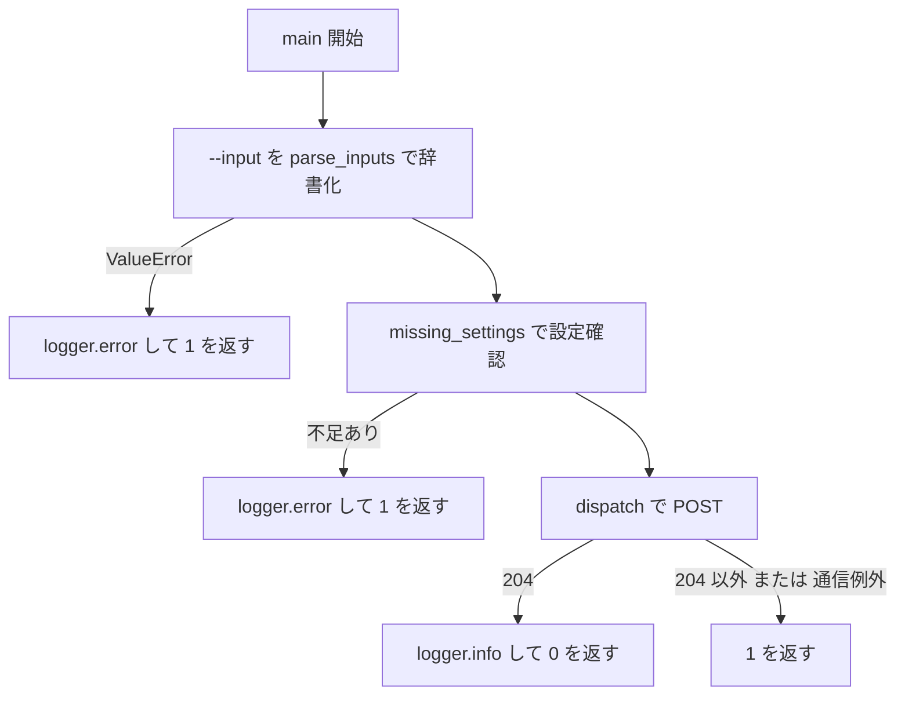
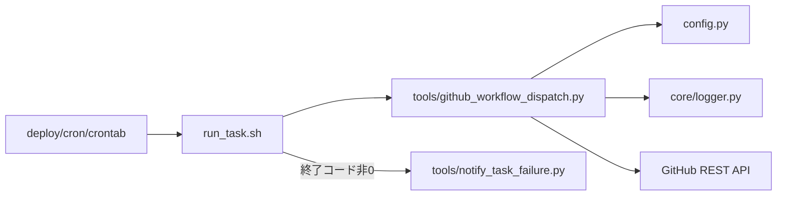

## 1. 解析メタ情報

| 項目 | 内容 |
| --- | --- |
| 対象ファイル | `tools/github_workflow_dispatch.py` |
| 言語 | Python |
| 解析対象 | 提供されたコードのみ |
| 推測・補完 | 一切なし |
| 解析基準コミット | 新規追加時点（2026-11-02） |

## 関連ドキュメント

* [run_task.md](./run_task.md) - 呼び出し元。`deploy/cron/crontab` の3エントリ（7:31・12:17・21:13）が `run_task.sh` 経由で本スクリプトを起動する
* [notify_task_failure.md](./notify_task_failure.md) - 本スクリプトが終了コード1を返したとき、`run_task.sh` から呼ばれて Discord の error チャンネルへ通知する
* [config.md](./config.md) - `GITHUB_DISPATCH_*` 設定値の提供元（「21. GitHub Actions ワークフローの時刻起動設定」）
* [logger.md](./logger.md) - `get_logger` の実体。`logger.error` は `DiscordErrorHandler` 経由で error チャンネルへも送られる

## 2. ファイルの概要

GitHub Actions のワークフローを `workflow_dispatch` で起動する小さな CLI。GitHub Actions の schedule（cron）は混雑時に数時間遅れることがあるため、時刻どおりに動かしたいワークフローをラズパイの cron から起動する。起動先（リポジトリ・ワークフロー・ブランチ）とトークンは `.env` の個人環境値（`config.GITHUB_DISPATCH_*`）から読み、ワークフローへ渡す inputs だけを引数で受け取る。成功（HTTP 204）なら終了コード0、設定不足・通信失敗・204以外の応答では終了コード1を返す。

* 根拠: [モジュールdocstring] (行番号: 2〜17 / 抜粋: "GitHub Actions のワークフローを workflow_dispatch で起動する小さなCLI。")

## 3. 外部依存関係

### インポート一覧

| 名称 | 種類 | 用途 | 根拠 |
| --- | --- | --- | --- |
| `argparse` | 標準 | `--input` 引数の解析 | 根拠: [インポート宣言] (行番号: 19 / 抜粋: "import argparse") |
| `os` | 標準 | `sys.path` に追加する親ディレクトリのパス組み立て | 根拠: [インポート宣言] (行番号: 20 / 抜粋: "import os") |
| `sys` | 標準 | `sys.path` 操作・終了コード返却 | 根拠: [インポート宣言] (行番号: 21 / 抜粋: "import sys") |
| `typing` | 標準 | 型ヒント | 根拠: [インポート宣言] (行番号: 22 / 抜粋: "from typing import Dict, List, Optional") |
| `requests` | 外部 | GitHub API への POST | 根拠: [インポート宣言] (行番号: 24 / 抜粋: "import requests") |
| `config` | 自作 | `GITHUB_DISPATCH_*` 設定値 | 根拠: [インポート宣言] (行番号: 28 / 抜粋: "import config") |
| `core.logger.get_logger` | 自作 | ロガー取得 | 根拠: [インポート宣言] (行番号: 29 / 抜粋: "from core.logger import get_logger") |

### ブラックボックスとなる外部要素

| 名称 | 理由 | 根拠 |
| --- | --- | --- |
| `config.GITHUB_DISPATCH_*` の実際の値 | `.env` から読み込まれ、本ファイルからは読み取れない。 | 根拠: [変数参照] (行番号: 50 / 抜粋: "if not config.GITHUB_DISPATCH_TOKEN:") |
| 起動先ワークフローの inputs 定義 | 受け付ける inputs のキーと型は起動先リポジトリのワークフロー側で決まる。 | 根拠: [リクエストボディ] (行番号: 72 / 抜粋: "json={\"ref\": config.GITHUB_DISPATCH_REF, \"inputs\": inputs},") |

## 4. 主要要素の定義（関数 / エンドポイント / コンポーネント）

### `API_URL_TEMPLATE`

* **役割**: GitHub REST API の workflow_dispatch エンドポイントの URL テンプレート。
* 根拠: [定数定義] (行番号: 33 / 抜粋: "API_URL_TEMPLATE: str = \"https://api.github.com/repos/{repo}/actions/workflows/{workflow}/dispatches\"")

### `parse_inputs`

* **役割**: `key=value` 形式の文字列のリストを inputs の辞書へ変換する。
* **引数**: `pairs: List[str]`
* **戻り値**: `Dict[str, str]`。値に `=` が含まれていてもよい（最初の `=` で分割する）。キーは前後の空白を除去する。
* **副作用**: なし
* **エラーハンドリング**: `=` を含まない要素、またはキーが空の要素では `ValueError` を送出する。
* 根拠: [関数定義] (行番号: 36 / 抜粋: "def parse_inputs(pairs: List[str]) -> Dict[str, str]:")
* 根拠: [例外送出] (行番号: 42 / 抜粋: "raise ValueError(f\"--input は key=value 形式で指定してください: {pair!r}\")")

### `missing_settings`

* **役割**: 起動に必要な設定のうち未設定のものの名前を返す。
* **引数**: なし
* **戻り値**: `List[str]`。`GITHUB_DISPATCH_TOKEN` が偽、`GITHUB_DISPATCH_REPO` が空または `/` を含まない、`GITHUB_DISPATCH_WORKFLOW` が空、のそれぞれで名前を加える。
* **副作用**: なし
* **エラーハンドリング**: なし
* 根拠: [関数定義] (行番号: 47 / 抜粋: "def missing_settings() -> List[str]:")
* 根拠: [条件判定] (行番号: 52 / 抜粋: "if not config.GITHUB_DISPATCH_REPO or \"/\" not in config.GITHUB_DISPATCH_REPO:")

### `dispatch`

* **役割**: GitHub API へ workflow_dispatch の POST を送る。
* **引数**: `inputs: Dict[str, str]`
* **戻り値**: `int`。HTTP ステータスコード。通信例外のときは `0`。
* **副作用**: 外部 API 呼び出し（ヘッダーに `Authorization: Bearer <トークン>`・`Accept: application/vnd.github+json`・`X-GitHub-Api-Version: 2022-11-28`、ボディに `ref` と `inputs`、タイムアウトは `config.GITHUB_DISPATCH_TIMEOUT_SEC`）。
* **エラーハンドリング**: `requests.RequestException` は捕捉して例外の型名だけを `logger.error` に出す。204 以外の応答はステータスコードと本文の先頭200文字を `logger.error` に出す。
* 根拠: [関数定義] (行番号: 59 / 抜粋: "def dispatch(inputs: Dict[str, str]) -> int:")
* 根拠: [例外捕捉] (行番号: 75 / 抜粋: "except requests.RequestException as e:")
* 根拠: [ログ出力] (行番号: 80 / 抜粋: "logger.error(\"ワークフローの起動に失敗しました: HTTP %s %s\", res.status_code, res.text[:200])")

### `main`

* **役割**: CLI のエントリーポイント。引数解析 → 設定確認 → 起動。
* **引数**: `argv: Optional[List[str]]`（`None` のとき `sys.argv` を使う）。`--input KEY=VALUE` を複数指定できる。
* **戻り値**: `int`。成功（204）で `0`、それ以外で `1`。
* **副作用**: `logger.error` / `logger.info` の出力、`dispatch` 経由の外部 API 呼び出し。
* **エラーハンドリング**: inputs の形式誤り・設定不足のときは API を呼ばずに `1` を返す。
* 根拠: [関数定義] (行番号: 84 / 抜粋: "def main(argv: Optional[List[str]] = None) -> int:")
* 根拠: [ログ出力] (行番号: 98 / 抜粋: "logger.error(\"GitHub ワークフロー起動の設定が不足しています: %s\", \", \".join(missing))")

## 5. 処理フロー図

## 6. 依存関係図

## 7. 次のステップ

| 優先度 | ファイル | 理由 |
| --- | --- | --- |
| 高 | [run_task.md](./run_task.md) | 失敗時の通知経路 |
| 中 | [notify_task_failure.md](./notify_task_failure.md) | 通知のクールダウン |
| 低 | [config.md](./config.md) | 設定値の定義 |

## 8. 保守上の注意点

* 起動先のリポジトリ名・ワークフロー名はこのリポジトリ（公開）に書かない方針。`deploy/cron/crontab` 側にも inputs（`dry_run`・`slot`）だけを書く。
* トークンは Fine-grained token で、対象リポジトリの `Actions: Read and write` のみを付ける想定（`config.py` のコメント）。有効期限が切れると 401 で失敗し、`run_task.sh` 経由で通知される。
* GitHub の workflow_dispatch は inputs の値を文字列として受け取る。boolean 型の input にも `"false"` のような文字列を渡す。
* 同じ時刻に二重に起動されても困らないかどうかは起動先ワークフローの責任（本スクリプトは重複を判定しない）。

## 9. 不明事項一覧

* 起動先ワークフローが受け付ける inputs の定義（本リポジトリ外）。
* `.env` に設定された実際の起動先。

## 10. 自己検証結果

* [x] すべての記述に根拠（行番号・抜粋）を付けた （完了）
* [x] 推測・補完を記述していない （完了）
* [x] Mermaid構文にエラーの原因となる記号（エスケープ漏れ）がない （完了）
* [x] 不明事項を漏れなく列挙した （完了）
