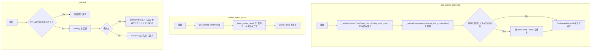
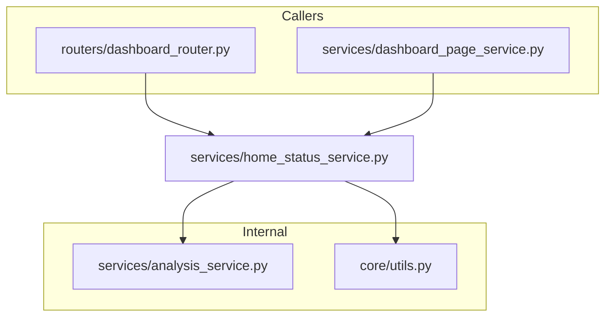

## 1. 解析メタ情報

| 項目 | 内容 |
| --- | --- |
| 対象ファイル | `services/home_status_service.py` |
| 言語 | Python |
| 解析対象 | 提供されたコードのみ |
| 推測・補完 | 一切なし |

## 関連ドキュメント

* [dashboard_router.md](./dashboard_router.md) - ホームページ(`{DASHBOARD_BASE_PATH}/`)・自動更新フラグメント(`.../status`)の呼び出し元。`collect_status_cards`/`get_cached_materials`を使う
* [dashboard_page_service.md](./dashboard_page_service.md) - ページ全体(見守り/くらし/システム)のHTML組み立て側。本ファイルのカードHTML・時刻表記・`get_cached_materials`を使う
* [analysis_service.md](./analysis_service.md) - `load_sensor_data`, `load_generic_data`, `load_nas_status`, `get_memory_usage`, `get_disk_usage`, `calculate_monthly_cost_cumulative`, `calculate_last_month_cost_same_point` の提供元
* [dashboard.md](./dashboard.md) / [summary.md](./summary.md) / [dashboard_common.md](./dashboard_common.md) - Issue #829でStreamlit版ダッシュボードごと廃止された旧呼び出し元(履歴として残る)

## 2. ファイルの概要

「家のいまの状況」を表すステータスカードについて、**判定ロジック・カードのHTML組み立て・カードのCSS・時刻の相対表記**を1箇所に集めたモジュール。Streamlitをimportしないため`unified_server.py`(FastAPI)側から使える。Issue #829でStreamlit版ダッシュボード(`dashboard.py`ほか)を廃止し、`routers/dashboard_router.py`配下のページ(この`unified_server`自身がHTMLを返す)だけになったが、「Streamlitに依存しないダッシュボードの正のロジック置き場」という役割自体は変わっていない。判定関数(`get_takasago_status`等)はいずれも副作用を持たない純粋関数で、DataFrameや取得済みの値を受け取って`(表示文字列, テーマ名)`を返す。取得はサーバー側の`get_cached_materials`/`collect_status_cards`が担う。ダッシュボードのページ定義(`DASHBOARD_TABS`)・カードの並びとグループ(`CARD_GROUPS`)・family-questへのパス(`QUEST_APP_PATH`)・値の下の補足を組み立てる`describe_*`群も持つ。**(不具合修正)** 以前あった「気になること」要約行(`summarize_alerts`/`render_alerts_html`/`ALERT_THEMES`)は要望により削除された。
根拠: `def build_status_cards(` (行番号: 998 / 抜粋: "def build_status_cards(")、`from services import analysis_service` (行番号: 38 / 抜粋: "from services import analysis_service")、`def get_takasago_status(df_sensor: pd.DataFrame, now: datetime) -> tuple[str, str]:` (行番号: 365)、`DASHBOARD_TABS: tuple[tuple[str, str], ...] = (` (行番号: 173)、`CARD_GROUPS: tuple[tuple[str, str], ...] = (` (行番号: 194)、`QUEST_APP_PATH = "/quest"` (行番号: 184)、`def describe_takasago(df_sensor: pd.DataFrame, now: datetime) -> str | None:` (行番号: 796)

## 3. 外部依存関係

### インポート一覧

| 名称 | 種類 | 用途 | 根拠 |
| --- | --- | --- | --- |
| `html` | 標準ライブラリ | カードのタイトル・値、ページ内のパス類のHTMLエスケープ | `import html` (行番号: 18 / 抜粋: "import html") |
| `os` | 標準ライブラリ | **(新機能)** ファミクエの`index.html`の存在確認(`os.path.isfile`) | `import os` (行番号: 20 / 抜粋: "import os") |
| `requests` | 外部ライブラリ | **(新機能)** あさノート(外部サービス)の稼働チェック(`requests.get`) | `import requests` (行番号: 33 / 抜粋: "import requests") |
| `core.database.get_ro_connection` | 内部モジュール | **(新機能)** ファミクエの稼働チェックでDBの読み取りができるかの確認 | `from core.database import get_ro_connection` (行番号: 35 / 抜粋: "from core.database import get_ro_connection") |
| `config` | 内部モジュール | **(新機能)** `QUEST_DIST_DIR`(ファミクエのビルド成果物のパス) | `import config` (行番号: 30 / 抜粋: "import config") |
| `services.parking_record_service` / `services.parking_occupancy_service` | 内部モジュール | **(#1117 で追加)** 駐車場の在否判定のまとめ(`get_car_summary`)と状態の定数。`parking_occupancy_service` は OpenCV を解析時だけ読み込むので、サーバー本体には OpenCV が読み込まれない | `from services import analysis_service, parking_record_service, recording_status_service` (行番号: 38 / 抜粋: "from services import analysis_service, parking_record_service, recording_status_service") |
| `logging` | 標準ライブラリ | 取得失敗時の警告ログ | `import logging` (行番号: 19 / 抜粋: "import logging") |
| `threading` | 標準ライブラリ | 自前キャッシュの排他（`threading.Lock`） | `import threading` (行番号: 21 / 抜粋: "import threading") |
| `time` | 標準ライブラリ | キャッシュのTTL判定（`time.monotonic()`） | `import time` (行番号: 22 / 抜粋: "import time") |
| `collections.abc.Callable` | 標準ライブラリ | `_cached` の引数の型注釈 | `from collections.abc import Callable` (行番号: 23 / 抜粋: "from collections.abc import Callable") |
| `datetime.date`, `datetime.datetime`, `datetime.timedelta` | 標準ライブラリ | 時刻比較（経過分数） | `from datetime import date, datetime, timedelta` (行番号: 27 / 抜粋: "from datetime import date, datetime, timedelta") |
| `typing.Any` / `NamedTuple` | 標準ライブラリ | 型注釈、`StatusCard`/`DashboardMaterials` の定義 | `from typing import Any, NamedTuple` (行番号: 28 / 抜粋: "from typing import Any, NamedTuple") |
| `pandas` | 外部ライブラリ | DataFrame/Series の判定処理 | `import pandas as pd` (行番号: 31 / 抜粋: "import pandas as pd") |
| `pytz` | 外部ライブラリ | `format_relative_time`の naive タイムスタンプJST化(`_JST`) | `import pytz` (行番号: 32 / 抜粋: "import pytz") |
| `core.utils.get_now_jst` | 内部モジュール | 現在時刻（JST固定）の取得 | `from core.utils import get_now_jst` (行番号: 36 / 抜粋: "from core.utils import get_now_jst") |
| `services.analysis_service` | 内部モジュール | センサー・NAS・メモリ・電気代の取得(防犯ログは`security_logs`テーブルへの書き込みが存在しないため、不具合修正で`df_sensor`由来のカメラ動体検知(`camera_motion_log`)に切り替え、`analysis_service`からの直接取得は無くなった) | `from services import analysis_service` (行番号: 38 / 抜粋: "from services import analysis_service") |

### ブラックボックスとなる外部要素

| 名称 | 理由 | 根拠 |
| --- | --- | --- |
| `analysis_service` の各ローダ | クエリ・対象テーブル・失敗時の挙動は [analysis_service.md](./analysis_service.md) 側にある。 | `df_sensor = _cached("sensor", lambda: analysis_service.load_sensor_data(limit=MOBILE_SENSOR_ROW_LIMIT))` (行番号: 809) |

## 4. 主要要素の定義（関数 / エンドポイント / コンポーネント）

### `_JST` / `format_short_timestamp` / `format_relative_time`

* **役割**: `_JST`はJSTのタイムゾーンオブジェクト。`format_short_timestamp`は時刻を「09/21 03:04」形式にする(読めない値は空文字)。`format_relative_time`は「3分前」のような相対表記にし、1週間以上前・未来の時刻は`format_short_timestamp`にフォールバックする。naive(tzinfo無し)な値はDB由来としてJSTでlocalizeする(`core.utils`のJST固定方針と同じ)。
* 根拠: [変数宣言] (行番号: 33 / 抜粋: '_JST = pytz.timezone("Asia/Tokyo")')、[関数定義] (行番号: 46, 54 / 抜粋: "def format_short_timestamp(value) -> str:", "def format_relative_time(value, now: datetime | None = None) -> str:")

* **引数/リクエスト**: `format_short_timestamp(value)`、`format_relative_time(value, now: datetime | None = None)`
* 根拠: [関数定義] (行番号: 36, 44)

* **戻り値/レスポンス**: いずれも`str`(「たった今」「N分前」「N時間前」「N日前」、または短縮絶対表記、または空文字)
* 根拠: [戻り値] (行番号: 40〜42, 60〜68)

* **副作用**: なし
* 根拠: [関数本体] (行番号: 36〜67)

* **エラーハンドリング**: `pd.to_datetime(..., errors="coerce")`で読めない値は`NaT`扱いにし空文字/該当分岐へ落とす。
* 根拠: [エラーハンドリング] (行番号: 38, 46〜47 / 抜粋: 'ts = pd.to_datetime(value, errors="coerce")\n    if pd.isna(ts):\n        return ""')

### `STATUS_CACHE_TTL_SEC` / `MOBILE_SENSOR_ROW_LIMIT` (モジュールレベル定数)

* **役割**: サーバー側キャッシュのTTL(60秒)、ダッシュボードで読むセンサー行数の上限(3000行)。**(不具合修正で削除)** 見守りページの防犯ログで読む行数の上限だった`SECURITY_LOG_ROW_LIMIT`は、防犯ログのデータソースを`security_logs`テーブルから`df_sensor`(カメラの動体検知)へ切り替えたのに伴い、`MOBILE_SENSOR_ROW_LIMIT`と別枠で行数を絞る意味が無くなったため削除された。
* 根拠: `STATUS_CACHE_TTL_SEC = 60` (行番号: 69)、`MOBILE_SENSOR_ROW_LIMIT = 3000` (行番号: 73)

* **引数/リクエスト**: なし（定数）
* 根拠: 同上

* **戻り値/レスポンス**: なし（定数）
* 根拠: 同上

* **副作用**: なし
* 根拠: 同上

* **エラーハンドリング**: なし
* 根拠: 同上

### `STATUS_CARD_CSS` (モジュールレベル定数)

* **役割**: カード1枚分のCSS（`.status-grid` / `.status-card` / `.theme-*`）。ホームページと各サブページ(`services/dashboard_page_service.py`)が共有する。グリッドは `repeat(auto-fit, minmax(160px, 1fr))` で、スマホ幅では2列・PCでは4〜6列に自動で折り返す。**(UI刷新)** 色は `MY_HOME_SYSTEM/static/dashboard/dashboard.css` のデザイントークン(CSS変数)を参照し、`.theme-*` は背景色に加えて左端の太い帯でも状態を示す(ダークモードは変数側で切替)。
* 根拠: `STATUS_CARD_CSS = """` (行番号: 86 / 抜粋: "STATUS_CARD_CSS = \"\"\"")

* **引数/リクエスト**: なし（定数）
* 根拠: 同上

* **戻り値/レスポンス**: なし（定数）
* 根拠: 同上

* **副作用**: なし
* 根拠: 同上

* **エラーハンドリング**: なし
* 根拠: 同上

### `DASHBOARD_TABS` / `DASHBOARD_TAB_KEYS` (モジュールレベル定数)

* **役割**: ダッシュボードのページ定義(`("home", "🏠 ホーム")`等4つ)と、そのキーのタプル。キーはカードの`tab`や`card_detail_href`が生成するURLの末尾セグメント(`/watch`等)としても使われる。
* 根拠: `DASHBOARD_TABS: tuple[tuple[str, str], ...] = (` (行番号: 173)、`DASHBOARD_TAB_KEYS: tuple[str, ...] = tuple(key for key, _ in DASHBOARD_TABS)` (行番号: 179)

* **引数/リクエスト**: なし（定数）
* 根拠: 同上

* **戻り値/レスポンス**: なし（定数）
* 根拠: 同上

* **副作用**: なし
* 根拠: 同上

* **エラーハンドリング**: なし
* 根拠: 同上

### `QUEST_APP_PATH` / `CARD_GROUPS` / `CARD_GROUP_LABELS` (モジュールレベル定数)

* **(2026-11-24)** `CARD_GROUPS`の最後に「🖥️ システム・サービス」(`service`)を追加した。ホームのタイル(`build_service_cards`)専用で、`build_status_cards`のカードはこのグループを持たない。`QUEST_APP_PATH`はタイル「⚔️ ファミクエ」のリンク先として使われる。
* 根拠: `CARD_GROUPS: tuple[tuple[str, str], ...] = (` (行番号: 225)

* **役割**: `QUEST_APP_PATH`はfamily-quest(PWA)へのパス(`/quest`)。ホームページの外部リンクカードが参照する。`CARD_GROUPS`はカードの並びとグループ(見守り→室温→くらし→システムの順)。**(新機能)** 拠点別の温湿度カードのために「🌡️ 室温」(`climate`)グループを見守りとくらしの間に追加した。Issue #829でファミクエ(承認待ち件数)のカードを廃止したため、以前あった`quest`グループは無い。`CARD_GROUP_LABELS`は`CARD_GROUPS`から作る`dict`。
* 根拠: `QUEST_APP_PATH = "/quest"` (行番号: 184)、`CARD_GROUPS: tuple[tuple[str, str], ...] = (` (行番号: 194)、`CARD_GROUP_LABELS: dict[str, str] = dict(CARD_GROUPS)` (行番号: 199)

### `CLIMATE_SITES` / `CLIMATE_LOCATIONS` / `CLIMATE_LOCATION_KEYS` / `climate_location` (温湿度を表示する拠点)

* **役割**: **(新機能)** 温湿度を表示する拠点の唯一の定義元。`CLIMATE_SITES`は`(拠点名, ?hm_loc= のキー, カードの見出し)`のタプルで、伊丹(`itami`)・伊丹の寝室(`伊丹(寝室)`/`itami_bedroom`)・高砂(`takasago`)・長岡京(`nagaokakyo`。単身赴任先)の順。**(新機能)** 同じ拠点の別の部屋は「拠点名(部屋名)」を1つの拠点として扱う(`climate_site_name(location, room)`: 部屋が空なら拠点名のまま、あれば`f"{location}({room})"`)。以前は拠点ごとに1枚で、同じ拠点に温湿度計が2台あるとカードの値が5分ごとに入れ替わり、ヒートマップは2部屋の平均になっていたため。並び順はカードとヒートマップの切り替えで共通。`CLIMATE_LOCATIONS`(拠点名のタプル)と`CLIMATE_LOCATION_KEYS`(拠点名→キー)はここから作る。以前は拠点名とキーの対応が`dashboard_page_service`の3か所(`CLIMATE_LOCATIONS`・`parse_climate_location`・`_climate_switch`)に散らばり、1か所だけ足すと切り替えリンクの組み立てが`KeyError`でホームごと500になる構造だったため、ここへ集約した。`dashboard_page_service`は循環importになるため、こちらに置いて向こうから参照させる。カードの見出しは見守りの「🏠 伊丹 (自宅)」等と重ならないよう「〜の室温」で揃える。
* `climate_location(device_id, device_name)`: 温湿度の記録がどの拠点のものか。`devices.json`で一致した機器に`room`があれば`climate_site_name(location, room)`を返し、その名前が`CLIMATE_LOCATIONS`に無ければ`None`(拠点の値へは混ぜない)。`room`が無く`location`が`CLIMATE_LOCATIONS`に入っていればそれ、無ければ機器名の先頭(`伊丹_`/`高砂_`。Nature Remoの保存名。部屋の拠点=名前に`(`を含むものは対象外で、部屋は`room`でしか決めない)で判定し、どちらでも分からなければ`None`。Nature Remo由来の行はdevice_idが`devices.json`に無く`load_sensor_data`の`location`列が「その他」になるため、カード・ヒートマップとも`location`列ではなくこれで判定する(旧`dashboard_page_service._climate_location`を移したもの)。
* 根拠: `CLIMATE_SITES: tuple[tuple[str, str, str], ...] = (` (行番号: 213)、`def climate_site_name(location: Any, room: Any = None) -> str:` (行番号: 273)、`def climate_location(device_id: Any, device_name: Any) -> str | None:` (行番号: 279)

### 温湿度カード(`get_climate_status` / `describe_climate` / `build_climate_cards`)

* **役割**: **(新機能)** 拠点別の温湿度カード(「🌡️ 室温」グループ)。材料は他のカードと同じ`df_sensor`(`load_sensor_data`の結合結果。`switchbot_meter_logs`の行が`temperature_celsius`/`humidity_percent`を持つ)で、専用のクエリ・キャッシュは持たない。抽出(`_climate_rows`: `temperature_celsius`が欠けていない行のうち`climate_location`が一致するもの、新しい順)は判定と補足で共有する。同じ拠点に複数の機器があれば一番新しい記録を使う(別の部屋の機器は`room`で別の拠点になるので混ざらない)。
* `get_climate_status(df_sensor, location, now)`: `"19.3℃ / 43%"`(温度は小数1桁、湿度は整数)と色を返す。記録が無い・`CLIMATE_MAX_AGE_MIN`(24時間)より古い → `⚪ データなし`(灰色)。`CLIMATE_STALE_MIN`(30分。システムページの「⚡ 電気・環境の見守り」と同じ閾値)より古い → 値は出すが灰色。それ以外は温度で色分け(`CLIMATE_HOT_C`=30℃以上は赤、`CLIMATE_COLD_C`=15℃未満は青、その間は緑。ヒートマップの5段階の両端)。湿度0以下は取れなかったときの代用値とみなして`--%`(前の記録の湿度は混ぜない)。
* `describe_climate(df_sensor, location, now)`: 補足。何分前の値か(`format_relative_time`)。30分を超えたら「◯分前の値(更新が止まっています)」、湿度が`CLIMATE_DRY_PCT`(30%)未満なら「◯分前・乾燥」。記録が無ければ`None`。
* `build_climate_cards(df_sensor, now)`: `CLIMATE_SITES`の順に4枚(伊丹・🛏️ 伊丹の寝室・高砂・長岡京)。`tab="home"`・`anchor="?hm_loc=<キー>&hm_metric=temp#climate-heatmap"`で、タップするとホームのヒートマップでその拠点を開く。
* 根拠: `def get_climate_status(df_sensor: pd.DataFrame, location: str, now: datetime) -> tuple[str, str]:` (行番号: 944)、`def describe_climate(df_sensor: pd.DataFrame, location: str, now: datetime) -> str | None:` (行番号: 968)、`def build_climate_cards(df_sensor: pd.DataFrame, now: datetime) -> list[StatusCard]:` (行番号: 983)

* **引数/リクエスト**: なし（定数）
* 根拠: 同上

* **戻り値/レスポンス**: なし（定数）
* 根拠: 同上

* **副作用**: なし
* 根拠: 同上

* **エラーハンドリング**: なし
* 根拠: 同上

### `StatusCard` (NamedTuple)

* **(2026-11-24)** フィールド`new_tab: bool = False`を追加した(別アプリへのリンクを新しいタブで開くタイル用)。見守りのカードの`anchor`は詳細画面のパス(`/takasago`・`/itami`・`/live?camera=<駐車場カメラ>`・`/live`)、サーバー・NASは`/server`・`/nas`になり、電気代カードの`tab`は`power`になった(下の`#takasago-log`等の例は以前のもの)。
* 根拠: `class StatusCard(NamedTuple):` (行番号: 302)

* **役割**: 1枚のカードを表す。`title`, `value`, `theme`, `value_is_html`（既定 `False`）, `tab`（既定 `None`）, `sub`（既定 `None`）, `href`（既定 `None`）, `group`（既定 `None`）, `anchor`（既定 `None`）を持つ。`tab`はそのカードの詳細が載っているページのキー(`DASHBOARD_TABS`)で、`card_detail_href`がこれを`/watch`等のURLに変換する。`href`は詳細がダッシュボードの外にあるカードのための直接リンク先で、`tab`より優先される。**(不具合修正で追加)** `anchor`は`tab`のURLの末尾にそのまま付け足す文字列(例: `#takasago-log`、`?camera=xxx#camera-section`)。同じ`tab`を持つ複数のカードがあるとき、タップしたカードの内容が実際に載っているページ内の場所まで連れて行くために使う(以前は見守りグループの4枚が全部`tab="watch"`だけを持ち、どれをタップしても同じURL=ページ先頭のカメラ映像にしか飛べなかった)。
* 根拠: `class StatusCard(NamedTuple):` (行番号: 302)

* **引数/リクエスト**: `title` (str), `value` (str), `theme` (str), `value_is_html` (bool, 既定 False), `tab` (str | None, 既定 None), `sub` (str | None, 既定 None), `href` (str | None, 既定 None), `group` (str | None, 既定 None), `anchor` (str | None, 既定 None)
* 根拠: [クラス定義] (行番号: 202〜227)

* **戻り値/レスポンス**: 該当なし（データ型）
* 根拠: 同上

* **副作用**: なし
* 根拠: 同上

* **エラーハンドリング**: なし
* 根拠: 同上

### `render_status_card_html`

* **(2026-11-24)** キーワード引数`new_tab: bool = False`を追加。True かつ`href`があれば`<a>`に`target="_blank" rel="noopener"`を付ける。
* 根拠: `def render_status_card_html(` (行番号: 333)

* **役割**: カード1枚のHTML文字列を返す。`title` は常にHTMLエスケープし、`value` も既定でエスケープする（Issue #378）。`value_is_html=True` のときだけ `value` のエスケープをスキップする。`href` を渡すと外枠が `<a>` になりカード全体がリンクになる。`sub` を渡すと値の下に `.status-sub` の行を足す（常にエスケープする）。改行・インデントを含まない1行の文字列を返す。
* 根拠: `def render_status_card_html(` (行番号: 333〜382)

* **引数/リクエスト**: `title` (str), `value` (str), `theme` (str), キーワード専用 `value_is_html` (bool, 既定 False), `href` (str | None, 既定 None), `sub` (str | None, 既定 None)
* 根拠: [関数定義] (行番号: 227〜235)

* **戻り値/レスポンス**: 1行のHTML文字列
* 根拠: [戻り値] (行番号: 264〜271)

* **副作用**: なし（文字列を返すのみ）
* 根拠: [関数本体] (行番号: 251〜271)

* **エラーハンドリング**: なし
* 根拠: [関数本体] (行番号: 251〜271)

### `card_detail_href`

* **役割**: カードの詳細ページへのURLを返す。`card.href`があればそれを、無ければ`{dashboard_path}/{tab}`(例: `/dashboard/watch`)を返す。`tab`も`href`も無いカードは`None`。**(不具合修正)** `card.anchor`があれば、そのURLの末尾にそのまま付け足す(例: `/dashboard/watch#takasago-log`)。同じ`tab`の複数カードをページ内の異なる場所へ振り分けるための仕組み。**(新機能)** `tab="home"`はサブページではなくダッシュボードのルート(`/dashboard/`)を指す(温湿度カードが`anchor`で同じホームのヒートマップへ飛ぶため)。
* 根拠: `def card_detail_href(card: StatusCard, dashboard_path: str) -> str | None:` (行番号: 385〜405)

* **引数/リクエスト**: `card` (`StatusCard`), `dashboard_path` (str)
* 根拠: [関数定義] (行番号: 279)

* **戻り値/レスポンス**: URL文字列、または `None`
* 根拠: [戻り値] (行番号: 290〜297 / 抜粋: 'return card.href', 'return None', 'href = f"{dashboard_path.rstrip(\'/\')}/{card.tab}"\n    if card.anchor:\n        href += card.anchor\n    return href')

* **副作用**: なし
* 根拠: [関数本体] (行番号: 290〜297)

* **エラーハンドリング**: なし
* 根拠: [関数本体] (行番号: 398 / 抜粋: "if card.tab is None:")

### （削除済み）`ALERT_THEMES` / `summarize_alerts` / `render_alerts_html`

* **(2026-11-12 追記)** ホーム最上部のサマリーは、UX改善レビューを受けて形を変えて再導入した(下の「ホーム最上部の『いまの状態』」を参照)。以前との違いは、**赤(異常)だけ**を数え、黄色は数えないこと(黄色まで並べると留守のたびに埋まり、要約行が意味を失っていた)。

* **（不具合修正で削除）** 以前は「いま気にすべきカード」を赤（`theme-red`）→ 黄（`theme-yellow`）の順に拾い、ホームページ先頭に「⚠️ 気になること: ...」/「✅ 気になることはありません」の要約行として出していた。カード自体が赤・黄の色で状態を示しており要約行は不要という要望により、この3つのシンボルは本ファイルから完全に削除された(`services/dashboard_page_service.py`の呼び出し箇所も削除)。
* 根拠: 削除は差分（`git diff`）で確認。現在の`services/home_status_service.py`には`ALERT_THEMES`/`summarize_alerts`/`render_alerts_html`のいずれの定義も存在しない(`card_detail_href`の直後は`group_cards`の定義)。

### `group_cards`

* **役割**: カードを `group` ごとの塊に分ける（並び順は変えない）。隣り合う同じグループをまとめる。`group` を持たないカードは見出し `None` の塊になる。
* 根拠: `def group_cards(cards) -> list[tuple[str | None, list[StatusCard]]]:` (行番号: 408〜421)

* **引数/リクエスト**: `cards` (`StatusCard` のイテラブル)
* 根拠: [関数定義] (行番号: 300)

* **戻り値/レスポンス**: `[(グループキー | None, カードのリスト), ...]`
* 根拠: [戻り値] (行番号: 421 / 抜粋: "return grouped")

* **副作用**: なし
* 根拠: [関数本体] (行番号: 307〜313)

* **エラーハンドリング**: なし（空のイテラブルは空のリストになる）
* 根拠: [初期化] (行番号: 415 / 抜粋: "grouped: list[tuple[str | None, list[StatusCard]]] = []")

### `render_status_grid_html`

* **(2026-11-24)** 引数`variants`(`{グループのキー: 見た目の種類}`)を追加した。グリッドに`status-grid-<種類>`のクラスを付ける(`compact`=背を低く、`mini`=さらに小さく、`tiles`=3列のタイル)。`tiles`のグループは補足(`sub`)を出さない。各カードの`new_tab`も`render_status_card_html`へ渡す。対応するCSSは`STATUS_CARD_CSS`にある(見出し・補足を1行に収めて「…」にする)。
* 根拠: `def render_status_grid_html(` (行番号: 424)

* **(新機能)** 引数`group_extras`(`{グループのキー: HTML}`)を追加した。そのグループのカードの直後にHTMLを差し込む(ホームの「見守り」の直下に温湿度ヒートマップを置くため。**(新機能)** 拠点別の温湿度カードの追加に伴い、差し込み先は「🌡️ 室温」グループの直下に変わった)。

* **役割**: 複数のカードを `.status-grid` のブロックにまとめたHTMLを返す。`group` を持つカードには見出し(`<h2 class="group-title">`)が付き、1枚だけのグループには`.status-grid-solo`が付く。`dashboard_path`を渡すと、行き先を持つカードがその行き先へのリンク(`<a>`)になる。`show_group_titles=False`でグループ見出しを出さない(ページ見出しと重複するサブページ用。既定True)。
* 根拠: `def render_status_grid_html(` (行番号: 424)

* **引数/リクエスト**: `cards`, キーワード専用 `dashboard_path` (str | None, 既定 None), `show_group_titles` (bool, 既定 True)
* 根拠: [関数定義] (行番号: 316)

* **戻り値/レスポンス**: 見出しと`
…
`を並べた文字列
* 根拠: [戻り値] (行番号: 345 / 抜粋: 'return "".join(blocks)')

* **副作用**: なし
* 根拠: [関数本体] (行番号: 322〜345)

* **エラーハンドリング**: なし
* 根拠: [関数本体] (行番号: 316〜345)

### 判定関数（`get_takasago_status` / `get_itami_status` / `get_camera_status` / `get_parking_status` / `get_server_status` / `get_nas_status_simple`）

* **(2026-11-12 UX改善)** 値の文言を変えた。下の記述のうち旧文言は現在のコードには当てはまらない。
    * `get_itami_status`: 10〜59分前は「🟢 活動中」(以前は「🟢 活動中 (N分前)」。スマホ幅で2行に折れていたため、何分前かは補足の「最終検知 HH:MM」に任せる)。
    * `get_server_status`: `memory["percent"]`が`SERVER_MEMORY_ALERT_PERCENT`(80)未満なら「🟢 正常」、以上なら「🔴 メモリ不足」、取得失敗は「⚪ 取得できません」(以前は「💻 RAM: N%」/「⚪ 取得失敗」)。
    * `get_nas_status_simple`: 「🟢 稼働中」/「🔴 応答なし」/「🟡 データ異常」(以前は「🗄️ NAS: …」「⚠️ NAS: …」)。
    * `get_parking_status`: 値から「🚗」を除いた(タイトルと二重になるため)。
    * `get_camera_status(df_sensor, now, recording=None)`: `recording`(`get_camera_recording_states()`の結果)があるときは録画の状態を値にする。止まっているカメラが1台なら「🔴 {カメラ名} 録画停止」、複数なら「🔴 N台 録画停止」(いずれも`theme-red`)、全台録画中なら「🟢 N台とも録画中」(1台だけなら「🟢 録画中」。`theme-green`)。`recording`が`None`のときは従来どおり最後の動体検知(値から「🎥」を除いた。色は青か灰)。
    * `get_cost_status(monthly_cost)`(新設): `None`(取得失敗)なら「⚪ 取得できません」(`theme-gray`)、それ以外は「N 円」(`theme-blue`)。以前は取得失敗を0に丸めて「⚡ 0 円」と表示していた。
* 根拠: [関数定義] (行番号: 590 / 抜粋: "def get_server_status(memory: dict[str, float] | None) -> tuple[str, str]:")、[関数定義] (行番号: 648 / 抜粋: "def get_camera_status(")、[関数定義] (行番号: 861 / 抜粋: "def get_cost_status(monthly_cost: int | None) -> tuple[str, str]:")

* **役割**: それぞれ1枚のカードの `(表示文字列, テーマ名)` を返す純粋関数。
  * `get_takasago_status`: 高砂（実家）の `contact_state` が `open`/`detected` の最新行からの経過時間で、1時間未満=緑「元気」、3時間未満=黄「静か」、それ以上=赤「N時間 動きなし」。
  * `get_itami_status`: 伊丹（自宅）の人感（`device_type` に `Motion` を含むか `Webhook`）かつ検知の最新行から段階的に判定。該当が無ければ開閉センサーで60分未満のみ「活動中」とする。
  * `get_camera_status`: カメラ(`device_type`が`CAMERA_DEVICE_TYPE`="ONVIF_CAMERA"かつ`movement_state=="ON"`)の最新行からの経過時間で判定。**色は情報色(青)かグレーだけ**。
  * `get_parking_status`: **(#829で新設)** 駐車場カメラ(`device_id == PARKING_CAMERA_ID`)の動体検知の最新行からの経過時間で判定(`get_camera_status`と同じ考え方)。以前は`car_records`(action='LEAVE'/'ARRIVE')テーブルから「🚗外出中」/「🏠在宅」を判定する`get_car_status`だったが、`car_records`への書き込み経路がリポジトリ内のどこにも存在せず常に空だった(恒常的に「🏠在宅」を返す死んだ機能)ため、駐車場カメラの動体検知に置き換えた。人の往来も拾うため在宅/外出中は断定できず、`get_camera_status`と同じく常に情報色(青)かグレーにする。**(不具合修正)** 以前は表示名(`friendly_name == PARKING_CAMERA_NAME`="駐車場")の完全一致で判定していたが、実際の表示名は`devices.json`で運用者が「駐車場カメラ」に設定しており一致せず、常に「⚪ データなし」になっていた(ダッシュボードの不具合)。表示名は運用者が自由に変えられ変更のたびに再発しうるため、変更されにくい`id`(`PARKING_CAMERA_ID`)で照合するよう修正した。
  * `get_server_status`: メモリ使用率が80%未満で緑、以上で赤。`None` ならグレー「取得失敗」。
  * `get_nas_status_simple`: `status_ping` が `OK` なら緑、それ以外は赤。`None` はグレー、キー欠落は黄「データ異常」。
* **(不具合修正で削除)** `get_rice_status`(炊飯器カードの判定)は、炊飯器の表示自体が不要という要望により`_rice_cooking_rows`/`RICE_COOKER_ON_WATTS`とともに削除された。
* 判定に使う行の抽出は、補足表示（`describe_*`）と共有する private 関数（`_takasago_activity` / `_itami_motion` / `_itami_contact` / `_camera_motion` / `_parking_camera_motion`）に切り出してある。
* 根拠: `def get_takasago_status(df_sensor: pd.DataFrame, now: datetime) -> tuple[str, str]:` (行番号: 496)、`def get_itami_status(df_sensor: pd.DataFrame, now: datetime) -> tuple[str, str]:` (行番号: 555)、`def get_server_status(memory: dict[str, float] | None) -> tuple[str, str]:` (行番号: 590)、`def get_nas_status_simple(nas_data: pd.Series | None) -> tuple[str, str]:` (行番号: 599)、`def get_camera_status(df_sensor: pd.DataFrame, now: datetime) -> tuple[str, str]:` (行番号: 648)、`def get_parking_status(df_sensor: pd.DataFrame, now: datetime) -> tuple[str, str]:` (行番号: 695)、`PARKING_CAMERA_ID = "VIGI_C540_Parking"` (行番号: 491)

* **引数/リクエスト**: DataFrame（センサー）、`now`（`datetime`）、取得済みの辞書（メモリ使用率）、`pd.Series | None`（NAS）
* 根拠: `def get_server_status(memory: dict[str, float] | None) -> tuple[str, str]:` (行番号: 590)

* **戻り値/レスポンス**: `(表示文字列, テーマ名)` のタプル。テーマ名は `theme-green` / `theme-yellow` / `theme-red` / `theme-blue` / `theme-gray` のいずれか。
* 根拠: `return "⚪ データなし", "theme-gray"` (行番号: 543〜544付近を含む各関数の早期return)

* **副作用**: なし（いずれもデータ取得を行わない）
* 根拠: [各関数本体]

* **エラーハンドリング**: 列の欠落・空DataFrameは早期returnで「データなし」を返す。NASは `KeyError` を捕捉して「データ異常」を返す。
* 根拠: `if df_sensor.empty or "location" not in df_sensor.columns or "contact_state" not in df_sensor.columns:` (行番号: 358)、`except KeyError:` (行番号: 467)

### `build_status_cards`

* **(2026-11-24)** 見守りの4枚の`anchor`を、見守りの詳細画面・カメラのページのパスにした(高砂=`/takasago`、伊丹=`/itami`、駐車場=`/live?camera=PARKING_CAMERA_ID`、カメラ=`/live`)。電気代は`tab="power"`(「⚡ 電気」ページの今月のまとめ)、サーバー=`anchor="/server"`、NAS=`anchor="/nas"`(システムの詳細画面)。判定・並び順は変わらない。
* 根拠: `def build_status_cards(` (行番号: 998)

### ホームの「システム・サービス」タイル(`get_recording_tile_status` / `get_app_tile_status` / `build_service_cards`)

* **役割**: **(2026-11-24 新設)** ホームで、家の様子と一緒にシステムとアプリの稼働を一目で見るためのタイル。`build_service_cards`は`[🖥️ サーバー, 🗄️ NAS, 🎥 録画, ⚔️ ファミクエ, 📝 あさノート, (🌙 よるノート)]`を返す(すべて`group="service"`)。サーバー・NASは`build_status_cards`のカードを`_replace(group="service")`で流用する(判定を食い違わせないため)。録画は`get_recording_tile_status(recording)`(全台`ok`=緑「🟢 録画中」、1台でも`ok`以外=赤「🔴 N台停止」、`recording`が空/None=灰「⚪ 不明」)で、行き先は`tab="watch", anchor="/live"`。アプリは`get_app_tile_status(link_health[キー])`(True=緑「🟢 稼働中」、False=赤「🔴 停止中」、None=灰「⚪ 確認中」)で、`href`=各URL・`new_tab=True`。よるノートは`yoru_note_url`があるときだけ。
* 根拠: [関数定義] (行番号: 1065 / 抜粋: "def get_recording_tile_status(recording: list[dict[str, Any]] | None) -> tuple[str, str]:")、[関数定義] (行番号: 1080 / 抜粋: "def get_app_tile_status(healthy: bool | None) -> tuple[str, str]:")、[関数定義] (行番号: 1089 / 抜粋: "def build_service_cards(")
* **引数/リクエスト**: `build_service_cards(cards, *, link_health, recording, quest_path, asa_note_url, yoru_note_url=None)`
* **戻り値/レスポンス**: `list[StatusCard]` / `tuple[str, str]`(値, テーマ)
* **副作用**: なし(取得は呼び出し元=`dashboard_router._home_status_parts`)
* **エラーハンドリング**: `cards`にサーバー・NASのカードが無ければそのタイルを出さないだけ

* **(#1117 で変更)** 引数 `car`(`parking_record_service.CarSummary | None`)を追加。`get_car_status` が値を返せば「🚗 駐車場」カードは車の在否(駐車中/外出中)と `describe_car` の補足を出し、`None`(判定のデータが無い)なら従来どおり `get_parking_status` / `describe_parking`(駐車場カメラの最後の動体検知)に戻る。リンク先(`?camera=…#camera-section`)は変わらない。`collect_status_cards` は `get_car_summary()` を渡すので、ホームと自動更新フラグメントで内容は食い違わない。
* 根拠: `def build_status_cards(` (行番号: 998 / 抜粋: "def build_status_cards(")

* **(2026-11-12 UX改善)** `monthly_cost`の型は`int | None`(Noneは取得失敗)。引数`recording: list[dict[str, Any]] | None = None`を追加し、`get_camera_status`/`describe_camera`へ渡す。室温カード(`build_climate_cards`)のリンク先は`tab="life"`になった(過去30日ヒートマップを「くらし」ページへ移したため)。

* **役割**: 渡された材料から、画面に並べる順で11枚の `StatusCard` を組み立てる（取得は行わない）。**(新機能)** 室温グループに「🛏️ 伊丹の寝室」を足したため10枚から11枚になった。並び順は`CARD_GROUPS`と同じ順(見守り→室温→くらし→システム)。**(新機能)** 見守りの4枚の後に、拠点別の温湿度カード3枚(`build_climate_cards`。伊丹・高砂・長岡京)を挟んだため7枚から10枚になった。既存のカードの相対的な順番は変えていない。**(#829)** 以前は9枚(ファミクエの「📝承認待ち」カードを含む)だったが、ダッシュボード内にファミクエの状態表示を残さず外部リンクのみにする方針変更により、そのカードを削除して8枚になった。同時に、`df_car`/`pending_quests`引数も廃止された(車カードは`df_sensor`から駐車場カメラの動きを見るように変更、ファミクエカード自体が無くなったため)。**(不具合修正)** 炊飯器表示が不要という要望により「🍚 炊飯器」カードを削除し7枚になった。あわせて、見守りグループの4枚(高砂・伊丹・駐車場・カメラ)は以前すべて`tab="watch"`のみで`anchor`を持たなかったため、どのカードをタップしても同じURL(見守りページ先頭=カメラ映像)にしか飛べなかった不具合を修正し、それぞれ`anchor`(`#takasago-log`/`#itami-log`/`?camera={PARKING_CAMERA_ID}#camera-section`/`#camera-section`)で見守りページ内の異なる場所に振り分けるようにした。**(不具合修正)** 「🗄️ NAS」カードにも`anchor="#nas-history"`を追加した。以前はNASカードをタップしてもシステムページの先頭に飛ぶだけで、容量履歴を見る手段が無かったため。
* 根拠: `def build_status_cards(` (行番号: 998〜1061)

* **引数/リクエスト**: `now`, `df_sensor`, `nas_data`, `memory`, `monthly_cost`、および補足表示にだけ使う省略可能な `last_month_cost` (int | None, 既定 None), `disk` (dict | None, 既定 None)
* 根拠: [関数定義] (行番号: 650〜657)

* **戻り値/レスポンス**: `list[StatusCard]`（7枚）
* 根拠: [戻り値] (行番号: 682〜698)

* **副作用**: なし
* 根拠: [関数本体] (行番号: 669〜698)

* **エラーハンドリング**: なし（各判定関数側で処理される）
* 根拠: [関数呼び出し] (行番号: 669〜674)

### ホームを待たせない取得(`HOME_RENDER_BUDGET_SEC` / `STALE_SERVE_MAX_SEC` / `RenderBudget` / `render_within_budget` / `_start_refresh` / `_resolve_in_budget`)

* **役割**: **(2026-11-23 新設)** ホームをスマートフォンのホーム画面から開くと、最初の描画までPWAの起動画面が出続ける。以前は材料(DB・外部リンクの稼働チェック・NASの一覧)を1つずつ順番に取得しており、キャッシュが切れていると外部サイト・NASの待ちが足し算になって起動画面が長く続いていた。`render_within_budget(build, budget_sec=None)`は`build`を2回呼ぶ: 1回目(`RenderBudget(prefetch=True)`)は`_cached`・`cached_with_timeout`が取得を裏で始めるだけで待たずに値(キャッシュか None)を返し、結果は捨てる。始まった取得を最大`budget_sec`(省略時`HOME_RENDER_BUDGET_SEC`=1.0秒)だけまとめて待ったあと、2回目で組み立てる。戻り値は`(build の結果, pending)`。
* 根拠: `HOME_RENDER_BUDGET_SEC = 1.0` (行番号: 981)、`STALE_SERVE_MAX_SEC = 15 * 60` (行番号: 982)、`class RenderBudget:` (行番号: 1153)、`def render_within_budget(build: Callable[[], Any], budget_sec: float | None = None) -> tuple[Any, bool]:` (行番号: 1235)
* **2回目での値の決め方**(`_resolve_in_budget`): `optional=False`(DB由来の材料)は取得が終わるまで必ず待つ(古い家の状態や空の値を出さないため)。`optional=True`(外部サイトの稼働チェック)と`cached_with_timeout`(NASの一覧)は期限までに終わらなければ待たず、`RenderBudget.pending`を True にして、取得から`STALE_SERVE_MAX_SEC`(15分)以内のキャッシュがあればその値、無ければ None を返す。
* 根拠: `return _result_or_none(future)  # DB由来の材料は必ず待つ` (行番号: 1058)、`budget.pending = True` (行番号: 1065)
* **同時に1本だけ(single-flight)**: `_start_refresh(key, loader, pool)`は同じキーの取得が実行中ならその Future を返し、新たには始めない(モジュールレベルの`_inflight`で管理)。結果は`(成功したか, 値)`で、成功時だけ`_cache`へ書く。`clear_status_cache()`が`_inflight`も空にするため、その前に始まった取得は結果を書き戻さない(識別子が外れる)。DB・外部チェックは`_refresh_pool`(ワーカー8)、NASの読み取りは`_nas_read_pool`(ワーカー2)で実行する。
* 根拠: `def _start_refresh(key: str, loader: Callable[[], Any], pool: ThreadPoolExecutor) -> tuple[Future, float]:` (行番号: 1176)、`_refresh_pool = ThreadPoolExecutor(max_workers=8, thread_name_prefix="dash-refresh")` (行番号: 983)、`_inflight.clear()` (行番号: 1132)
* **引数/リクエスト**: `build: Callable[[], Any]`(材料が None でも組み立てられること)、`budget_sec: float | None`
* **戻り値/レスポンス**: `(Any, bool)`
* **副作用**: スレッドプールでの取得、`_cache`・`_inflight`の更新。現在の`RenderBudget`は`contextvars.ContextVar`(`_render_budget`)で`_cached`へ渡す。
* **エラーハンドリング**: 取得の例外は`_start_refresh`の中で警告ログにして`(False, None)`にする(`_cached`と同じく失敗はキャッシュしない)。

### `_cached` / `clear_status_cache`

* **(2026-11-23)** キーワード専用引数`optional: bool = False`を追加した。`render_within_budget()`の中で呼ばれたとき(`_render_budget`が設定されているとき)は自分で`loader`を実行せず、`_start_refresh`で裏の取得に回して`_resolve_in_budget`で値を決める(上の節を参照)。それ以外では従来どおり同期で`loader`を実行する。
* 根拠: `def _cached(key: str, loader: Callable[[], Any], ttl: float | None = None, *, optional: bool = False) -> Any:` (行番号: 1261)

* **(新機能)** `get_hourly_activity(build)`: 過去`CLIMATE_DAYS`日の動きを、`analysis_service.load_activity_events`の結果を`build`(呼び出し側の`dashboard_page_service.activity_hourly_grids`。循環importを避けるため引数で受け取る)で集計した軽い辞書として10分キャッシュして返す。DataFrameは保持しない。

* **(新機能)** `_cached`に任意の`ttl`(秒。省略時は`STATUS_CACHE_TTL_SEC`)を追加した。温湿度ヒートマップの集計(`get_hourly_climate`。`CLIMATE_CACHE_TTL_SEC`=600秒、対象は`CLIMATE_DAYS`=30日)が、ホームの自動更新(60秒)より長く保持するために使う。

* **役割**: `unified_server`には`st.cache_data`が無いため、同じTTL（60秒）の小さなメモを自前で持つ。`_cached(key, loader)`はTTL内なら前回値を返し、`loader`が例外を送出した場合は例外を伝播させず`None`を返す。**失敗はキャッシュしない**。`clear_status_cache()`はTTLを待たずに捨てる。
* 根拠: `def _cached(key: str, loader: Callable[[], Any]) -> Any:` (行番号: 1261〜1288)、`def clear_status_cache() -> None:` (行番号: 1291〜1296)

* **引数/リクエスト**: `key` (str), `loader` (引数なしの呼び出し可能オブジェクト)
* 根拠: [関数定義] (行番号: 711)

* **戻り値/レスポンス**: `loader` の戻り値、または取得失敗時は `None`
* 根拠: [戻り値] (行番号: 727, 731 / 抜粋: 'return None', 'return value')

* **副作用**: モジュールレベルの `_cache` 辞書の更新（`threading.Lock` で保護）。読み取りのみで、DBへの書き込みは行わない。
* 根拠: `_cache[key] = (time.monotonic(), value)` (行番号: 730)

* **エラーハンドリング**: `except Exception` で捕捉し、警告ログを出して `None` を返す。
* 根拠: `except Exception as e:  # noqa: BLE001 (1枚のカードの取得失敗でページ全体を落とさない)` (行番号: 725)

### `DAILY_COST_HISTORY_DAYS` (モジュールレベル定数)

* **役割**: **(不具合修正で新設)** 日別の電気代推移で遡る日数。**(2026-11-24)** 14日から31日に変えた(使い道が「⚡ 電気」ページの「今月のまとめ」の日別になり、今月の日を月末まで欠けずに出すため)。
* 根拠: `DAILY_COST_HISTORY_DAYS = 31` (行番号: 1294)

* **引数/リクエスト**: なし(定数)
* 根拠: 同上

* **戻り値/レスポンス**: なし(定数)
* 根拠: 同上

* **副作用**: なし
* 根拠: 同上

* **エラーハンドリング**: なし
* 根拠: 同上

### `DashboardMaterials` (NamedTuple) / `get_cached_materials`

* **(2026-11-12 UX改善)** `monthly_cost`は`int | None`。取得失敗(None)を0に丸めなくなった。

* **役割**: **(#829で新設)** ホーム・見守り・くらし・システムの各ページが共有する材料(`df_sensor`/`nas_data`/`nas_history`/`memory`/`disk`/`monthly_cost`/`last_month_cost`/`daily_cost_rows`)をまとめた型と、それを`_cached`経由でTTLキャッシュしつつ集める関数。同じリクエストで複数ページぶんの材料を集めてもDB・スクレイピングの回数は増えない(`_cached`のキーはページに関わらず共通)。**(不具合修正で削除)** 以前は`df_security_log`(`security_logs`テーブルから`load_generic_data`で取得)も持っていたが、このテーブルへ書き込むコードがリポジトリ内のどこにも存在せず常に空だった(防犯ログが恒常的に「表示できるデータがありません」になる不具合の原因)。見守りページの防犯ログは`df_sensor`から`camera_motion_log`で抽出したカメラの動体検知を使うよう切り替えたため、この材料自体が不要になり削除された。**(不具合修正で追加)** NASカードのタップ先(容量履歴グラフ)用に`nas_history`(`analysis_service.load_nas_history`)、電気代カードのタップ先(日別推移)用に`daily_cost_rows`(`analysis_service.calculate_daily_cost_series`)をそれぞれ追加した。
* 根拠: `class DashboardMaterials(NamedTuple):` (行番号: 1308〜1321)、`def get_cached_materials() -> DashboardMaterials:` (行番号: 1324〜1347)
* **（Issue #1178 で変更）`daily_cost_rows` を共通の材料から外した**: 日別の電気代(`analysis_service.calculate_daily_cost_series(DAILY_COST_HISTORY_DAYS)`。1日ごとにスマートメーターを読むので最大31回の集計)を使うのは電気ページ(`/power`)の「今月のまとめ」だけだが、以前は `get_cached_materials()` が毎回集めていたため、キャッシュ(60秒)が切れるたびにホーム・見守り・システムの各ページとホームの60秒ごとの自動更新でも集計が走っていた。電気ページを開いたときだけ `get_daily_cost_rows()`(`_cached("daily_cost_rows", …, ttl=DAILY_COST_CACHE_TTL_SEC)`、電気ページの分析と同じ10分。失敗時は空のリスト)で取る。31回の集計を1回の読み取りにまとめる案は、電気ページでしか走らなくなり頻度が十分下がったため見送った。
* 根拠: `def get_daily_cost_rows() -> list[tuple[Any, int]]:` (参照: get_daily_cost_rows)

* **引数/リクエスト**: `get_cached_materials()`は引数なし
* 根拠: [関数定義] (行番号: 769)

* **戻り値/レスポンス**: `DashboardMaterials`(NamedTuple)
* 根拠: [戻り値] (行番号: 786〜795)

* **副作用**: DBの読み取り、`psutil`相当のリソース取得、キャッシュの更新。書き込みは行わない。
* 根拠: [関数本体] (行番号: 775〜784)

* **エラーハンドリング**: 個々の取得失敗は`_cached`が`None`に丸める。
* 根拠: [フォールバック] (行番号: 787〜794 / 抜粋: 'df_sensor=df_sensor if df_sensor is not None else empty,')

### `ASA_NOTE_HEALTH_TIMEOUT_SEC` / `check_quest_app_health` / `check_asa_note_health` / `collect_link_health`

* **役割**: **(新機能)** ホームの外部リンク(ファミクエ・あさノート)の稼働状況を判定する。`check_quest_app_health`は`config.QUEST_DIST_DIR/index.html`が存在し、かつ`quest_users`を読み取り専用接続(`get_ro_connection`)で読めるとき True(`/quest`が404になる状態と、DB異常で`/api/quest/data`が500になる状態の両方を異常とする。ファミクエは`unified_server`自身が配信するため自分自身へのHTTPは使わない)。`check_asa_note_health`は外部URLへ`requests.get`(`stream=True`で本文は読まない、タイムアウト`ASA_NOTE_HEALTH_TIMEOUT_SEC`=3秒)を送り、最終ステータスが200〜399なら True(接続失敗・タイムアウト・4xx/5xxは False)。`collect_link_health(asa_note_url, yoru_note_url=None)`は両者を`_cached`(TTL60秒、**(2026-11-23)** `optional=True`)経由で呼び`{"quest": bool, "asa_note": bool}`を返す。**(新機能)** `yoru_note_url`を渡すとよるノートも同じ`check_asa_note_health`で判定し`"yoru_note"`キーを追加する。
* 根拠: `ASA_NOTE_HEALTH_TIMEOUT_SEC = 3` (行番号: 805)、`def check_quest_app_health() -> bool:` (行番号: 1371)、`def check_asa_note_health(url: str) -> bool:` (行番号: 1392)、`def collect_link_health(asa_note_url: str) -> dict[str, bool]:` (行番号: 1403)
* **引数/リクエスト**: `check_asa_note_health(url: str)`、`collect_link_health(asa_note_url: str)`。他は引数なし。
* **戻り値/レスポンス**: `bool`(`collect_link_health`は`dict[str, bool | None]`。`_cached`が`None`を返した場合、`render_within_budget()`の外では異常(False)として扱い、中では確認中として None(状態表示なし)のまま返す。`_health_flag`)
* 根拠: `def collect_link_health(asa_note_url: str, yoru_note_url: str | None = None) -> dict[str, bool | None]:` (行番号: 1403)、`def _health_flag(value: Any) -> bool | None:` (行番号: 1421)
* **副作用**: DBの読み取り、ファイルの存在確認、あさノートへのHTTP GET。書き込みは行わない。
* **エラーハンドリング**: どのチェックも例外を送出せず、失敗は警告ログを出して False(=異常)にする。**(2026-11-23)** ホームでは`render_within_budget()`の中で呼ばれるため、あさノートが遅い・不達でもページは`HOME_RENDER_BUDGET_SEC`以内に返る(以前はタイムアウトの3秒×サイト数を待っていた)。

### `get_nas_history`

* **役割**: **(新機能)** システムページのNAS容量グラフ用に、直近`days`日の履歴を`analysis_service.load_nas_history(days=days)`から返す。期間ごとのキー(`nas_history:{days}`)の`_cached`(TTL付き)経由。期間は呼び出し側(`dashboard_router`)が7/30/90に絞るのでキーは3種類に収まる。
* 根拠: `def get_nas_history(days: int) -> pd.DataFrame:` (行番号: 1430)
* **引数/リクエスト**: `days: int`
* **戻り値/レスポンス**: `pd.DataFrame`(取得失敗時は空)
* **副作用**: DBの読み取りのみ(TTLキャッシュ)。
* **エラーハンドリング**: `_cached`が例外を握りつぶして None を返し、空のDataFrameにフォールバックする。

### `get_sensor_data_today`

* **役割**: **(新機能)** 見守りページの活動ヒートマップ用に、今日(JST)のセンサーデータを全件返す。共通キャッシュの`df_sensor`は直近`MOBILE_SENSOR_ROW_LIMIT`件までで、温湿度計などの定期記録が多いと今日の早い時間帯が欠けるため、今日分だけ別に`load_sensor_data(day=今日)`で取る。固定キー`sensor_today`で`STATUS_CACHE_TTL_SEC`だけ`_cached`にキャッシュする(日付入りのキーだと日ごとにDataFrameが溜まり続けるため。日付をまたいだ直後の最大TTL秒は前日のデータが返りうるが、呼び出し側が表示日で絞るので「記録なし」になるだけ)。取得に失敗したら空のDataFrame。

### `get_sensor_data_for_day`

* **役割**: **(新機能)** 見守りページのログの日付フィルタ用に、指定日(JST)のセンサーデータを全件返す。`get_cached_materials()`の`df_sensor`は直近`MOBILE_SENSOR_ROW_LIMIT`件までで、それより古い日は含まれないため、日付指定時だけ`analysis_service.load_sensor_data(day=day)`でDBから範囲取得する。日付ごとにキーが増えて`_cache`が肥大しないよう、このデータはキャッシュしない。
* 根拠: `def get_sensor_data_for_day(day: date) -> pd.DataFrame:` (行番号: 1438)
* **引数/リクエスト**: `day` (`date`)
* **戻り値/レスポンス**: `pd.DataFrame`(失敗時は空)
* **副作用**: DBの読み取りのみ。
* **エラーハンドリング**: 例外はログに警告を出して空のDataFrameにする(ページ全体を落とさない)。
* 根拠: `return analysis_service.load_sensor_data(day=day)` (行番号: 806)

### NAS上のファイルを読む取得(`NAS_READ_TIMEOUT_SEC` / `cached_with_timeout` / `get_camera_recording_states`)

* **役割**: **(2026-11-12 新設)** 録画の状態・カメラの写真はNAS上のファイル一覧から作る。NASが応答しないまま待たされるとホームごと固まるため、`cached_with_timeout`は`loader`を専用のスレッドプール(`_nas_read_pool`、ワーカー2)で実行し、`timeout`(既定`NAS_READ_TIMEOUT_SEC`=3秒)で打ち切る。間に合わなければ`None`(失敗はキャッシュしない)。成功した値は`ttl`(既定`NAS_READ_CACHE_TTL_SEC`=120秒)の間キャッシュする。**(2026-11-23)** 同じキーの読み取りは`_start_refresh`で同時に1本だけにし、2回目以降の要求は**最初の読み取りの開始から**`timeout`秒までしか待たない(以前は時間切れをキャッシュしなかったため、NASが固まっている間は要求のたびに3秒ずつ待たされていた)。`render_within_budget()`の中では`optional=True`の材料として扱う。`get_camera_recording_states`は`recording_status_service.camera_recording_states`をこれで包んだもの。
* 根拠: [関数定義] (行番号: 1508 / 抜粋: "def cached_with_timeout(")、[関数定義] (行番号: 1532 / 抜粋: "def get_camera_recording_states() -> list[dict[str, Any]] | None:")

* **引数/リクエスト**: `key: str`、`loader: Callable[[], Any]`、`ttl: float`、`timeout: float`(後ろ2つはキーワード専用)
* **戻り値/レスポンス**: `loader`の戻り値、または`None`(時間切れ・例外)
* **副作用**: 別スレッドでの`loader`実行、モジュールレベルのキャッシュの更新
* **エラーハンドリング**: 例外は`_start_refresh`が捕捉して警告ログにし、時間切れ・例外とも`None`を返す。

### ホーム最上部の「いまの状態」(`HomeAlert` / `build_home_alerts` / `_strip_leading_emoji` / `render_home_alerts_html`)

* **(2026-11-24)** 定期チェックの異常の行き先を`{dashboard_path}/sys/health`(システムの「🩺 定期チェック」の詳細画面)にした(以前は`/sys#health-check`)。数え方は変わらない(赤のカード+`HEALTH_HOME_KEYS`の異常。ホームのアプリのタイルが赤でも数えない)。
* 根拠: `def build_home_alerts(` (行番号: 1554)

* **役割**: **(2026-11-12 新設)** ホームを開いてすぐ「大丈夫か」が分かるよう、確認が必要なことを1か所にまとめる。`build_home_alerts`は (1) `theme-red`のカードをカードの並び順のまま1件ずつ(文言は「タイトル: 値」から先頭の絵文字を除いたもの。リンク先は`card_detail_href`)、(2) `health`(`read_health_result()`の結果)が古くなく、`HEALTH_HOME_KEYS`(service/api/disk/memory/nas/recording)に含まれる異常があれば「定期チェック: …」を1件(リンク先は`{dashboard_path}/sys#health-check`)、を返す。黄・灰・青のカード、管理者向けの異常(更新の遅れ・構成の差分等)は数えない。`render_home_alerts_html`は空なら「✅ すべて正常です」、あれば「⚠️ N件、確認が必要です」と各項目のリスト(文言・URLは`html.escape`)。
* 根拠: [関数定義] (行番号: 1554 / 抜粋: "def build_home_alerts(")、[関数定義] (行番号: 1587 / 抜粋: "def render_home_alerts_html(alerts: list[HomeAlert]) -> str:")、[関数定義] (行番号: 1579 / 抜粋: "def _strip_leading_emoji(text: str) -> str:")

* **引数/リクエスト**: `cards`、`dashboard_path: str`、`health: dict[str, Any] | None = None`(後ろ2つはキーワード専用)
* **戻り値/レスポンス**: `list[HomeAlert]` / `str`(HTML)
* **副作用**: なし
* **エラーハンドリング**: なし

### 定期チェックの結果(`HEALTH_RESULT_FILENAME` / `HEALTH_CHECK_LABELS` / `HEALTH_HOME_KEYS` / `health_result_path` / `read_health_result` / `_as_jst`)

* **役割**: **(2026-11-12 新設)** `monitors/health_watch.py`(毎時)が`{config.LOG_DIR}/.health_watch_last_result`へ書いた検知結果を読む。戻り値は`{"checked_at": datetime, "stale": bool, "anomalies": [{"key", "label", "text"}], "history": [{"at": datetime, "labels": [str]}]}`。`label`はチェック名を`HEALTH_CHECK_LABELS`で画面用の短い名前にしたもの(表に無いチェック名はそのまま)。`stale`は最後のチェックから`HEALTH_RESULT_STALE_MIN`(150分)以上経っていること。時刻は`_as_jst`でJSTのawareに揃える(naiveはJSTとみなす)。
* 根拠: [関数定義] (行番号: 1639 / 抜粋: "def read_health_result(now: datetime | None = None) -> dict[str, Any] | None:")、[関数定義] (行番号: 1635 / 抜粋: "def health_result_path() -> str:")、[関数定義] (行番号: 1630 / 抜粋: "def _as_jst(value: datetime) -> datetime:")

* **引数/リクエスト**: `now: datetime | None = None`
* **戻り値/レスポンス**: `dict[str, Any] | None`(ファイルが無い・JSONでない・`checked_at`を読めないときは`None`)
* **副作用**: 状態ファイルの読み取り
* **エラーハンドリング**: 読み取り時の例外は警告ログにして`None`。`history`の壊れた要素は読み飛ばす。

### (削除済み)今日の天気(`get_today_weather` / `render_today_weather_html`)

* **(2026-11-24 削除)** 要望によりホームから今日の天気を外したため、2つの関数ごと削除した。以下は削除前の記述(履歴として残す。行番号は削除前のもの)。
* **役割**: **(2026-11-12 新設)** `weather_history`テーブルから今日(JST)・`config.WEATHER_LOCATION_NAME`の行を読み、`{"desc", "max_temp", "min_temp"}`を返す(行が無い・最高/最低とも欠損なら`None`)。`CLIMATE_CACHE_TTL_SEC`(10分)キャッシュ、キーは固定の`weather_today`。`render_today_weather_html`は「今日の天気: 晴れ・最高 18℃ / 最低 9℃」の1行を返す(材料が無ければ空文字)。
* 根拠: 削除は差分（`git diff`）で確認。現在の`services/home_status_service.py`には`get_today_weather`/`render_today_weather_html`のいずれの定義も存在しない。

* **引数/リクエスト**: なし / `weather: dict[str, Any] | None`
* **戻り値/レスポンス**: `dict[str, Any] | None` / `str`(HTML)
* **副作用**: DBの読み取り(`get_ro_connection`)
* **エラーハンドリング**: DB読み取りの例外は`_cached`が捕捉して`None`。

### `collect_status_cards`

* **(2026-11-12 UX改善)** `build_status_cards`に`recording=get_camera_recording_states()`を渡す。

* **役割**: `get_cached_materials`で材料を集め、`build_status_cards`に渡して`(カード一覧, 取得時刻)`を返す。ホームページ用。
* 根拠: `def collect_status_cards(now: datetime | None = None) -> tuple[list[StatusCard], datetime]:` (行番号: 1680〜1696)

* **引数/リクエスト**: `now` (`datetime | None`。省略時は `core.utils.get_now_jst()`)
* 根拠: `now = now or get_now_jst()` (行番号: 785)

* **戻り値/レスポンス**: `(list[StatusCard], datetime)`
* 根拠: `return cards, now` (行番号: 796)

* **副作用**: `get_cached_materials`経由でDBの読み取り等。書き込みは行わない。
* 根拠: `materials = get_cached_materials()` (行番号: 786)

* **エラーハンドリング**: 個々の取得失敗は`get_cached_materials`側(`_cached`)が`None`に丸める。カード側は「データなし」「取得失敗」として表示され、ページ全体は返る。
* 根拠: [関数本体] (行番号: 783〜796)

### 補足表示（`describe_takasago` / `describe_itami` / `describe_parking` / `describe_camera` / `describe_cost` / `describe_server` / `describe_nas`）

* **(2026-11-12 UX改善)** `describe_camera(df_sensor, now, recording=None)`: 止まっているカメラがあれば「最新の録画 HH:MM」(録画ファイルが無ければ「今日・昨日の録画がありません」)、全台録画中なら「最終検知 {カメラ名} HH:MM」。`describe_server(disk, memory=None)`: 「メモリ N%・ディスク N%」(取れたものだけ)。`describe_cost`: `monthly_cost`が`None`なら`None`。

* **役割**: カードの値の下に小さく出す1行（`StatusCard.sub`）を組み立てる。
  * `describe_takasago` / `describe_itami`: `最終検知 09:40`。
  * `describe_parking`: **(#829で`describe_car`から置き換え)** 駐車場カメラの最終検知時刻(`最終検知 08:15`)。以前の`describe_car`(`08:15 に出発`/`に帰宅`)は`car_records`が常に空だったため意味を成さず、`get_parking_status`と同じ理由で廃止された。抽出元の`_parking_camera_motion`は不具合修正で`device_id`照合に変更されたが、`describe_parking`自体のロジックは変わっていない。
  * `describe_camera`: どのカメラが捉えたのか（`玄関 15:42`）。
  * `describe_cost`: `先月同日 11,000円 (+1,345)`。比較対象が無いときは`None`。
  * `describe_server`: `ディスク 55%`。`describe_nas`: `空き 1,234GB`。
  * 時刻の書式は `_format_moment` が決める。
* **(#829で削除)** `describe_quest`(ファミクエの承認待ちの補足)は、ファミクエのカード自体が廃止されたため削除された。**(不具合修正で削除)** `describe_rice`(炊飯器の前回稼働時刻の補足)は、`get_rice_status`と同時に炊飯器カード自体が削除されたため削除された。
* 根拠: `def describe_takasago(df_sensor: pd.DataFrame, now: datetime) -> str | None:` (行番号: 796)、`def describe_itami(df_sensor: pd.DataFrame, now: datetime) -> str | None:` (行番号: 801)、`def describe_parking(df_sensor: pd.DataFrame, now: datetime) -> str | None:` (行番号: 810)、`def describe_camera(df_sensor: pd.DataFrame, now: datetime) -> str | None:` (行番号: 836)、`def describe_cost(monthly_cost: int, last_month_cost: int | None) -> str | None:` (行番号: 868)、`def _format_moment(moment, now: datetime) -> str | None:` (行番号: 776)

* **引数/リクエスト**: 判定関数と同じ材料（DataFrame・取得済みの辞書・`now`）
* 根拠: [各関数定義] (行番号: 583〜647)

* **戻り値/レスポンス**: 補足の文字列、または材料が無いときは `None`
* 根拠: `return None if at is None else f"最終検知 {at}"` (行番号: 585, 594, 599付近のパターン)

* **副作用**: なし（いずれもデータ取得を行わない）
* 根拠: [各関数本体]

* **エラーハンドリング**: 空DataFrame・列の欠落・`NaT`はいずれも `None` を返す。
* 根拠: `def _latest_timestamp(df: pd.DataFrame):` (行番号: 789)

### `get_car_status` / `describe_car` / `get_car_summary`

* **役割**: **(#1117 で新設)** 「🚗 駐車場」カードを、駐車場カメラの録画から判定した車の在否で示す。`get_car_status` は「🅿️ 駐車中」(緑)・「🚙 外出中」(青)・「⚪ 判定できません」(灰)を返す。どちらもふだんの状態なので赤・黄にはしない(ホームの「確認が必要です」に数えない)。最後の判定が `CAR_STATE_STALE_MINUTES`(45分)より古ければ「⚪ 判定が止まっています」(灰)にする。判定は書き終わった録画(10分)を10分ごとに解析して積み上がるので、ふだんでも10〜20分遅れる。`describe_car` は「09:30 に帰宅」「昨日 18:05 に出発」と今日の外出回数(「今日 2回外出」)を「・」でつなぎ、判定が止まっていれば「最終判定 …」を返す。`get_car_summary` は `parking_record_service.get_car_summary` を `_cached`(60秒)で包み、録画ファイル名と同じホストのローカル時刻(`datetime.now()`)で読む。カードの `now` はタイムゾーン付きなので、比べるときは `tzinfo` を外す。
* 根拠: `def get_car_status(car: "parking_record_service.CarSummary | None", now: datetime) -> tuple[str, str] | None:` (行番号: 733 / 抜粋: "def get_car_status(")
* 根拠: `def describe_car(car: "parking_record_service.CarSummary | None", now: datetime) -> str | None:` (行番号: 750 / 抜粋: "def describe_car(")
* 根拠: `def get_car_summary() -> "parking_record_service.CarSummary | None":` (行番号: 1538 / 抜粋: "def get_car_summary(")

* **引数/リクエスト**: `car`(`CarSummary` または None)、`now`
* 根拠: [関数定義] (行番号: 684)

* **戻り値/レスポンス**: `get_car_status` は `(値, テーマ)` または None。`describe_car` は補足の文字列または None
* 根拠: [関数定義] (行番号: 701)

* **副作用**: `get_car_summary` だけ DB を読む(60秒キャッシュ)
* 根拠: [関数定義] (行番号: 1415)

* **エラーハンドリング**: `get_car_summary` は取得失敗(テーブルが無い等)を `_cached` が None にし、カードは動体検知の表示に戻る
* 根拠: [関数定義] (行番号: 1415)

### `latest_parking_motion_at`

* **役割**: **(#829で新設)** 駐車場カメラが最後に動きを捉えた時刻を返す(無ければ`None`)。システムページ(`services/dashboard_page_service.py`)の鮮度一覧が、カード判定(`get_parking_status`/`describe_parking`)と同じ抽出(`_parking_camera_motion`)を使うための公開ラッパー。
* 根拠: `def latest_parking_motion_at(df_sensor: pd.DataFrame):` (行番号: 815〜821)

* **引数/リクエスト**: `df_sensor: pd.DataFrame`
* 根拠: [関数定義] (行番号: 602)

* **戻り値/レスポンス**: タイムスタンプ、または`None`
* 根拠: `return _latest_timestamp(_parking_camera_motion(df_sensor))` (行番号: 608)

* **副作用**: なし
* 根拠: [関数本体] (行番号: 602〜608)

* **エラーハンドリング**: なし(`_latest_timestamp`/`_parking_camera_motion`側で空チェック済み)
* 根拠: [関数本体] (行番号: 602〜608)

### `camera_motion_log`

* **役割**: **(不具合修正で新設)** 見守りページの防犯ログに出す、カメラが動きを捉えた行(新しい順)を返す。以前は`security_logs`テーブル(`analysis_service.load_generic_data("security_logs", ...)`)を読んでいたが、このテーブルへ書き込むコードがリポジトリ内のどこにも存在せず(`monitors/camera_monitor.py`が動体検知を記録するのは`device_records`のみ)、防犯ログは常に「表示できるデータがありません」のままだった。カード側の判定(`get_camera_status`)と同じ抽出(`_camera_motion`)を公開する薄いラッパーで、`df_sensor`(既に`analysis_service.load_sensor_data`側で`apply_friendly_names`済み)から抽出するため`friendly_name`/`location`を追加で付与し直す必要が無い。
* 根拠: `def camera_motion_log(df_sensor: pd.DataFrame) -> pd.DataFrame:` (行番号: 824〜833)

* **引数/リクエスト**: `df_sensor: pd.DataFrame`
* 根拠: [関数定義] (行番号: 607)

* **戻り値/レスポンス**: カメラの動体検知行(`device_type=="ONVIF_CAMERA"`かつ`movement_state=="ON"`)を新しい順に並べた`pd.DataFrame`
* 根拠: `return _camera_motion(df_sensor)` (行番号: 616)

* **副作用**: なし
* 根拠: [関数本体] (行番号: 607〜616)

* **エラーハンドリング**: なし(`_camera_motion`側で列欠落・空DataFrameを早期returnで処理済み)
* 根拠: [関数本体] (行番号: 607〜616)

### `MOBILE_PAGE_REFRESH_SEC` / `STATUS_SECTION_ID` (モジュールレベル定数)

* **役割**: ページの自動更新間隔(`STATUS_CACHE_TTL_SEC`と同じ60秒)と、自動更新で差し替える`
`の`id`(`"status"`)。**(#829)** 以前はこのモジュールが軽量ページのHTML全体(`render_mobile_status_page_html`)・専用CSS(`_MOBILE_PAGE_BASE_CSS`等)・タイトル(`MOBILE_PAGE_TITLE`)も持っていたが、ページ組み立て自体は`services/dashboard_page_service.py`へ移設され、このモジュールにはページに依存しない2つの定数だけが残った。
* 根拠: `MOBILE_PAGE_REFRESH_SEC = STATUS_CACHE_TTL_SEC` (行番号: 806)、`STATUS_SECTION_ID = "status"` (行番号: 809)

* **引数/リクエスト**: なし（定数）
* 根拠: 同上

* **戻り値/レスポンス**: なし（定数）
* 根拠: 同上

* **副作用**: なし
* 根拠: 同上

* **エラーハンドリング**: なし
* 根拠: 同上

## 5. 処理フロー図

## 6. 依存関係図

## 7. 次のステップ（リバースエンジニアリングの提案）

| 優先度 | ファイル名(推測可) | 理由 | 根拠 |
| --- | --- | --- | --- |
| 高 | `routers/dashboard_router.py` | ホーム・見守り・くらし・システムの各ページの実際のURL・呼び出し方を把握するため。 | `def collect_status_cards(now: datetime | None = None) -> tuple[list[StatusCard], datetime]:` (行番号: 830) |
| 高 | `services/dashboard_page_service.py` | 本ファイルのカードHTML・時刻表記が実際にどのページで使われるかを把握するため。 | `STATUS_CARD_CSS = """` (行番号: 80) |
| 中 | `services/analysis_service.py` | 各ローダが返すDataFrameの列と失敗時の挙動を把握するため。 | `df_sensor = _cached("sensor", ...)` (行番号: 809) |

## 8. 保守上の注意点

* **（Issue #951）コメントの Streamlit 版への言及**: #829 の後も「Streamlit 側と揃えてある」「`?tab=` のリンクにする」等、廃止済みの Streamlit 版を現役として書くコメントが残っていたため、「#829 以前は」の経緯として読める表記に改め、カードのリンクは `card_detail_href` がサブページのパスへ向けることに合わせた(コメントのみの変更で挙動・行数は不変)。
* **このモジュールに Streamlit を import しないこと**: `unified_server.py` が読み込むため、Streamlit 依存を持ち込むとサーバー側が巻き添えになる。`tests/test_mobile_status_page.py` の `TestOneSourceOfTruth` が`home_status_service`と`dashboard_page_service`両方のimport文を検査して固定している。
* 根拠: `from services import analysis_service` (行番号: 29)

* **判定をページ組み立て側（`dashboard_page_service.py`）へ戻さないこと**: 戻すとページごとに同じカードの内容が食い違いうる。
* 根拠: `def build_status_cards(` (行番号: 998)

* **`render_within_budget()`で DB 由来の材料を`optional=True`にしないこと**: `optional=True`は期限までに取れなければ古い値か None で組み立てるため、家の状態(カード・サマリー)が古いまま、または「取得できません」と誤って出る。待たずに済ませてよいのは、表示が「未判定」で成り立つ外部サイトの稼働チェックと、従来から None を「分からない」として扱っている NAS の一覧だけ。
* 根拠: `return _result_or_none(future)  # DB由来の材料は必ず待つ` (行番号: 1058)

* **取得失敗をキャッシュしないこと**: `_cached` は失敗時に `None` を返すだけでキャッシュに入れない。入れてしまうと、復旧してもTTLの60秒間は壊れた表示のままになる。
* 根拠: `except Exception as e:  # noqa: BLE001 (1枚のカードの取得失敗でページ全体を落とさない)` (行番号: 725)

* **`value_is_html=True` を渡す呼び出し元は、値の構築元に外部/DB由来の生文字列を含めないこと**: エスケープをスキップするため、格納型XSSの経路になりうる（Issue #378）。`sub` にはこの抜け道が無く、常にエスケープされる。
* 根拠: [`render_status_card_html`本体] (行番号: 253付近のエスケープ分岐)

* **判定と補足表示で同じ行の抽出を使うこと**: `describe_*` が判定（`get_*_status`）と別の条件で行を絞ると、「カードの色は緑なのに最終検知の時刻だけ新しい」という食い違いが起きる。抽出は `_takasago_activity` / `_itami_motion` / `_itami_contact` / `_parking_camera_motion` に集約してある。
* 根拠: `def _takasago_activity(df_sensor: pd.DataFrame) -> pd.DataFrame:` (行番号: 483)

* **カードの並びを「異常が上」に並べ替えないこと**: どの位置に何があるかで覚えている画面で順番が入れ替わると、かえって読み違える。**(不具合修正)** 以前は気になることを`summarize_alerts`の要約行で先頭に出す方式にしていたが、この要約行自体が削除された(要望により)ため、現在はカード自体の色(赤・黄)だけで異常を示す。
* 根拠: `def group_cards(cards) -> list[tuple[str | None, list[StatusCard]]]:` (行番号: 408)、削除は差分（`git diff`）で確認: 現在の`services/home_status_service.py`に`summarize_alerts`の定義は存在しない。

* **駐車場カメラの動体検知(`get_parking_status`)は在宅/外出中を断定しない**: 人の往来も拾うため、常に情報色(青)かグレーにする設計になっている。
* 根拠: `def get_parking_status(df_sensor: pd.DataFrame, now: datetime) -> tuple[str, str]:` (行番号: 695)

* **駐車場カメラの特定は表示名(`name`)ではなく`id`で行うこと**: `name`(`config.CAMERAS`の`name`/`devices.json`)は運用者が自由に変更できる文字列で、変更するたびに`friendly_name`との完全一致が壊れ「⚪ データなし」に静かに戻ってしまう(過去に実際に起きた不具合)。`id`は変更されにくいため`PARKING_CAMERA_ID`で照合する。同じ理由から`weekly_analyze_report.py`の駐車場動体検知カウントも`device_id`照合にしてある。
* 根拠: `PARKING_CAMERA_ID = "VIGI_C540_Parking"` (行番号: 491)、`def _parking_camera_motion(df_sensor: pd.DataFrame) -> pd.DataFrame:` (行番号: 687)

* **`security_logs`テーブルを直接読む処理を復活させないこと**: このテーブルへ書き込むコードはリポジトリ内のどこにも存在しない(`monitors/camera_monitor.py`が動体検知を記録するのは`device_records`のみ)。以前このモジュールは`analysis_service.load_generic_data("security_logs", ...)`で読んでおり、防犯ログが常に空になる不具合の原因だった。防犯ログの正のデータは`camera_motion_log`(`df_sensor`からの動体検知抽出)であり、書き込み先の無い`security_logs`を読む経路を新たに足さないこと。
* 根拠: `def camera_motion_log(df_sensor: pd.DataFrame) -> pd.DataFrame:` (行番号: 824)

## 9. 不明事項一覧

| 項目 | 理由 | 必要なファイル |
| --- | --- | --- |
| 各ローダが返すDataFrameの正確な列とクエリ | `analysis_service` の実装が本ファイルからは見えないため。 | `services/analysis_service.py` |
| `calculate_last_month_cost_same_point` が対象にするテーブルと期間の境界 | `analysis_service` の実装が本ファイルからは見えないため。 | `services/analysis_service.py` |

## 10. 自己検証結果

* [x] 完了: 推測・外部ファイルの仕様を一切含んでいない
* [x] 完了: 全関数・全クラス・全コンポーネントを列挙した
* [x] 完了: 全てのインポート要素を列挙した
* [x] 完了: すべての仕様説明に「根拠（行番号・抜粋）」を明記した
* [x] 完了: 根拠漏れが0件である
* [x] 完了: Mermaid構文にエラーの原因となる記号（エスケープ漏れ）がない
* [x] 完了: 不明事項を漏れなく列挙した

完了
