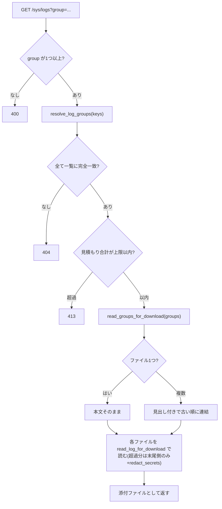
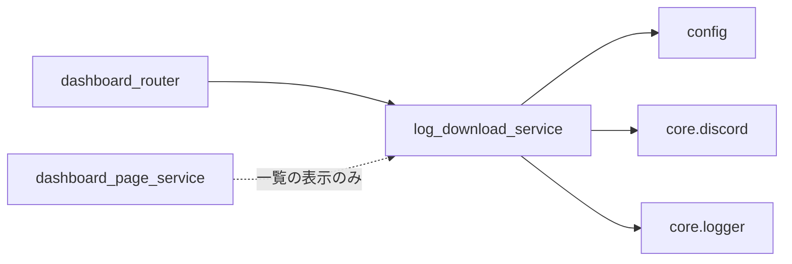

## 1. 解析メタ情報

| 項目 | 内容 |
| --- | --- |
| 対象ファイル | `log_download_service.py` |
| 言語 | Python |
| 解析対象 | 提供されたコードのみ |
| 推測・補完 | 一切なし |

## 関連ドキュメント

* [config.md](./config.md) - `LOG_DIR`・`BASE_DIR`・`LOG_DOWNLOAD_MAX_MB`・`LOG_DOWNLOAD_MAX_TOTAL_MB`の提供元
* [logger.md](./logger.md) - `setup_logging`の実体(本サービスが読む`home_system.log`の書き込み元でもある)
* [discord.md](./discord.md) - `redact_webhook_url`(Webhook URLのマスク)の実体
* [dashboard_router.md](./dashboard_router.md) - 一覧・ダウンロードを呼び出すルート(`/sys`と`/sys/logs/{name}`)
* [dashboard_page_service.md](./dashboard_page_service.md) - 一覧を表示する「ログのダウンロード」欄(`_render_log_download_box`)

## 2. ファイルの概要

ダッシュボードのシステムページからログファイルをダウンロードするためのサービス。用途は「スマホにログを保存してClaude Codeに渡し、調査する」ことで、行の絞り込みや検索は持たず、ファイルを(既知形式の機密情報だけ伏せて)そのまま返す。対象は`config.LOG_DIR`直下の`*.log`・`*.log.1`と、DDDの`newface_monitor.log`のみで、logrotateで退避された`x.log.1`は本体`x.log`と同じグループ(`LogGroup`)にまとめ、リクエストのグループ名は本サービスが列挙した一覧との完全一致でしか解決しない(パスを受け取らない)。複数選択では選んだグループのファイルを古い順に1つのテキストへ連結する(1ファイルだけなら本文そのまま)。

## 3. 外部依存関係

### インポート一覧

| 名称 | 種類 | 用途 | 根拠 |
| --- | --- | --- | --- |
| `os` | 標準 | ディレクトリ列挙・`stat`・シンボリックリンク判定・ファイル読み取り | 根拠: [インポート宣言] (行番号: 20 / 抜粋: "import os") |
| `re` | 標準 | ファイル名の許可パターン・機密情報のマスク用正規表現 | 根拠: [インポート宣言] (行番号: 21 / 抜粋: "import re") |
| `dataclasses.dataclass` | 標準 | `LogFile`の定義 | 根拠: [インポート宣言] (行番号: 22 / 抜粋: "from dataclasses import dataclass") |
| `datetime.datetime` | 標準 | 更新時刻・保存名の日時 | 根拠: [インポート宣言] (行番号: 23 / 抜粋: "from datetime import datetime") |
| `config` | 外部 | `LOG_DIR`・`BASE_DIR`・`LOG_DOWNLOAD_MAX_MB`・`LOG_DOWNLOAD_MAX_TOTAL_MB` | 根拠: [インポート宣言] (行番号: 25 / 抜粋: "import config") |
| `core.discord` | 外部 | `redact_webhook_url`でDiscord Webhook URLを伏せる | 根拠: [インポート宣言] (行番号: 26 / 抜粋: "from core import discord as core_discord") |
| `core.logger.setup_logging` | 外部 | ロガー初期化 | 根拠: [インポート宣言] (行番号: 27 / 抜粋: "from core.logger import setup_logging") |

### ブラックボックスとなる外部要素

| 名称 | 理由 | 根拠 |
| --- | --- | --- |
| `config.LOG_DIR` | 実際のパス(`BASE_DIR/logs`、または書き込み不可時のフォールバック先)は`config.py`側の解決次第 | 根拠: [変数参照] (行番号: 101 / 抜粋: "os.listdir(config.LOG_DIR)") |
| DDDのログ置き場 | `config.BASE_DIR`の親の`DDD/logs`と決め打ちしており、実機の配置で実在するかは本ファイルからは分からない | 根拠: [関数定義] (行番号: 83〜84 / 抜粋: "def _ddd_log_dir() -> str:") |

## 4. 主要要素の定義(関数 / エンドポイント / コンポーネント)

### `LogFile`

* **役割**: ダウンロード対象1件(公開名・実パス・サイズ・更新時刻)を表す不変のデータクラス。
* 根拠: [クラス定義] (行番号: 48〜53 / 抜粋: "@dataclass(frozen=True)\nclass LogFile:")

### `redact_secrets`

* **役割**: 既知の形式の機密情報を`<redacted>`に置き換えた文字列を返す。順に(1)Discord Webhook URLのトークン部、(2)`scheme://user:pass@`の認証情報(RTSP URL等)、(3)`token`/`secret`/`password`/`api_key`/`authorization`/`signature`等のキー名の直後の値、(4)`Bearer`トークンを伏せる。氏名・IPアドレス等は伏せない。
* 根拠: [関数定義] (行番号: 63〜69 / 抜粋: "def redact_secrets(text: str) -> str:")

* **引数/リクエスト**: `text: str`
* **戻り値/レスポンス**: マスク済みの`str`
* **副作用**: なし
* **エラーハンドリング**: なし(正規表現置換のみ)

### `LogGroup` / `_group_key`

* **役割**: 同じログのローテーション分(`x.log`と`x.log.1`)を1つにまとめる不変のデータクラス(`key`はグループ名=本体の名前、`files`は古い順)。`_group_key`は`.log.1`で終わる名前から`.1`を除いた名前を返す。
* 根拠: [クラス定義] (行番号: 56〜60 / 抜粋: "@dataclass(frozen=True)\nclass LogGroup:")

### `list_log_files`

* **役割**: ダウンロードできるログの一覧を更新が新しい順で返す。候補は`_candidates`(`LOG_DIR`直下で`^[A-Za-z0-9._-]+\.log(\.1)?$`に合致する名前と、`DDD__`接頭辞付きのDDDログ)で、シンボリックリンクと通常ファイル以外は`_stat_regular_file`で除外する。
* 根拠: [関数定義] (行番号: 114〜123 / 抜粋: "def list_log_files() -> list[LogFile]:")

* **引数/リクエスト**: なし
* **戻り値/レスポンス**: `list[LogFile]`
* **副作用**: ディレクトリ列挙と`stat`。`LOG_DIR`を列挙できないときはWARNINGログを出して空扱いにする
* **エラーハンドリング**: `OSError`は握りつぶして候補から外す(`_stat_regular_file`・`_candidates`)

### `list_log_groups`

* **役割**: `list_log_files`の結果をローテーション分ごとの`LogGroup`にまとめる(グループは更新が新しい順、グループ内は古い順=`x.log.1`→`x.log`)。画面のチェックボックス1つがこの1グループに対応する。
* 根拠: [関数定義] (行番号: 149〜157 / 抜粋: "def list_log_groups() -> list[LogGroup]:")

* **引数/リクエスト**: なし
* **戻り値/レスポンス**: `list[LogGroup]`
* **副作用**: `list_log_files`と同じ
* **エラーハンドリング**: なし

### `resolve_log_groups`

* **役割**: グループ名の列を`list_log_groups`の一覧内のグループへ解決する(重複は除く)。1つでも一覧に無い名前(`../`や`/`、`.log.1`の名前を含む)があれば`None`。パスを組み立てて開くことはしない。
* 根拠: [関数定義] (行番号: 160〜169 / 抜粋: "def resolve_log_groups(keys: list[str]) -> list[LogGroup] | None:")

* **引数/リクエスト**: `keys: list[str]`
* **戻り値/レスポンス**: `list[LogGroup] | None`
* **副作用**: なし(一覧の取得のみ)
* **エラーハンドリング**: なし

### `estimated_download_bytes` / `max_total_bytes`

* **役割**: 返却サイズの見積もり(1ファイルあたり`LOG_DOWNLOAD_MAX_MB`で頭打ちにした合計バイト数)と、複数選択の合計上限(`LOG_DOWNLOAD_MAX_TOTAL_MB`のバイト数)を返す。呼び出し側(ルーター)が見積もりが上限を超える選択を413で拒否するために使う。
* 根拠: [関数定義] (行番号: 172〜175 / 抜粋: "def estimated_download_bytes(groups: list[LogGroup]) -> int:")

* **引数/リクエスト**: `groups: list[LogGroup]`(`max_total_bytes`は引数なし)
* **戻り値/レスポンス**: `int`
* **副作用**: なし
* **エラーハンドリング**: なし

### `read_log_for_download`

* **役割**: 1ファイルを読み、マスク済みの本文を返す。ファイルが`config.LOG_DOWNLOAD_MAX_MB`を超える場合は末尾側のみを読み、欠けた先頭行を捨て、先頭に切り詰めた旨の注記行を付ける。UTF-8でデコードできない部分は置換文字にする。
* 根拠: [関数定義] (行番号: 126〜146 / 抜粋: "def read_log_for_download(log_file: LogFile) -> tuple[str, bool]:")

* **引数/リクエスト**: `log_file: LogFile`
* **戻り値/レスポンス**: `(マスク済み本文, 切り詰めたか)`
* **副作用**: ファイルの読み取りのみ
* **エラーハンドリング**: `open`・読み取りの`OSError`は握りつぶさず呼び出し元へ伝播する

### `read_groups_for_download`

* **役割**: 選択したグループ群のマスク済み本文を返す。対象ファイルが1つだけなら本文そのまま、複数なら各ファイルの前に`===== 名前 (サイズ bytes, 更新 日時) =====`の見出しを付け、末尾に改行が無ければ補って連結する(グループ順・グループ内は古い順)。
* 根拠: [関数定義] (行番号: 182〜198 / 抜粋: "def read_groups_for_download(groups: list[LogGroup]) -> str:")

* **引数/リクエスト**: `groups: list[LogGroup]`
* **戻り値/レスポンス**: `str`
* **副作用**: ファイルの読み取りのみ
* **エラーハンドリング**: `OSError`は呼び出し元へ伝播する

### `download_filename`

* **役割**: スマホで開きやすいよう末尾を`.txt`にし、取得日時を付けた保存名を返す。グループが1つなら`<グループ名>.<YYYYmmdd-HHMM>.txt`、複数なら`logs_<N>items.<YYYYmmdd-HHMM>.txt`。
* 根拠: [関数定義] (行番号: 201〜206 / 抜粋: "def download_filename(groups: list[LogGroup], now: datetime) -> str:")

* **引数/リクエスト**: `groups: list[LogGroup]`, `now: datetime`
* **戻り値/レスポンス**: `str`
* **副作用**: なし
* **エラーハンドリング**: なし

## 5. 処理フロー図

## 6. 依存関係図

## 7. 次のステップ(リバースエンジニアリングの提案)

| 優先度 | 対象 | 理由 |
| --- | --- | --- |
| 高 | `routers/dashboard_router.py` | 本サービスの呼び出し元。選択の検証(400/404/413)と、認証を設けずネットワーク制御に委ねている点の確認 |
| 中 | `deploy/logrotate/home_system` | `*.log`・`.log.1`(delaycompress)が生成される根拠 |

## 8. 保守上の注意点

* マスクは**既知の形式だけ**。氏名・IPアドレス・URLのクエリ等で上記パターンに当たらないものは伏せない。新しい秘密情報の形式がログに出る機能を足したら`_KEYED_SECRET_RE`等に追記すること。
* グループ名の解決を一覧との完全一致に限るのが、パストラバーサル対策の本体。`resolve_log_groups`をパス結合を使う実装に変えないこと。
* マスク用の正規表現は、開始位置を単語の先頭に限っている(`(?<![A-Za-z0-9_-])`等)。これを外すと、base64のような長い英数字列で処理時間が文字数の2乗になり、ダウンロードが固まる(`tests/test_log_download.py`に回帰テストあり)。
* 圧縮済み(`.gz`)・journalは対象外(最初のリリースで意図的に外している)。

## 9. 不明事項一覧

* 実機でのログの実在と`LOG_DIR`の実パス、DDDログ置き場(`<BASE_DIR>/../DDD/logs`)の実在は、ソースだけからは分からない。
* 実機の`home_system.log`の実サイズ。上限10MBで足りるかは運用で確認が必要。

## 10. 自己検証結果

* [x] 4章の記述すべてに根拠を付けた (完了)
* [x] ソースにない推測を書いていない (完了)
* [x] Mermaid構文にエラーの原因となる記号がない (完了)
* [x] 不明事項を漏れなく列挙した (完了)
