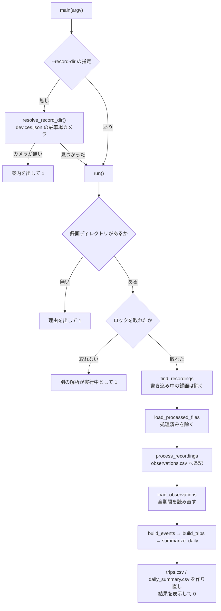
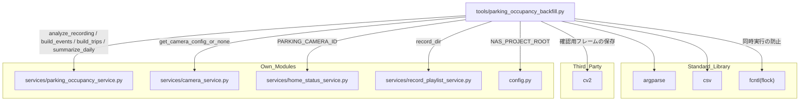

## 1. 解析メタ情報

| 項目 | 内容 |
| --- | --- |
| 対象ファイル | `MY_HOME_SYSTEM/tools/parking_occupancy_backfill.py` |
| 言語 | Python |
| 解析対象 | 提供されたコードのみ |
| 推測・補完 | 一切なし |
| 解析基準コミット | 新規追加時点（駐車場の在否判定 Phase 0） |

## 関連ドキュメント

* [parking_occupancy_service.md](./parking_occupancy_service.md) - 実処理の実体。フレームの取り出し・特徴量・在否の判定・外出の集計はすべてそちらにある
* [record_playlist_service.md](./record_playlist_service.md) - `record_dir` で駐車場カメラの録画ディレクトリを決める
* [home_status_service.md](./home_status_service.md) - 駐車場カメラを特定する `PARKING_CAMERA_ID` の定義元
* [camera_service.md](./camera_service.md) - `get_camera_config_or_none` で devices.json のカメラ設定を引く
* [config.md](./config.md) - `NAS_PROJECT_ROOT`（既定の出力先）の定義元
* [db_retention.md](./db_retention.md) - 同じ `tools/` 配下の CLI。`sys.path` へ親ディレクトリを足してから `config` を import する構成が共通

## 2. ファイルの概要

駐車場カメラの NVR 録画を遡って読み、自家用車の在否と外出の区間を CSV に書き出す CLI。**Phase 0（実現性検討）用で、DB には何も書かない。** ここで集めた特徴量を見て、`services/parking_occupancy_service.py` のしきい値を決め直す。

* 根拠: モジュールdocstring (行番号: 3〜22 / 抜粋: "駐車場カメラの NVR 録画を遡って読み、自家用車の在否と外出の区間を CSV に書き出す CLI。")

出力先は既定で NAS の `home_system/parking_occupancy/`（SD カードには書かない）。`observations.csv` は追記していき、`trips.csv` と `daily_summary.csv` は毎回作り直す。処理済みの録画は `observations.csv` の `file` 列で分かるので、もう一度実行すると続きから進む。

* 根拠: `def run(record_dir: str, out_dir: str, days: int, interval_seconds: int, confirm_count: int,` (行番号: 297 / 抜粋: "def run(")

## 3. 外部依存関係

### インポート一覧

| 名称 | 種類 | 用途 | 根拠 |
| --- | --- | --- | --- |
| `argparse` | 標準 | 引数の解析 | 根拠: [インポート宣言] (行番号: 29 / 抜粋: "import argparse") |
| `csv` | 標準 | 3つの CSV の読み書き | 根拠: [インポート宣言] (行番号: 30 / 抜粋: "import csv") |
| `datetime` | 標準 | 録画の開始時刻、対象日の計算 | 根拠: [インポート宣言] (行番号: 31 / 抜粋: "import datetime") |
| `fcntl` | 標準 | 同時実行を防ぐロック | 根拠: [インポート宣言] (行番号: 32 / 抜粋: "import fcntl") |
| `glob` | 標準 | 録画ファイルの列挙 | 根拠: [インポート宣言] (行番号: 33 / 抜粋: "import glob") |
| `os` / `sys` | 標準 | パス操作・録画ディレクトリの列挙・終了コード | 根拠: [インポート宣言] (行番号: 35 / 抜粋: "import sys") |
| `cv2` | サードパーティ | 確認用フレームの縮小と JPEG 保存 | 根拠: [インポート宣言] (行番号: 38 / 抜粋: "import cv2") |
| `config` | 自作 | `NAS_PROJECT_ROOT` | 根拠: [インポート宣言] (行番号: 42 / 抜粋: "import config") |
| `services.camera_service` / `home_status_service` / `record_playlist_service` | 自作 | 駐車場カメラの録画ディレクトリの解決 | 根拠: [インポート宣言] (行番号: 43 / 抜粋: "from services import camera_service, home_status_service, record_playlist_service") |
| `services.parking_occupancy_service` | 自作 | 実処理のすべて | 根拠: [インポート宣言] (行番号: 44 / 抜粋: "from services import parking_occupancy_service as occupancy") |

インポートに先立ち親ディレクトリを `sys.path` へ追加している（根拠: [パス操作] (行番号: 40 / 抜粋: "sys.path.insert(0, os.path.abspath(os.path.join(os.path.dirname(__file__), \"..\")))")）。

### ブラックボックスとなる外部要素

| 名称 | 理由 | 根拠 |
| --- | --- | --- |
| NAS 上の録画ファイル | `nvr-parking.service` が書く。本数・サイズ・欠落は実行環境に依存する | 根拠: `def find_recordings(record_dir: str, days: int, today: datetime.date) -> List[str]:` (行番号: 96) |
| `devices.json` の駐車場カメラの定義 | gitignore 対象で、リポジトリには無い | 根拠: `def resolve_record_dir() -> Optional[str]:` (行番号: 79) |

## 4. 主要要素の定義（関数 / エンドポイント / コンポーネント）

### `resolve_record_dir`

* **役割**: `home_status_service.PARKING_CAMERA_ID` のカメラ設定を引き、その録画ディレクトリを返す。
* 根拠: `def resolve_record_dir() -> Optional[str]:` (行番号: 79 / 抜粋: "def resolve_record_dir(")

* **引数/リクエスト**: なし
* 根拠: `def resolve_record_dir() -> Optional[str]:` (行番号: 79)

* **戻り値/レスポンス**: 録画ディレクトリのパス。devices.json に駐車場カメラが無ければ `None`
* 根拠: `def resolve_record_dir() -> Optional[str]:` (行番号: 79)

* **副作用**: なし
* 根拠: `def resolve_record_dir() -> Optional[str]:` (行番号: 79)

* **エラーハンドリング**: なし
* 根拠: `def resolve_record_dir() -> Optional[str]:` (行番号: 79)

### `recording_start` / `find_recordings`

* **役割**: `recording_start` は録画ファイル名（`%Y%m%d_%H%M%S.mp4`）から開始時刻を読む。`find_recordings` は今日を含む直近 `days` 日分の録画を古い順に返す。名前から時刻を読めないものと、**録画ディレクトリ内でいちばん新しい録画**（書き込み中とみなす。次の録画ができた時点で書き終わっている）は除く。途中までしか読めないのに処理済みと記録すると、残りの時間帯が二度と解析されないため。以前はファイルの更新時刻（120秒以内なら書き込み中）で判定していたが、この NAS（CIFS）では書き込み中のファイルの更新時刻が書き込みに合わせて進まず（`monitors/health_watch.py` のチェック10と同じ事情。実機でも、書き込み中の録画の更新時刻が現在より13分古いことを確認）、書き込み中の録画も書き終わったと誤判定していた。ファイル名とその並びだけで決めれば、更新時刻にも時計のずれにも左右されない。
* 根拠: `def recording_start(path: str) -> Optional[datetime.datetime]:` (行番号: 87 / 抜粋: "def recording_start(")
* 根拠: `def find_recordings(record_dir: str, days: int, today: datetime.date) -> List[str]:` (行番号: 96 / 抜粋: "def find_recordings(")

* **引数/リクエスト**: `record_dir`、`days`、`today`
* 根拠: `def find_recordings(record_dir: str, days: int, today: datetime.date) -> List[str]:` (行番号: 96)

* **戻り値/レスポンス**: 録画ファイルのパスのリスト
* 根拠: `def find_recordings(record_dir: str, days: int, today: datetime.date) -> List[str]:` (行番号: 96)

* **副作用**: なし（ディレクトリの列挙のみ）
* 根拠: `def find_recordings(record_dir: str, days: int, today: datetime.date) -> List[str]:` (行番号: 96)

* **エラーハンドリング**: 時刻を読めないファイル名は `ValueError` を捕捉して `None` とし、対象から外す
* 根拠: `def recording_start(path: str) -> Optional[datetime.datetime]:` (行番号: 87)

### `load_processed_files` / `load_observations`

* **役割**: `observations.csv` を読む。前者は既に載っている録画ファイル名の集合（再実行時に飛ばすため）を返す。後者は外出の集計を、今回追記した分だけでなく全期間でやり直すための観測のリストで、各行の特徴量（`_features_from_row`）から **今のしきい値で `occupancy.classify` し直した判定** を付けて返す。`state` 列は解析した時点の判定の記録で、集計には使わない。こうしておけば、しきい値を見直しても録画を読み直さずに集計をやり直せる（#1115）。`load_unreadable_files` は `unreadable.txt` に載っている録画ファイル名の集合を返し、`run` が処理済みと同じく飛ばす。
* 根拠: `def load_processed_files(observations_path: str) -> Set[str]:` (行番号: 123 / 抜粋: "def load_processed_files(")
* 根拠: `def load_observations(observations_path: str) -> List[occupancy.Observation]:` (行番号: 144 / 抜粋: "def load_observations(")

* **引数/リクエスト**: `observations_path`
* 根拠: `def load_processed_files(observations_path: str) -> Set[str]:` (行番号: 123)

* **戻り値/レスポンス**: ファイル名の集合 / `Observation` のリスト。ファイルが無ければ空
* 根拠: `def load_observations(observations_path: str) -> List[occupancy.Observation]:` (行番号: 144)

* **副作用**: なし
* 根拠: `def load_processed_files(observations_path: str) -> Set[str]:` (行番号: 123)

* **エラーハンドリング**: なし
* 根拠: `def load_processed_files(observations_path: str) -> Set[str]:` (行番号: 123)

### `FrameSaver`

* **役割**: 判定が直前のフレームと変わったフレームと、不明だったフレームを、目で確かめる用に 640×360 の JPEG で残す。ファイル名は `<時刻>_<判定>.jpg`。`max_frames` 枚に達したらそれ以上は残さない。
* 根拠: `class FrameSaver:` (行番号: 188 / 抜粋: "class FrameSaver:")

* **引数/リクエスト**: `frames_dir`、`max_frames`。`offer(obs, frame)` にフレームを順に渡す
* 根拠: `class FrameSaver:` (行番号: 188)

* **戻り値/レスポンス**: なし
* 根拠: `class FrameSaver:` (行番号: 188)

* **副作用**: `frames_dir` を作り、JPEG を書く
* 根拠: `class FrameSaver:` (行番号: 188)

* **エラーハンドリング**: なし
* 根拠: `class FrameSaver:` (行番号: 188)

### `process_recordings`

* **役割**: 録画を順に `occupancy.analyze_recording` にかけ、1フレーム1行で `observations.csv` へ追記する。**録画1本分の行は、その録画を最後まで読めてからまとめて書く。** 途中で止めた・ffmpeg が失敗した録画の行は1行も残さない（途中までの行が残ると、次回は処理済みとみなされて残りの時間帯が二度と解析されないため）。書かなかった録画と、フレームが1枚も取れなかった録画は、次回もう一度試される。
* 根拠: `def process_recordings(` (行番号: 207 / 抜粋: "def process_recordings(")

* **引数/リクエスト**: `paths`、`observations_path`、`interval_seconds`、`frame_saver`（省略可）、`unreadable_path`（省略可）
* 根拠: `def process_recordings(` (行番号: 207)

* **戻り値/レスポンス**: 書いた行数
* 根拠: `def process_recordings(` (行番号: 207)

* **副作用**: `observations.csv` への追記（無ければヘッダー付きで作る）。読めない録画があれば `unreadable.txt` への追記
* 根拠: `def process_recordings(` (行番号: 207)

* **エラーハンドリング**: `occupancy.FrameExtractionError`（ffmpeg の失敗・時間切れ）を捕捉し、その録画の行を捨てて標準エラーへ理由を出し、次の録画へ進む。そのうち `unreadable` なもの（ffmpeg 自身が読めないと答えた。録画が細切れになった日の、映像が1コマも入っていない録画など）は、何度読み直しても同じなので `unreadable_path` にファイル名を追記し、次回からは飛ばす。時間切れは NAS が一時的に固まっただけかもしれないので記録せず、次回もう一度試す。Ctrl-C などで中断された場合も、読みかけの録画の行は書かれない
* 根拠: `def process_recordings(` (行番号: 207)

### `write_trips` / `write_daily_summary` / `print_report`

* **役割**: 外出の一覧を `trips.csv`（出庫・入庫の時刻、分、不確かかどうか）、日ごとの集計を `daily_summary.csv`（日付、回数、合計分）に書き、同じ内容を標準出力にも表示する。表示には観測の総数と、判定できなかった件数・割合も含める。
* 根拠: `def write_trips(path: str, trips: Iterable[occupancy.Trip]) -> None:` (行番号: 256 / 抜粋: "def write_trips(")
* 根拠: `def write_daily_summary(path: str, summaries: Iterable[occupancy.DailySummary]) -> None:` (行番号: 268 / 抜粋: "def write_daily_summary(")
* 根拠: `def print_report(observations: List[occupancy.Observation], trips: List[occupancy.Trip],` (行番号: 276 / 抜粋: "def print_report(")

* **引数/リクエスト**: 出力先のパスと、`Trip` / `DailySummary` のリスト
* 根拠: `def write_trips(path: str, trips: Iterable[occupancy.Trip]) -> None:` (行番号: 256)

* **戻り値/レスポンス**: `None`
* 根拠: `def write_trips(path: str, trips: Iterable[occupancy.Trip]) -> None:` (行番号: 256)

* **副作用**: CSV の上書き、標準出力への印字
* 根拠: `def write_daily_summary(path: str, summaries: Iterable[occupancy.DailySummary]) -> None:` (行番号: 268)

* **エラーハンドリング**: なし
* 根拠: `def write_trips(path: str, trips: Iterable[occupancy.Trip]) -> None:` (行番号: 256)

### `run`

* **役割**: 全体の実行。録画ディレクトリの存在を確かめ、出力先を作り、ロックを取ってから、未処理の録画を解析して追記し、`observations.csv` の全行から外出を集計し直して CSV と標準出力に出す。
* 根拠: `def run(record_dir: str, out_dir: str, days: int, interval_seconds: int, confirm_count: int,` (行番号: 297 / 抜粋: "def run(")

* **引数/リクエスト**: `record_dir`、`out_dir`、`days`、`interval_seconds`、`confirm_count`、`save_frames`、`max_saved_frames`（既定 500）
* 根拠: `def run(record_dir: str, out_dir: str, days: int, interval_seconds: int, confirm_count: int,` (行番号: 297)

* **戻り値/レスポンス**: 終了コード（録画ディレクトリが無い・別の解析が実行中なら `1`、それ以外 `0`）
* 根拠: `def run(record_dir: str, out_dir: str, days: int, interval_seconds: int, confirm_count: int,` (行番号: 297)

* **副作用**: 出力先ディレクトリの作成、ロックファイル（`.backfill.lock`）の作成、3つの CSV と確認用フレームの書き込み
* 根拠: `def run(record_dir: str, out_dir: str, days: int, interval_seconds: int, confirm_count: int,` (行番号: 297)

* **エラーハンドリング**: 録画ディレクトリが無ければ出力先を作る前に標準エラーへ理由を出して `1`。`fcntl.flock` が取れなければ（`BlockingIOError`）何もせず `1`
* 根拠: `def run(record_dir: str, out_dir: str, days: int, interval_seconds: int, confirm_count: int,` (行番号: 297)

### `main`

* **役割**: 引数（`--days` 既定 7、`--interval` 既定 60、`--confirm` 既定 3、`--out`、`--record-dir`、`--save-frames`）を解析して `run` を呼ぶ。`--record-dir` が無ければ devices.json の駐車場カメラから録画先を決め、`--out` が無ければ NAS の `parking_occupancy` に出す。
* 根拠: `def main(argv: Optional[List[str]] = None) -> int:` (行番号: 335 / 抜粋: "def main(")

* **引数/リクエスト**: `argv`（省略時は `sys.argv[1:]`）
* 根拠: `def main(argv: Optional[List[str]] = None) -> int:` (行番号: 335)

* **戻り値/レスポンス**: 終了コード
* 根拠: `def main(argv: Optional[List[str]] = None) -> int:` (行番号: 335)

* **副作用**: `run` に従う
* 根拠: `def main(argv: Optional[List[str]] = None) -> int:` (行番号: 335)

* **エラーハンドリング**: `--days` / `--interval` / `--confirm` が 1 未満なら `parser.error`。駐車場カメラが devices.json に無く `--record-dir` も無ければ、標準エラーへ案内を出して `1`
* 根拠: `def main(argv: Optional[List[str]] = None) -> int:` (行番号: 335)

## 5. 処理フロー図

## 6. 依存関係図

## 7. 次のステップ（リバースエンジニアリングの提案）

| 優先度 | ファイル名(推測可) | 理由 | 根拠 |
| --- | --- | --- | --- |
| 高 | `services/parking_occupancy_service.py` | 本 CLI はその薄い層で、判定と集計のロジックはすべてそちらにある | `from services import parking_occupancy_service as occupancy` (行番号: 42) |
| 中 | `services/record_playlist_service.py` | 録画ディレクトリの決め方 | `def resolve_record_dir() -> Optional[str]:` (行番号: 73) |

## 8. 保守上の注意点

* **30日分は数時間かかる**: 録画1本（10分）ごとにファイル全体を NAS から読む。既定は直近7日分。途中で止めても続きから再開できる。
* **読めない録画は `unreadable.txt` に記録して飛ばす**: ffmpeg 自身が読めないと答えた録画は二度と読まない。録画を復旧させて読み直したいときは、`unreadable.txt` から該当の行を消す。時間切れになった録画は記録しないので、実行のたびに試す。
* **いちばん新しい録画は、次の録画ができるまで解析されない**: 録画サービスが止まっていると、止まる直前の1本は再開するまで残る。
* **`--interval` を途中で変えない**: 処理済みかどうかは録画ファイル名だけで決めるので、間隔を変えても既に処理した録画は読み直されない。変えるなら出力先を分けるか `observations.csv` を消す。
* **しきい値を変えても読み直さなくてよい**: 集計は `observations.csv` の特徴量から今のしきい値で判定し直す。`state` 列は解析した時点の判定のまま残る（集計とは食い違うことがある）。新しい特徴量を追加したときだけは、`observations.csv` を消して読み直す必要がある。
* **定期実行には載せていない**: `scheduler_boot.py` にも cron にも登録していない。手元から実行する確認用の CLI である。
* **`_today()` はホストのローカル日付を使う（意図的）**: 録画ファイル名は ffmpeg の `-strftime 1` でホストのローカル時刻から付けられるため、突き合わせる日付もホストの時計で数える。JST 固定ヘルパーに変えると、ホストが UTC の場合に日付境界でずれる。
* **`tools/` は `.coveragerc` の omit 対象ではない**: 本ファイルもカバレッジの分母に入る。

## 9. 不明事項一覧

| 項目 | 理由 | 必要なファイル |
| --- | --- | --- |
| 実機での実行時間と NAS への負荷 | 録画のサイズと NAS の読み出し速度に依存する | 実機での計測 |
| 実機の録画での外出の検出結果が実際と合うか | 正解（実際の出入りの時刻）との突き合わせをしていない | 実機での実行結果と、手で記録した出入りの時刻 |
