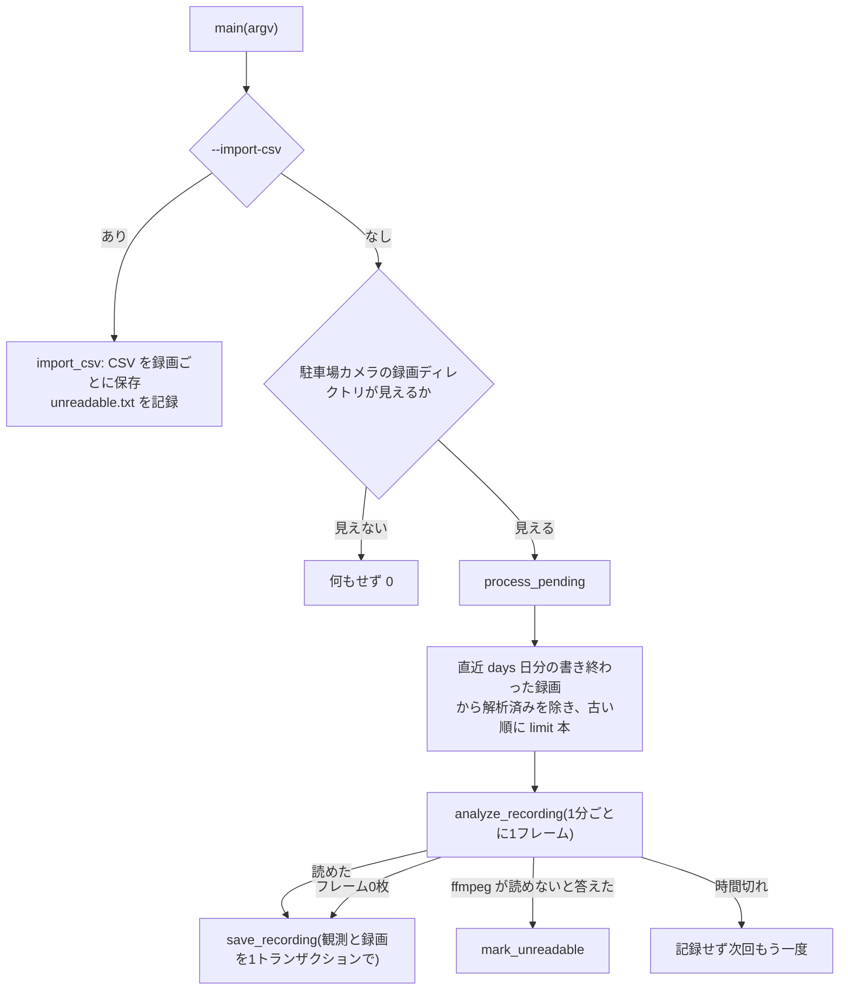
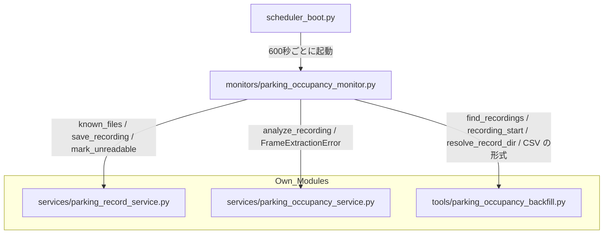

## 1. 解析メタ情報

| 項目 | 内容 |
| --- | --- |
| 対象ファイル | `MY_HOME_SYSTEM/monitors/parking_occupancy_monitor.py` |
| 言語 | Python |
| 解析対象 | 提供されたコードのみ |
| 推測・補完 | 一切なし |
| 解析基準コミット | #1116（駐車場の在否判定 Phase 2）での新規追加時点 |

## 関連ドキュメント

* [parking_record_service.md](./parking_record_service.md) - DB への保存と読み出し
* [parking_occupancy_service.md](./parking_occupancy_service.md) - 録画の解析（フレームの取り出し・特徴量・判定）
* [parking_occupancy_backfill.md](./parking_occupancy_backfill.md) - Phase 0〜1 の CLI。録画の列挙・ファイル名の解釈・CSV の形式をそこから借りている
* [scheduler_boot.md](./scheduler_boot.md) - 本スクリプトを600秒ごとに起動する
* [start_all.md](./start_all.md) - 再起動時の掃除対象に本スクリプトが含まれる

## 2. ファイルの概要

駐車場カメラの録画を解析して、自家用車の在否の特徴量を DB に保存するスクリプト。`scheduler_boot.py` から10分ごとに実行し、書き終わった録画のうちまだ解析していないものを古い順に読む。録画は10分ごとに1本増えるので、ふだんは1回の実行で1本（Pi で約7秒）を読む。

* 根拠: モジュールdocstring (行番号: 2〜21 / 抜粋: "駐車場カメラの録画を解析して、自家用車の在否の特徴量を DB に保存する(#1116)。")

止まっていた間の録画は直近 `LOOKBACK_DAYS`（2）日分まで遡って取り戻す。1回に読む本数は `MAX_FILES_PER_RUN`（12本 = 2時間分）までに抑え、残りは次の実行に回す。`--import-csv` で Phase 0〜1 の CLI が集めた CSV を、`--days N --no-limit` で録画から直接、過去分を取り込める。

* 根拠: [定数定義] (行番号: 42 / 抜粋: "MAX_FILES_PER_RUN = 12")

## 3. 外部依存関係

### インポート一覧

| 名称 | 種類 | 用途 | 根拠 |
| --- | --- | --- | --- |
| `argparse` / `csv` / `datetime` / `os` / `sys` | 標準 | 引数・CSV の取り込み・時刻・パス | 根拠: [インポート宣言] (行番号: 26 / 抜粋: "import csv") |
| `core.logger.setup_logging` | 自作 | ロガー | 根拠: [インポート宣言] (行番号: 34 / 抜粋: "from core.logger import setup_logging") |
| `services.parking_occupancy_service` | 自作 | `analyze_recording`・`FrameExtractionError`・`classify` | 根拠: [インポート宣言] (行番号: 35 / 抜粋: "from services import parking_occupancy_service as occupancy") |
| `services.parking_record_service` | 自作 | DB への保存 | 根拠: [インポート宣言] (行番号: 36 / 抜粋: "from services import parking_record_service as records") |
| `tools.parking_occupancy_backfill` | 自作 | 録画の列挙（いちばん新しい録画を書き込み中として除く）・ファイル名の解釈・駐車場カメラの録画ディレクトリの解決・CSV の形式 | 根拠: [インポート宣言] (行番号: 37 / 抜粋: "from tools import parking_occupancy_backfill as backfill") |

### ブラックボックスとなる外部要素

| 名称 | 理由 | 根拠 |
| --- | --- | --- |
| NAS 上の録画ファイル | `nvr-parking.service` が書く | 根拠: `def process_pending(record_dir: str, days: int, limit: Optional[int]) -> Dict[str, int]:` (行番号: 50) |
| `devices.json` の駐車場カメラの定義 | gitignore 対象 | 根拠: `def main(argv: Optional[List[str]] = None) -> int:` (行番号: 130) |

## 4. 主要要素の定義（関数 / エンドポイント / コンポーネント）

### `process_pending`

* **役割**: 直近 `days` 日分の書き終わった録画のうち、`records.known_files` に無いものを古い順に `limit` 本まで解析し、`records.save_recording` で保存する。1分ごとに1フレーム（`INTERVAL_SECONDS`）。
* 根拠: `def process_pending(record_dir: str, days: int, limit: Optional[int]) -> Dict[str, int]:` (行番号: 50 / 抜粋: "def process_pending(")

* **引数/リクエスト**: `record_dir`、`days`、`limit`（`None` なら上限なし）
* 根拠: `def process_pending(record_dir: str, days: int, limit: Optional[int]) -> Dict[str, int]:` (行番号: 50)

* **戻り値/レスポンス**: 件数の内訳（`saved` 保存した録画 / `observations` 保存した観測 / `unreadable` 読めないと記録した録画 / `retry` 次回に回した録画）
* 根拠: `def process_pending(record_dir: str, days: int, limit: Optional[int]) -> Dict[str, int]:` (行番号: 50)

* **副作用**: ffmpeg の起動（`analyze_recording` 経由）、DB への書き込み
* 根拠: `def process_pending(record_dir: str, days: int, limit: Optional[int]) -> Dict[str, int]:` (行番号: 50)

* **エラーハンドリング**: `FrameExtractionError` のうち `unreadable`（ffmpeg 自身が読めないと答えた）は `records.mark_unreadable` で記録して次回から読まない。時間切れは記録せず次回もう一度読む。**（Issue #1184 で変更）** 時間切れが出たら、NAS が固まっている可能性が高い(残りも読めず1本につき最大300秒ずつ長引く)ため、その回の残りの録画は読まずに終える(残りの本数も `retry` に数える)。どちらも途中まで読めた観測は保存しない。ffmpeg は成功したがフレームが1枚も取れなかった録画（数秒で切れた録画など）は、観測0件として記録して読み直さない（何度読んでも同じで、記録しないと毎回キューの先頭に残り、1回に読む本数の上限を食いつぶして新しい録画が読まれなくなるため）
* 根拠: `def process_pending(record_dir: str, days: int, limit: Optional[int]) -> Dict[str, int]:` (行番号: 50)

### `import_csv`

* **役割**: Phase 0〜1 の CLI（`tools/parking_occupancy_backfill.py`）の出力ディレクトリから、`observations.csv` を録画ごとにまとめて `records.save_recording` に、`unreadable.txt` の録画を `records.mark_unreadable` に渡す。もう DB にある録画は飛ばされる。
* 根拠: `def import_csv(out_dir: str) -> Dict[str, int]:` (行番号: 97 / 抜粋: "def import_csv(")

* **引数/リクエスト**: `out_dir`
* 根拠: `def import_csv(out_dir: str) -> Dict[str, int]:` (行番号: 97)

* **戻り値/レスポンス**: 件数の内訳（`saved` / `observations` / `unreadable`）
* 根拠: `def import_csv(out_dir: str) -> Dict[str, int]:` (行番号: 97)

* **副作用**: DB への書き込み
* 根拠: `def import_csv(out_dir: str) -> Dict[str, int]:` (行番号: 97)

* **エラーハンドリング**: ファイルが無ければ取り込む物が無いだけで、エラーにはしない。ファイル名から時刻を読めない録画は飛ばす
* 根拠: `def import_csv(out_dir: str) -> Dict[str, int]:` (行番号: 97)

### `main`

* **役割**: 引数（`--days` 既定2、`--no-limit`、`--import-csv DIR`、`--record-dir`）を解析する。`--import-csv` があれば取り込みだけを行う。それ以外は、駐車場カメラの録画ディレクトリを決めて `process_pending` を呼ぶ。
* 根拠: `def main(argv: Optional[List[str]] = None) -> int:` (行番号: 130 / 抜粋: "def main(")

* **引数/リクエスト**: `argv`
* 根拠: `def main(argv: Optional[List[str]] = None) -> int:` (行番号: 130)

* **戻り値/レスポンス**: 終了コード。通常は 0
* 根拠: `def main(argv: Optional[List[str]] = None) -> int:` (行番号: 130)

* **副作用**: 上記の関数に従う
* 根拠: `def main(argv: Optional[List[str]] = None) -> int:` (行番号: 130)

* **エラーハンドリング**: 駐車場カメラが devices.json に無い・録画ディレクトリが見えない場合は、何もせず 0 を返す（スケジューラのエラー通知を起こさない。NAS の停止は nas_monitor / health_watch が検知する）。`--days` が 1 未満なら `parser.error`
* 根拠: `def main(argv: Optional[List[str]] = None) -> int:` (行番号: 130)

## 5. 処理フロー図

## 6. 依存関係図

## 7. 次のステップ（リバースエンジニアリングの提案）

| 優先度 | ファイル名(推測可) | 理由 | 根拠 |
| --- | --- | --- | --- |
| 高 | `services/parking_record_service.py` | 保存の形式 | `from services import parking_record_service as records` (行番号: 36) |
| 中 | `tools/parking_occupancy_backfill.py` | 録画の列挙と、いちばん新しい録画を書き込み中として除く判定 | `from tools import parking_occupancy_backfill as backfill` (行番号: 37) |

## 8. 保守上の注意点

* **`tools/` から関数を借りている**: 録画の列挙・ファイル名の解釈・CSV の形式は `tools/parking_occupancy_backfill.py` と同じものを使う（判定がずれないように）。CLI 側の関数名を変えたら、こちらも直すこと。
* **初回は過去分を取り込む**: 定期実行は直近2日分しか遡らない。それより前の分は `--import-csv` か `--days N --no-limit` で手で取り込む。
* **時間切れの扱い（Issue #1184 で変更）**: 時間切れの録画は記録しないので、次の実行でも先頭から読み直す。以前は時間切れの後も残りの録画を読み続けたため、NAS が固まっている間は1回の実行が「本数 × 最大300秒」まで長引き、同じ録画が毎回上限を占め続けた。現在は時間切れが出た時点でその回を終えるので、1回あたり最大300秒で済む。NAS が戻れば次の回で時間切れだった録画から読み直す。時間切れの回数を記録して `unreadable` 扱いにする案は、NAS の一時停止で正常な録画を捨てるおそれがあるため採らなかった。
* **CPU 負荷**: 1回に最大12本（Pi で2分弱）。ffmpeg は `nice`・スレッド数2で動く（`parking_occupancy_service.build_frame_command`）。
* **単一プロセス前提に当たらない**: 書き込むのは `parking_*` テーブルだけで、`quest_users` には触れない。

## 9. 不明事項一覧

| 項目 | 理由 | 必要なファイル |
| --- | --- | --- |
| 実機で定期実行したときの CPU・温度への影響 | タイムラプス生成・NVR 録画と同時に動く。1本約7秒の見込みだが、定期実行としては未計測 | 実機での計測 |
