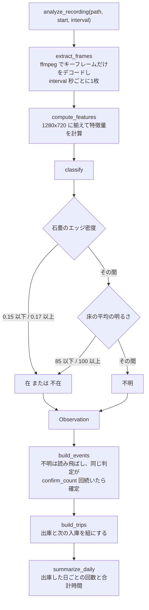
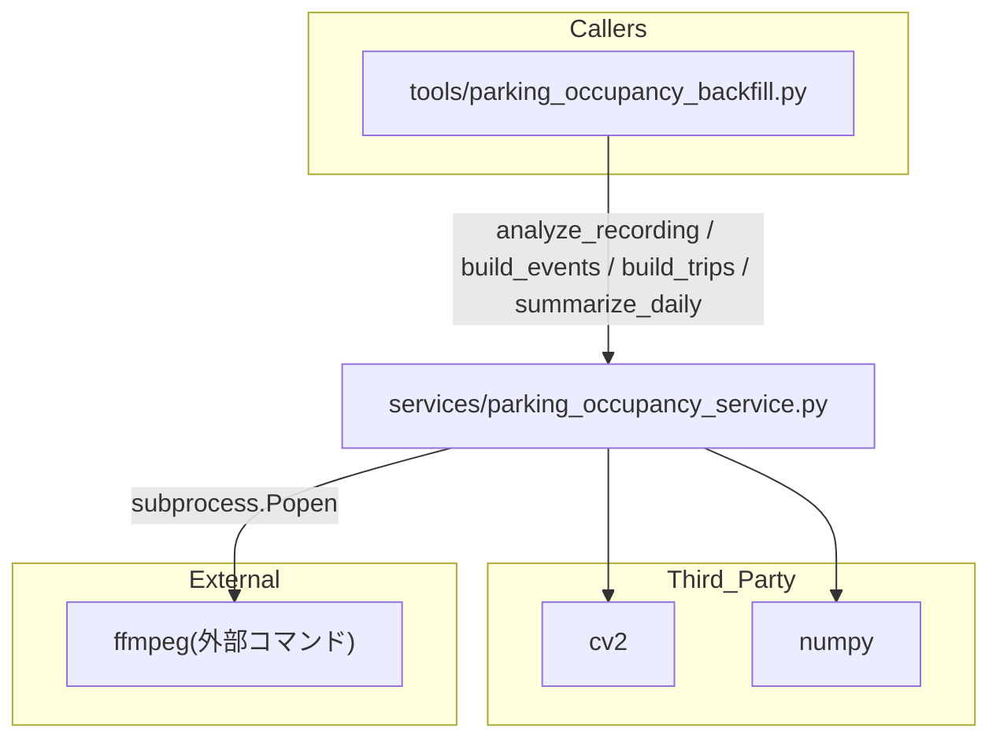

## 1. 解析メタ情報

| 項目 | 内容 |
| --- | --- |
| 対象ファイル | `MY_HOME_SYSTEM/services/parking_occupancy_service.py` |
| 言語 | Python |
| 解析対象 | 提供されたコードのみ |
| 推測・補完 | 一切なし |
| 解析基準コミット | 新規追加時点（駐車場の在否判定 Phase 0） |

## 関連ドキュメント

* [parking_occupancy_backfill.md](./parking_occupancy_backfill.md) - 本モジュールを呼ぶ唯一の経路。NAS の録画を遡って読み、結果を CSV に書き出す CLI
* [home_status_service.md](./home_status_service.md) - 今の「🚗 駐車場」カードの判定元。動体検知の最終時刻を出すだけで、車の在否は分からない
* [smart_timelapse_generator.md](./smart_timelapse_generator.md) - 同じく録画を ffmpeg の生フレームで読んで OpenCV にかける先行例。`nice`/`ionice`・スレッド数の絞り方を合わせている
* [record_playlist_service.md](./record_playlist_service.md) - 録画ファイルの置き場所と命名規則（`%Y%m%d_%H%M%S.mp4`）の定義元

## 2. ファイルの概要

駐車場カメラの映像から自家用車の在否を判定し、外出（出庫→入庫）の区間にまとめるサービス。**Phase 0（実現性検討）の実装で、DB にもダッシュボードにもつながっていない。** 物体検出や学習モデルは使わず、車がない時だけ見える2つの領域（石畳・床）の特徴量をしきい値で判定する。しきい値は昼・夜 × 車あり・なしのスクリーンショット4枚から決め、実機の録画7日分（2026-11-17〜23、約9,600観測）で見直した（#1115）。

* 根拠: モジュールdocstring (行番号: 2〜20 / 抜粋: "駐車場カメラの映像から自家用車の在否を判定し、外出(出庫→入庫)の区間にまとめる。")

処理は3段に分かれる。(1) 録画からフレームを取り出す（`extract_frames`）、(2) 1フレームの特徴量を計算して在否を判定する（`compute_features` / `classify`）、(3) 判定の並びから出庫・入庫を確定し、外出の区間と日ごとの集計にまとめる（`build_events` / `build_trips` / `summarize_daily`）。

* 根拠: `def analyze_recording(` (行番号: 284 / 抜粋: "def analyze_recording(")

## 3. 外部依存関係

### インポート一覧

| 名称 | 種類 | 用途 | 根拠 |
| --- | --- | --- | --- |
| `datetime` | 標準 | 観測の時刻、空白の判定 | 根拠: [インポート宣言] (行番号: 26 / 抜粋: "import datetime") |
| `shutil` | 標準 | `ionice` があるかの確認 | 根拠: [インポート宣言] (行番号: 27 / 抜粋: "import shutil") |
| `subprocess` | 標準 | ffmpeg の起動 | 根拠: [インポート宣言] (行番号: 28 / 抜粋: "import subprocess") |
| `tempfile` | 標準 | ffmpeg の stderr の受け皿 | 根拠: [インポート宣言] (行番号: 29 / 抜粋: "import tempfile") |
| `threading` | 標準 | 時間切れで ffmpeg を止める見張り(`Timer`) | 根拠: [インポート宣言] (行番号: 30 / 抜粋: "import threading") |
| `dataclasses.dataclass` | 標準 | 特徴量・観測・イベント・外出・日次集計の型 | 根拠: [インポート宣言] (行番号: 31 / 抜粋: "from dataclasses import dataclass") |
| `cv2` | サードパーティ | リサイズ・色変換・Canny・Laplacian。**(#1117 で変更)** モジュールの先頭ではなく `compute_features` / `_edge_density` の中で読み込む。ダッシュボード(unified_server)は判定と集計だけを使うので、サーバー本体に OpenCV を読み込ませない(Pi のメモリのため) | 根拠: [遅延インポート] (行番号: 179 / 抜粋: "    import cv2") |
| `numpy` | サードパーティ | フレームの配列操作 | 根拠: [インポート宣言] (行番号: 34 / 抜粋: "import numpy as np") |

### ブラックボックスとなる外部要素

| 名称 | 理由 | 根拠 |
| --- | --- | --- |
| `ffmpeg`（外部コマンド） | 録画のデコード結果は実行環境の ffmpeg と録画ファイルに依存する | 根拠: `def build_frame_command(path: str, interval_seconds: int) -> List[str]:` (行番号: 228) |
| 駐車場カメラの画角 | ROI の比率はカメラの向きが変わらない前提で決めている。画角が変わると判定できなくなる | 根拠: [定数定義] (行番号: 51 / 抜粋: "FLAGSTONE_ROI = Roi(0.52, 0.36, 0.78, 0.47)") |

## 4. 主要要素の定義（関数 / エンドポイント / コンポーネント）

### 定数（ROI としきい値）

* **役割**: 判定に使う領域としきい値。エッジ密度は解像度で値が変わるため、フレームは必ず 1280×720 に揃えてから計算する。`FLAGSTONE_ROI` は車がない時に石畳の目地が見える領域、`FLOOR_ROI` は車がない時にコンクリートの床が見える領域で、自転車置き場・奥の道路・日時表示にはかからないように置いている。しきい値は「これ以下なら在」「これ以上なら不在」の2つを持ち、その間は不明とする。
* 根拠: [定数定義] (行番号: 54 / 抜粋: "FLOOR_ROI = Roi(0.55, 0.60, 0.85, 0.79)")
* 根拠: [定数定義] (行番号: 60 / 抜粋: "FLAGSTONE_EDGE_PRESENT_MAX = 0.15  # これ以下なら「車あり」")
* 根拠: [定数定義] (行番号: 65 / 抜粋: "FLOOR_MEAN_PRESENT_MAX = 85.0      # これ以下なら「車あり」")
* 床の判定は、当初は「外れ画素の割合」で行っていたが、実機の録画で2つの誤判定が見つかったため「平均の明るさ」に変えた（#1115）。(1) 車を左・奥に寄せて停めると床の ROI が一様な暗いリアガラスで埋まり、外れ画素がほとんど無いので「車なし」になった。(2) 日没後に玄関灯で柱の影が床に斜めに落ちると、外れ画素が増えて「車あり」になった。平均の明るさは車なし 106〜165・車あり 36〜78 で、どちらの場面でも正しく分かれる。外れ画素の割合は判定には使わず、記録だけ続けている
* 根拠: [定数定義] (行番号: 69 / 抜粋: "FLOOR_OUTLIER_DELTA = 40           # 中央値からこれより離れた画素を「外れ」と数える")

### データ型

* **役割**: `ParkingFeatures`（1フレームの特徴量。しきい値を決め直せるよう、判定に使わない値も持つ）、`Observation`（時刻・判定・特徴量）、`ParkingEvent`（確定した出庫/入庫と、時刻が不確かかどうか）、`Trip`（外出1回分。`returned_at` が `None` ならまだ戻っていない）、`DailySummary`（出庫した日ごとの回数と合計時間）。いずれも `frozen=True` の dataclass。
* 根拠: `class ParkingFeatures:` (行番号: 113 / 抜粋: "class ParkingFeatures:")
* 根拠: `class Trip:` (行番号: 142 / 抜粋: "class Trip:")

### `compute_features`

* **役割**: BGR のフレームから特徴量を計算する。彩度の平均（IR かどうかの判別）、石畳 ROI のエッジ密度と Laplacian の分散、床 ROI の平均・標準偏差・エッジ密度・外れ画素の割合を返す。判定に使うのは石畳のエッジ密度と床の平均だけで、ほかはしきい値を見直す材料として記録する。
* 根拠: `def compute_features(frame_bgr: np.ndarray) -> ParkingFeatures:` (行番号: 174 / 抜粋: "def compute_features(")

* **引数/リクエスト**: `frame_bgr`（BGR の `np.ndarray`。大きさは問わない）
* 根拠: `def compute_features(frame_bgr: np.ndarray) -> ParkingFeatures:` (行番号: 174)

* **戻り値/レスポンス**: `ParkingFeatures`
* 根拠: `def compute_features(frame_bgr: np.ndarray) -> ParkingFeatures:` (行番号: 174)

* **副作用**: なし
* 根拠: `def compute_features(frame_bgr: np.ndarray) -> ParkingFeatures:` (行番号: 174)

* **エラーハンドリング**: なし。大きさが解析用と違えば `cv2.resize` で揃える
* 根拠: `def compute_features(frame_bgr: np.ndarray) -> ParkingFeatures:` (行番号: 174)

### `classify`

* **役割**: **石畳のエッジ密度で在否を決め、石畳がどちらとも言えない値（0.15〜0.17）の時だけ床の平均の明るさで決める**（`_vote`。どちらも値が低いほど「車あり」）。床もどちらとも言えなければ不明。以前は「2つが一致した時だけ」在否を返していたが、実機の7日分では「判定できず」1013件のうち約960件が、石畳は正しいのに床が外れたものだった（車を奥に停めて夜でも床が見えた: 767件、晴れた昼に影で床が暗くなった: 約140件）（#1115）。
* 根拠: `def classify(features: ParkingFeatures) -> str:` (行番号: 214 / 抜粋: "def classify(")

* **引数/リクエスト**: `features` (`ParkingFeatures`)
* 根拠: `def classify(features: ParkingFeatures) -> str:` (行番号: 214)

* **戻り値/レスポンス**: `STATE_PRESENT` / `STATE_ABSENT` / `STATE_UNKNOWN` のいずれか
* 根拠: `def classify(features: ParkingFeatures) -> str:` (行番号: 214)

* **副作用**: なし
* 根拠: `def classify(features: ParkingFeatures) -> str:` (行番号: 214)

* **エラーハンドリング**: なし
* 根拠: `def classify(features: ParkingFeatures) -> str:` (行番号: 214)

### `build_frame_command`

* **役割**: 録画から `interval_seconds` ごとに1枚、1280×720 の BGR 生フレームを stdout へ流す ffmpeg コマンドを組み立てる。`-skip_frame nokey` でキーフレームだけをデコードし、`nice`（あれば `ionice` も）とスレッド数の上限で負荷を抑える。
* 根拠: `def build_frame_command(path: str, interval_seconds: int) -> List[str]:` (行番号: 228 / 抜粋: "def build_frame_command(")

* **引数/リクエスト**: `path`（録画ファイル）、`interval_seconds`（何秒ごとに1枚か）
* 根拠: `def build_frame_command(path: str, interval_seconds: int) -> List[str]:` (行番号: 228)

* **戻り値/レスポンス**: コマンドの引数リスト
* 根拠: `def build_frame_command(path: str, interval_seconds: int) -> List[str]:` (行番号: 228)

* **副作用**: なし（`shutil.which` で `ionice` の有無を調べるのみ）
* 根拠: `def build_frame_command(path: str, interval_seconds: int) -> List[str]:` (行番号: 228)

* **エラーハンドリング**: なし
* 根拠: `def build_frame_command(path: str, interval_seconds: int) -> List[str]:` (行番号: 228)

### `extract_frames`

* **役割**: ffmpeg を起動し、stdout から1フレーム分ずつ読んで `np.ndarray` として順に返すジェネレータ。stderr はパイプにせず一時ファイルへ流す（読まないパイプが満杯になって ffmpeg が止まるのを避ける）。
* 根拠: `def extract_frames(path: str, interval_seconds: int) -> Iterator[np.ndarray]:` (行番号: 245 / 抜粋: "def extract_frames(")

* **引数/リクエスト**: `path`、`interval_seconds`
* 根拠: `def extract_frames(path: str, interval_seconds: int) -> Iterator[np.ndarray]:` (行番号: 245)

* **戻り値/レスポンス**: `(720, 1280, 3)` の `np.ndarray` を返すイテレータ
* 根拠: `def extract_frames(path: str, interval_seconds: int) -> Iterator[np.ndarray]:` (行番号: 245)

* **副作用**: ffmpeg の子プロセスを起動する
* 根拠: `def extract_frames(path: str, interval_seconds: int) -> Iterator[np.ndarray]:` (行番号: 245)

* **エラーハンドリング**: ffmpeg が 0 以外で終わった場合は、それまでに読めたフレームを返した後で、stderr の末尾と終了コードを付けた `FrameExtractionError` を送出する（呼び出し側が「最後まで読めていない録画」と分かるようにするため）。`FrameExtractionError.unreadable` は終了コードが正（ffmpeg 自身が読めないと答えた。映像が1コマも入っていない録画など）なら True で、時間切れの kill（シグナルで終わるので負）なら False になる。読み始める前に `threading.Timer` で `FFMPEG_TIMEOUT_SECONDS` 後の kill を予約しておくので、NAS が固まって ffmpeg が出力を止めても read は EOF で抜け、同じ例外になる。呼び出し側が途中で読むのをやめた場合も `finally` で kill し、プロセスを残さない
* 根拠: `def extract_frames(path: str, interval_seconds: int) -> Iterator[np.ndarray]:` (行番号: 245)

### `analyze_recording`

* **役割**: 録画1本を読み、(観測, そのフレーム) を順に返す。時刻は「開始時刻 + 何枚目か × 間隔」で付ける。
* 根拠: `def analyze_recording(` (行番号: 284 / 抜粋: "def analyze_recording(")

* **引数/リクエスト**: `path`、`start`（録画の開始時刻）、`interval_seconds`
* 根拠: `def analyze_recording(` (行番号: 284)

* **戻り値/レスポンス**: `(Observation, np.ndarray)` のイテレータ
* 根拠: `def analyze_recording(` (行番号: 284)

* **副作用**: `extract_frames` を通じて ffmpeg を起動する
* 根拠: `def analyze_recording(` (行番号: 284)

* **エラーハンドリング**: なし（`extract_frames` に任せる）
* 根拠: `def analyze_recording(` (行番号: 284)

### `build_events`

* **役割**: 観測の並びから、確定した出庫・入庫を求める。不明の観測は読み飛ばす。最初の状態は同じ判定が `confirm_count` 回続いた時点で決まり、イベントにはしない。以降、今の状態と違う判定が `confirm_count` 回続いたら変化を確定し、イベントの時刻はその連続の最初の観測の時刻とする。今の状態を最後に確認できた時刻から `max_gap` より空いていたら `uncertain` を立てる。
* 根拠: `def build_events(` (行番号: 294 / 抜粋: "def build_events(")

* **引数/リクエスト**: `observations`（順不同でよい。内部で時刻順に並べる）、`confirm_count`（既定 3）、`max_gap`（既定 30分）
* 根拠: `def build_events(` (行番号: 294)

* **戻り値/レスポンス**: `ParkingEvent` のリスト（時刻順）
* 根拠: `def build_events(` (行番号: 294)

* **副作用**: なし
* 根拠: `def build_events(` (行番号: 294)

* **エラーハンドリング**: `confirm_count` が 1 未満なら `ValueError`
* 根拠: `def build_events(` (行番号: 294)

### `current_state`

* **役割**: **(#1117 で追加)** 観測の並びから、いま確定している在否(`CurrentState.state`)と、その状態になった時刻(`since`)を求める。確定の仕方は `build_events` と同じ。最後のイベントがあればその種類と時刻、一度も変化が無ければ最初に確定した状態で `since` は None(観測の範囲より前からなので分からない)、一度も確定していなければ不明。`last_observed_at` は不明を含めた最後の観測の時刻で、判定が止まっていないかを見るのに使う。
* 根拠: `def current_state(` (行番号: 348 / 抜粋: "def current_state(")

* **引数/リクエスト**: `observations`、`confirm_count`(既定 3)
* 根拠: `def current_state(` (行番号: 348)

* **戻り値/レスポンス**: `CurrentState`
* 根拠: `def current_state(` (行番号: 348)

* **副作用**: なし
* 根拠: `def current_state(` (行番号: 348)

* **エラーハンドリング**: なし(観測が空なら不明・時刻はすべて None)
* 根拠: `def current_state(` (行番号: 348)

### `build_trips`

* **役割**: 出庫と、その次の入庫を組にして外出の区間にする。出庫より前の入庫（データの始まりで既に外出中だった分）は捨てる。最後の出庫に対応する入庫がなければ `returned_at=None` の外出として返す。出庫か入庫のどちらかが不確かなら、外出も不確かとする。
* 根拠: `def build_trips(events: Iterable[ParkingEvent]) -> List[Trip]:` (行番号: 377 / 抜粋: "def build_trips(")

* **引数/リクエスト**: `events`（時刻順の `ParkingEvent`）
* 根拠: `def build_trips(events: Iterable[ParkingEvent]) -> List[Trip]:` (行番号: 377)

* **戻り値/レスポンス**: `Trip` のリスト
* 根拠: `def build_trips(events: Iterable[ParkingEvent]) -> List[Trip]:` (行番号: 377)

* **副作用**: なし
* 根拠: `def build_trips(events: Iterable[ParkingEvent]) -> List[Trip]:` (行番号: 377)

* **エラーハンドリング**: なし
* 根拠: `def build_trips(events: Iterable[ParkingEvent]) -> List[Trip]:` (行番号: 377)

### `summarize_daily`

* **役割**: 出庫した日ごとに、外出の回数と合計時間（分）をまとめる。まだ戻っていない外出は回数には数え、時間には足さない。
* 根拠: `def summarize_daily(trips: Iterable[Trip]) -> List[DailySummary]:` (行番号: 396 / 抜粋: "def summarize_daily(")

* **引数/リクエスト**: `trips`
* 根拠: `def summarize_daily(trips: Iterable[Trip]) -> List[DailySummary]:` (行番号: 396)

* **戻り値/レスポンス**: `DailySummary` のリスト（日付の昇順）
* 根拠: `def summarize_daily(trips: Iterable[Trip]) -> List[DailySummary]:` (行番号: 396)

* **副作用**: なし
* 根拠: `def summarize_daily(trips: Iterable[Trip]) -> List[DailySummary]:` (行番号: 396)

* **エラーハンドリング**: なし
* 根拠: `def summarize_daily(trips: Iterable[Trip]) -> List[DailySummary]:` (行番号: 396)

## 5. 処理フロー図

## 6. 依存関係図

## 7. 次のステップ（リバースエンジニアリングの提案）

| 優先度 | ファイル名(推測可) | 理由 | 根拠 |
| --- | --- | --- | --- |
| 高 | `tools/parking_occupancy_backfill.py` | 本モジュールを呼ぶ唯一の経路 | モジュールdocstring (行番号: 2〜20) |
| 中 | `services/home_status_service.py` | 判定が固まった後に「🚗 駐車場」カードを在否の表示へ置き換える先 | モジュールdocstring (行番号: 2〜20) |

## 8. 保守上の注意点

* **しきい値は実機の7日分で見直した**: 2026-11-17〜23 の録画で、床の判定を平均の明るさに変えて判定できない割合が 21.7% → 10.5% に下がり、ユーザーが確かめた出入り（11/21 の帰宅、11/22 の外出、11/23 の外出）と一致した。続いて石畳を優先する形に変え、残りの約10%のうち約960件（石畳は正しく床が外れたもの）を解消した。石畳が苦手なのは「車がなくて暗い」場面（日没直後、エッジ密度が 0.17 前後まで下がる）で、その時は床で決まる。雨で濡れた石畳と、人が石畳や床に立っている場面はまだ確かめていない。見直すときは `tools/parking_occupancy_backfill.py` が記録した特徴量（`observations.csv`）を使う（録画を読み直さなくても、集計は今のしきい値でやり直される）。
* **床の判定は平均の明るさに頼っている**: 夜の IR でも床は明るく写る（約110）ことが前提。IR 照明が壊れる・カメラの夜間設定が変わると、車がないのに「あり」と判定する。
* **カメラの画角が変わると判定できなくなる**: ROI はフレームに対する比率で固定している。カメラを動かしたら `FLAGSTONE_ROI` / `FLOOR_ROI` を置き直す。
* **エッジ密度は解像度に依存する**: `ANALYZE_WIDTH` / `ANALYZE_HEIGHT` を変えたら、しきい値も測り直す。
* **`extract_frames` は録画1本を丸ごと読む**: `-skip_frame nokey` でデコードは軽いが、ファイル自体は NAS から最後まで読む。
* **テストに実際のカメラ画像は使わない**: 自宅の映像をリポジトリに入れないため、`tests/test_parking_occupancy_service.py` は合成したフレームで判定を確かめている。

## 9. 不明事項一覧

| 項目 | 理由 | 必要なファイル |
| --- | --- | --- |
| 石畳優先にした後の、7日分の出入りの一覧 | 実機の `observations.csv` で集計し直した結果をまだ見ていない | 実機での `tools/parking_occupancy_backfill.py` の実行結果 |
| 車がなく暗い時（夜・IR）の石畳の値 | 7日分に、夜に車がなかった時間がほとんど無かった。IR 照明で石畳が見えている前提に立っている | 夜に車で出かけた日の録画 |
| 雨の日・人が重なる場面での精度 | 見直しに使った7日分に、確かめられる場面が無かった | 該当する日の録画と、実際の出入り |
| 実機（Raspberry Pi）での録画1本あたりの処理時間 | 7日分（1391本）で約7秒/本と計測した。録画が長くなる・解析間隔を縮めると変わる | 実機での計測 |
| 録画のキーフレーム間隔 | カメラ側の設定に依存する。`interval_seconds` より長いとフレームが間引かれる | 実機の録画ファイル |

## 追補: 外出の傾向の集計（#1183）

* **`summarize_usage_trends(trips)`**: 外出を出発した曜日（月〜日の7件。外出の無い曜日も0回で含める）と時間帯（`DEPARTURE_BANDS` の7区分。開始時を含み終了時を含まない）に分け、それぞれ回数と平均の外出時間（分）を `UsageBucket` にして `UsageTrends` で返す。平均は戻りが確定した外出（`returned_at` が None でないもの）だけで求め、無ければ `None`。回数には戻り未確定の外出も数える。
* **`hourly_away_grid(trips, observations, since, now)`** / **`away_level(minutes)`**（「🚗 車」ヒートマップ）: 外出の出庫〜入庫（戻り未確定は `now` まで）を、重なった1時間ごとの不在の分に按分して `{日付: [0〜23時の分]}` を返す（日またぎ・時間またぎは分割、1マス上限60分）。「不明」でない観測のあった時間は不在0分の記録ありにし、観測も外出も無い時間は `None`（記録なし）。色段階は `AWAY_LEVEL_THRESHOLDS=(1, 20, 40)`（車あり / 〜20分 / 20〜40分 / 40分〜）。
* 根拠: `def summarize_usage_trends(trips: Iterable[Trip]) -> UsageTrends:` (行番号: 442 / 抜粋: "def summarize_usage_trends(")
