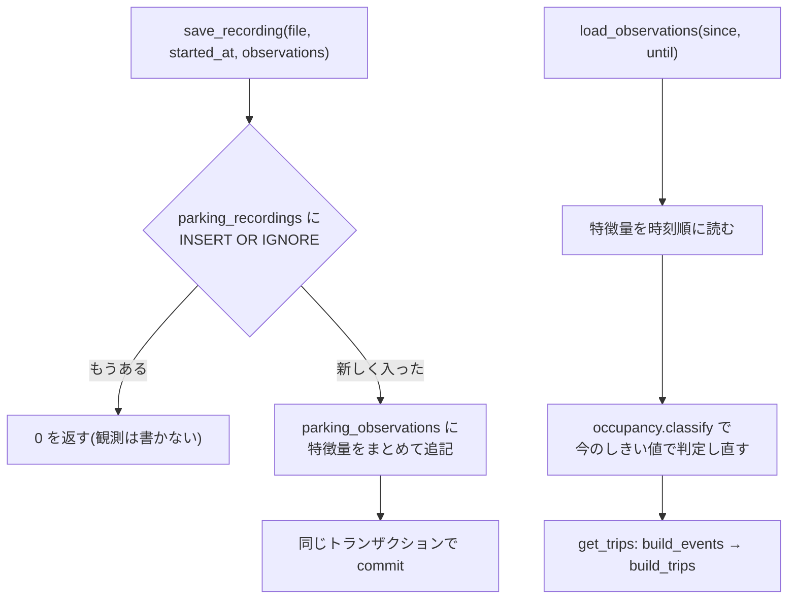
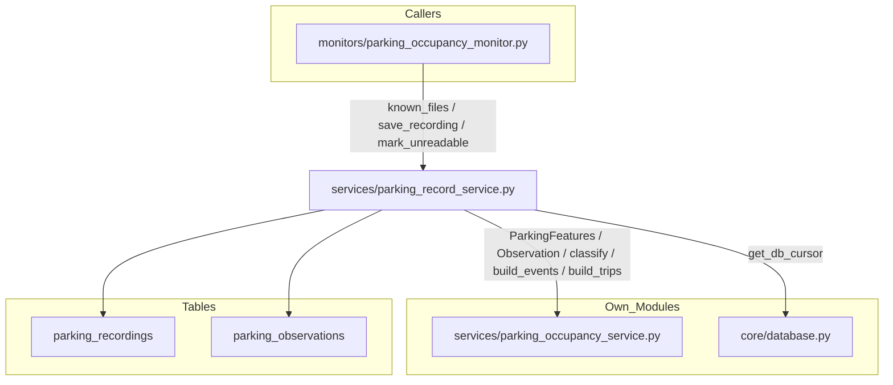

## 1. 解析メタ情報

| 項目 | 内容 |
| --- | --- |
| 対象ファイル | `MY_HOME_SYSTEM/services/parking_record_service.py` |
| 言語 | Python |
| 解析対象 | 提供されたコードのみ |
| 推測・補完 | 一切なし |
| 解析基準コミット | #1116（駐車場の在否判定 Phase 2）での新規追加時点 |

## 関連ドキュメント

* [parking_occupancy_service.md](./parking_occupancy_service.md) - 判定の本体。特徴量の型・しきい値・外出の区間へのまとめ方はすべてそちら
* [parking_occupancy_monitor.md](./parking_occupancy_monitor.md) - 本サービスへ書き込む唯一の経路（10分ごとの定期実行と、CSV の取り込み）
* [database.md](./database.md) - `get_db_cursor` の定義元
* [db_retention_service.md](./db_retention_service.md) - 本サービスのテーブルを保持期間削除の対象に登録している

## 2. ファイルの概要

駐車場の在否判定の結果を DB に保存し、読み出すサービス。判定そのものは `services/parking_occupancy_service.py` にあり、ここは永続化だけを担う。

* 根拠: モジュールdocstring (行番号: 2〜14 / 抜粋: "駐車場の在否判定の結果を DB に保存し、読み出すサービス(#1116)。")

保存するのは1フレームごとの**特徴量**で、在否（あり/なし/不明）は保存しない。読み出すたびに `parking_occupancy_service.classify` で今のしきい値から判定し直すので、しきい値を見直しても録画を読み直さずに過去分の集計が変わる。解析した録画は `parking_recordings` に1行ずつ記録し、観測と同じトランザクションで書く。時刻は録画ファイル名と同じホストのローカル時刻（`YYYY-MM-DD HH:MM:SS`）。

* 根拠: `def load_observations(` (行番号: 92 / 抜粋: "def load_observations(")

## 3. 外部依存関係

### インポート一覧

| 名称 | 種類 | 用途 | 根拠 |
| --- | --- | --- | --- |
| `datetime` | 標準 | 時刻の文字列化と解析 | 根拠: [インポート宣言] (行番号: 17 / 抜粋: "import datetime") |
| `core.database.get_db_cursor` | 自作 | DB の読み書き | 根拠: [インポート宣言] (行番号: 20 / 抜粋: "from core.database import get_db_cursor") |
| `services.parking_occupancy_service` | 自作 | 特徴量・観測の型、判定、外出の区間へのまとめ方 | 根拠: [インポート宣言] (行番号: 21 / 抜粋: "from services import parking_occupancy_service as occupancy") |

### ブラックボックスとなる外部要素

| 名称 | 理由 | 根拠 |
| --- | --- | --- |
| `parking_recordings` / `parking_observations` テーブル | 定義は `migrations/0025_add_parking_occupancy.sql` にある | 根拠: [定数定義] (行番号: 29 / 抜粋: "_INSERT_OBSERVATION_SQL = (") |

## 4. 主要要素の定義（関数 / エンドポイント / コンポーネント）

### 定数

* **役割**: `STATUS_OK` / `STATUS_UNREADABLE` は `parking_recordings.status` の値。SQL は文字列を組み立てず、列名を書き下した固定の文（`_INSERT_OBSERVATION_SQL` / `_SELECT_OBSERVATIONS_SQL`）にしている（bandit B608 対策）。`_FAR_FUTURE` は読み出しの上限を省略したときに使う、どの時刻よりも後ろに並ぶ文字列。
* 根拠: [定数定義] (行番号: 26 / 抜粋: "STATUS_UNREADABLE = \"unreadable\"")
* 根拠: [定数定義] (行番号: 40 / 抜粋: "_FAR_FUTURE = \"9999-12-31 23:59:59\"")

### `known_files`

* **役割**: `since` 以降に始まった録画のうち、もう解析した（読めなかったものを含む）ファイル名の集合を返す。定期実行が、まだ読んでいない録画を選ぶのに使う。
* 根拠: `def known_files(since: datetime.datetime) -> Set[str]:` (行番号: 47 / 抜粋: "def known_files(")

* **引数/リクエスト**: `since`（録画の開始時刻の下限）
* 根拠: `def known_files(since: datetime.datetime) -> Set[str]:` (行番号: 47)

* **戻り値/レスポンス**: ファイル名の集合
* 根拠: `def known_files(since: datetime.datetime) -> Set[str]:` (行番号: 47)

* **副作用**: なし（読み取りのみ）
* 根拠: `def known_files(since: datetime.datetime) -> Set[str]:` (行番号: 47)

* **エラーハンドリング**: なし（DB エラーは呼び出し元へ伝わる）
* 根拠: `def known_files(since: datetime.datetime) -> Set[str]:` (行番号: 47)

### `save_recording`

* **役割**: 録画1本分の観測（特徴量）と、その録画を解析したことを、1つのトランザクションで書く。録画の記録は `INSERT OR IGNORE` で、もう記録されていれば観測を書かずに 0 を返す（二重に動いた場合の重複を防ぐ）。
* 根拠: `def save_recording(` (行番号: 54 / 抜粋: "def save_recording(")

* **引数/リクエスト**: `file_name`、`started_at`（録画の開始時刻）、`observations`（特徴量つきの `Observation`）、`now`（解析した時刻）
* 根拠: `def save_recording(` (行番号: 54)

* **戻り値/レスポンス**: 書いた観測の数
* 根拠: `def save_recording(` (行番号: 54)

* **副作用**: `parking_recordings` に1行（`status='ok'`）、`parking_observations` に観測の数だけ追記
* 根拠: `def save_recording(` (行番号: 54)

* **エラーハンドリング**: 特徴量の無い観測は `assert` で弾く。DB エラーは `get_db_cursor` がロールバックして呼び出し元へ伝える
* 根拠: `def save_recording(` (行番号: 54)

### `mark_unreadable`

* **役割**: ffmpeg 自身が読めないと答えた録画を `status='unreadable'`・観測0件として記録する。次回からは `known_files` に含まれるので読まない。
* 根拠: `def mark_unreadable(file_name: str, started_at: datetime.datetime, now: datetime.datetime) -> None:` (行番号: 82 / 抜粋: "def mark_unreadable(")

* **引数/リクエスト**: `file_name`、`started_at`、`now`
* 根拠: `def mark_unreadable(file_name: str, started_at: datetime.datetime, now: datetime.datetime) -> None:` (行番号: 82)

* **戻り値/レスポンス**: `None`
* 根拠: `def mark_unreadable(file_name: str, started_at: datetime.datetime, now: datetime.datetime) -> None:` (行番号: 82)

* **副作用**: `parking_recordings` に1行（既にあれば何もしない）
* 根拠: `def mark_unreadable(file_name: str, started_at: datetime.datetime, now: datetime.datetime) -> None:` (行番号: 82)

* **エラーハンドリング**: なし
* 根拠: `def mark_unreadable(file_name: str, started_at: datetime.datetime, now: datetime.datetime) -> None:` (行番号: 82)

### `load_observations`

* **役割**: `since` 以上 `until` 未満の観測を時刻順に返す。各行の特徴量から `ParkingFeatures` を組み立て、`occupancy.classify` で**今のしきい値で判定し直した**在否を付ける。
* 根拠: `def load_observations(` (行番号: 92 / 抜粋: "def load_observations(")

* **引数/リクエスト**: `since`、`until`（省略時は上限なし）
* 根拠: `def load_observations(` (行番号: 92)

* **戻り値/レスポンス**: `Observation` のリスト（特徴量つき）
* 根拠: `def load_observations(` (行番号: 92)

* **副作用**: なし（読み取りのみ）
* 根拠: `def load_observations(` (行番号: 92)

* **エラーハンドリング**: なし
* 根拠: `def load_observations(` (行番号: 92)

### `get_trips`

* **役割**: 期間内の観測から `occupancy.build_events` → `occupancy.build_trips` で外出の区間を求める。期間の始まりで既に外出中だった分は、出た時刻が分からないので含まれない。ダッシュボード（#1117）と週次レポート（#1118）の入り口になる想定。
* 根拠: `def get_trips(` (行番号: 110 / 抜粋: "def get_trips(")

* **引数/リクエスト**: `since`、`until`（省略可）、`confirm_count`（既定は `occupancy.DEFAULT_CONFIRM_COUNT`）
* 根拠: `def get_trips(` (行番号: 110)

* **戻り値/レスポンス**: `Trip` のリスト
* 根拠: `def get_trips(` (行番号: 110)

* **副作用**: なし（読み取りのみ）
* 根拠: `def get_trips(` (行番号: 110)

* **エラーハンドリング**: なし
* 根拠: `def get_trips(` (行番号: 110)

## 5. 処理フロー図

## 6. 依存関係図

## 7. 次のステップ（リバースエンジニアリングの提案）

| 優先度 | ファイル名(推測可) | 理由 | 根拠 |
| --- | --- | --- | --- |
| 高 | `services/parking_occupancy_service.py` | 判定と外出の区間へのまとめ方の本体 | `from services import parking_occupancy_service as occupancy` (行番号: 21) |
| 中 | `monitors/parking_occupancy_monitor.py` | 書き込みの唯一の経路 | `def save_recording(` (行番号: 54) |
| 中 | `migrations/0025_add_parking_occupancy.sql` | テーブル定義 | `_INSERT_OBSERVATION_SQL = (` (行番号: 29) |

## 8. 保守上の注意点

* **在否は保存しない**: 集計のたびに特徴量から判定し直す。ダッシュボード等で使うときは、毎回 `load_observations` / `get_trips` を通すこと（別の場所で在否を保存すると、しきい値を見直したときに食い違う）。
* **特徴量を増やしたら列とマイグレーションを足す**: `ParkingFeatures` の欄と `parking_observations` の列は1対1。片方だけ変えると読み出しで落ちる。
* **時刻はホストのローカル時刻**: 録画ファイル名と同じ時計で書く。`core/utils` の JST 固定ヘルパーとは混ぜない（実機は JST なので値は同じ）。
* **保持期間**: 2つのテーブルとも `db_retention_service.RETENTION_TARGETS` に `DB_ROW_RETENTION_SENSOR_DAYS` で登録している。

## 9. 不明事項一覧

| 項目 | 理由 | 必要なファイル |
| --- | --- | --- |
| 1年分たまったときの読み出し速度 | 観測は1日約1,440行。週次レポートで1週間分（約1万行）を読む程度なら問題ない想定だが、実測していない | 実機での計測 |
