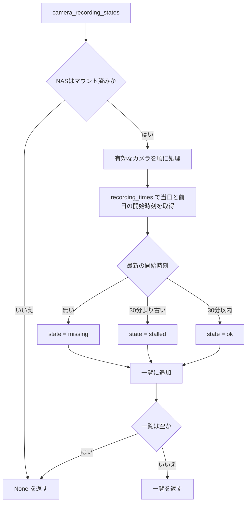
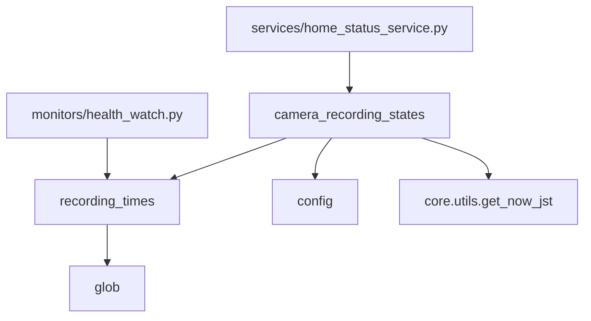

## 1. 解析メタ情報

| 項目 | 内容 |
| --- | --- |
| 対象ファイル | `recording_status_service.py` |
| 言語 | Python |
| 解析対象 | 提供されたコードのみ |
| 推測・補完 | 一切なし |

## 関連ドキュメント

* [health_watch.md](./health_watch.md) - `_recording_times` が本ファイルの `recording_times` を呼ぶ(毎時の録画停止チェック)
* [home_status_service.md](./home_status_service.md) - `get_camera_recording_states` が本ファイルの `camera_recording_states` を時間制限・キャッシュ付きで呼び、「🎥 カメラ」カードの値にする
* [dashboard_page_service.md](./dashboard_page_service.md) - 見守りページのカメラ名の横に録画の状態を出す
* [config.md](./config.md) - `NAS_MOUNT_POINT`・`NVR_RECORD_DIR`・`CAMERAS` を提供

## 2. ファイルの概要

カメラごとの常時録画(NVR)が続いているかを、NAS上の録画ファイルの新しさから判定するモジュール。録画そのものは行わず、読み取るだけである。録画ファイル名から開始時刻を読む処理は以前 `monitors/health_watch.py` にしか無く、ダッシュボードからは「カメラが生きているか」が分からなかった。その処理をここへ移し、health_watch とダッシュボードの両方が同じ実装を使う。

## 3. 外部依存関係

### インポート一覧

| 名称 | 種類 | 用途 | 根拠 |
| --- | --- | --- | --- |
| `datetime` | 標準 | 時刻の計算・ファイル名の解析 | 根拠: [インポート宣言] (行番号: 15 / 抜粋: "import datetime") |
| `glob` | 標準 | 録画ファイルの列挙 | 根拠: [インポート宣言] (行番号: 16 / 抜粋: "import glob") |
| `os` | 標準 | パスの結合・マウント判定 | 根拠: [インポート宣言] (行番号: 17 / 抜粋: "import os") |
| `typing.Any` | 標準 | 型ヒント | 根拠: [インポート宣言] (行番号: 18 / 抜粋: "from typing import Any") |
| `zoneinfo.ZoneInfo` | 標準 | JST のタイムゾーン | 根拠: [インポート宣言] (行番号: 19 / 抜粋: "from zoneinfo import ZoneInfo") |
| `config` | 外部 | NASのマウント先・録画ディレクトリ・カメラ定義 | 根拠: [インポート宣言] (行番号: 21 / 抜粋: "import config") |
| `core.utils.get_now_jst` | 外部 | 現在時刻(JST) | 根拠: [インポート宣言] (行番号: 22 / 抜粋: "from core.utils import get_now_jst") |

### ブラックボックスとなる外部要素

| 名称 | 理由 | 根拠 |
| --- | --- | --- |
| `config.CAMERAS` の各要素 | `id`・`name`・`enabled`・`nas_folder` を参照するが、実際の値は `devices.json`(リポジトリ外)に依存する | 根拠: [ループ] (行番号: 61 / 抜粋: "for cam in config.CAMERAS:") |
| 録画ファイルの命名 | `{YYYYMMDD}_{HHMMSS}.mp4` を前提にするが、書き込む側(nvr-*.service の ffmpeg)は本ファイルの外にある | 根拠: [パターン] (行番号: 39 / 抜粋: "pattern = os.path.join(folder, f\"{day.strftime('%Y%m%d')}_*.mp4\")") |

## 4. 主要要素の定義（関数 / エンドポイント / コンポーネント）

### `JST` / `RECORDING_STALE_SEC` (モジュールレベル定数)

* **役割**: `JST` は `ZoneInfo("Asia/Tokyo")`。`RECORDING_STALE_SEC` は 30分(1800秒)で、最新の録画セグメントの開始時刻がこれより古ければ「止まっている」とみなす。
* 根拠: [定数定義] (行番号: 24 / 抜粋: 'JST = ZoneInfo("Asia/Tokyo")')、[定数定義] (行番号: 28 / 抜粋: "RECORDING_STALE_SEC: int = 30 * 60")

### `recording_times`

* **役割**: 録画フォルダの当日・前日のセグメント開始時刻(ファイル名の先頭15文字 `YYYYMMDD_HHMMSS` を JST として解釈)を新しい順に返す。当日と前日に絞るのは、NAS越しに保持期間分を毎回列挙しないため。
* 根拠: [関数定義] (行番号: 31 / 抜粋: "def recording_times(folder: str, now: datetime.datetime) -> list[datetime.datetime]:")

* **引数/リクエスト**: `folder: str`(カメラの録画フォルダ)、`now: datetime.datetime`(当日・前日の基準)
* 根拠: [関数定義] (行番号: 31 / 抜粋: "def recording_times(folder: str, now: datetime.datetime) -> list[datetime.datetime]:")

* **戻り値/レスポンス**: `list[datetime.datetime]`(JST の aware。新しい順)
* 根拠: [戻り値] (行番号: 47 / 抜粋: "return times")

* **副作用**: ファイルシステムの列挙(読み取りのみ)
* 根拠: [関数呼び出し] (行番号: 40 / 抜粋: "names.extend(os.path.basename(p) for p in glob.glob(pattern))")

* **エラーハンドリング**: ファイル名を日時として読めないものは `ValueError` を捕捉して読み飛ばす。
* 根拠: [例外処理] (参照: recording_times / 抜粋: "except ValueError:")

### `camera_recording_states`

* **役割**: 有効なカメラごとの録画の状態を返す。`state` は `ok`(最新の録画の開始が `RECORDING_STALE_SEC` 以内)/`stalled`(それより古い)/`missing`(今日・昨日の録画ファイルが無い)。録画フォルダ名は `cam["nas_folder"]`、無ければ `cam["name"]`。
* 根拠: [関数定義] (行番号: 50 / 抜粋: "def camera_recording_states(now: datetime.datetime | None = None) -> list[dict[str, Any]] | None:")

* **引数/リクエスト**: `now: datetime.datetime | None = None`(省略時は `get_now_jst()`)
* 根拠: [条件式] (行番号: 59 / 抜粋: "now = now or get_now_jst()")

* **戻り値/レスポンス**: `list[dict[str, Any]] | None`。各要素は `{"id", "name", "state", "latest"}`。NAS が未マウント、または有効なカメラが1台も無いときは `None`(判定できない)。
* 根拠: [条件分岐] (行番号: 57 / 抜粋: "if not os.path.ismount(config.NAS_MOUNT_POINT):")、[戻り値] (行番号: 74 / 抜粋: "return states or None")

* **副作用**: ファイルシステムの列挙(読み取りのみ)
* 根拠: [関数呼び出し] (行番号: 65 / 抜粋: "times = recording_times(os.path.join(config.NVR_RECORD_DIR, folder_name), now)")

* **エラーハンドリング**: なし(例外は呼び出し側へ伝播する。ダッシュボード側は `home_status_service.cached_with_timeout` が捕捉して `None` にする)

## 5. 処理フロー図

## 6. 依存関係図

## 7. 次のステップ（リバースエンジニアリングの提案）

| 優先度 | ファイル名(推測可) | 理由 | 根拠 |
| --- | --- | --- | --- |
| 高 | `monitors/health_watch.py` | 同じ読み取りを使う録画停止チェック(断続的な切断の検知を含む)を確認するため | 根拠: モジュールdocstring (行番号: 5) |
| 中 | `services/home_status_service.py` | 結果がカードの値・色にどう変換されるかを確認するため | 根拠: モジュールdocstring (行番号: 8) |

## 8. 保守上の注意点

* 判定はファイルの更新時刻ではなく**ファイル名の時刻**による。書き込み中のファイルの更新時刻はこのNASでは進まないため(理由は `monitors/health_watch.py` の `RECORDING_STALE_SEC` のコメントにある)。
* `monitors/health_watch.py` にも同名・同値の定数 `RECORDING_STALE_SEC` がある。値を変えるときは両方を変えること(`tests/test_dashboard_ux_improvements.py` が一致を検証する)。
* 接続が断続的に切れて短いセグメントが大量に作られる状態(フラッピング)は、本ファイルでは検知しない(最新ファイルが新しいので `ok` になる)。その検知は `health_watch.check_recording_stalled` にあり、ダッシュボードではシステムページの「🩺 定期チェック」に出る。
* NAS が応答しないまま固まると `glob.glob` が返ってこない。ページ表示から呼ぶときは必ず `home_status_service.cached_with_timeout` を通すこと。

## 9. 不明事項一覧

| 項目 | 理由 | 必要なファイル |
| --- | --- | --- |
| 録画ファイルを書く側の設定 | セグメント長(10分)・ファイル名の形式は本ファイルの外で決まる | `deploy/systemd/nvr-*.service` |
| `config.CAMERAS` の実際の内容 | `devices.json` はリポジトリに含まれない | 実機の `devices.json` |

## 10. 自己検証結果

* [x] 完了: 推測・外部ファイルの仕様を一切含んでいない
* [x] 完了: 全関数・全クラス・全コンポーネントを列挙した
* [x] 完了: 全てのインポート要素を列挙した
* [x] 完了: すべての仕様説明に「根拠（行番号・抜粋）」を明記した
* [x] 完了: 根拠漏れが0件である
* [x] 完了: Mermaid構文にエラーの原因となる記号（エスケープ漏れ）がない
