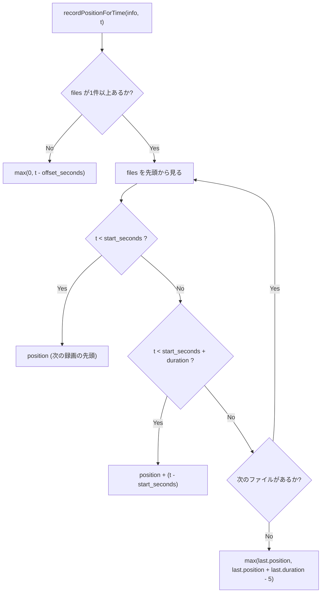
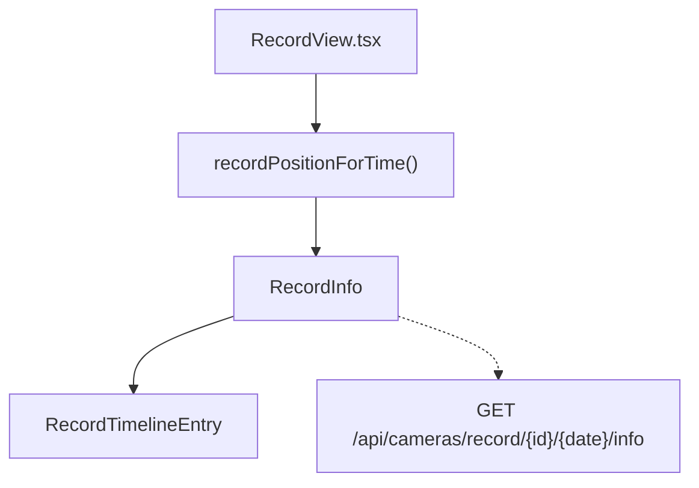

## 1. 解析メタ情報

| 項目 | 内容 |
| --- | --- |
| 対象ファイル | `family-quest/src/features/camera/recordTimeline.ts` |
| 言語 | TypeScript |
| 解析対象 | 提供されたコードのみ |
| 推測・補完 | 一切なし |

## 関連ドキュメント

* [./components/RecordView.md](./components/RecordView.md) - 呼び出し元。「再生開始」時に各カメラのシーク位置を本ファイルで求める
* [../../../../MY_HOME_SYSTEM/record_playlist_service.md](../../../../MY_HOME_SYSTEM/record_playlist_service.md) - 対応表(`files`)を作るバックエンド(`get_record_timeline`)
* [../../../../MY_HOME_SYSTEM/camera_router.md](../../../../MY_HOME_SYSTEM/camera_router.md) - 対応表を返す `GET /api/cameras/record/{camera_id}/{date}/info`

## 2. ファイルの概要

* 録画の「指定時刻(0時からの秒数)」を、その日の録画プレイリスト上の再生位置(秒)に変換する関数と、`/info` のレスポンス型を定義する (Issue #1091)。
* 録画VODのプレイリストは NAS 上の録画 MP4 をそのまま並べたもので、録画が欠けている時間帯は詰まっている。以前の ffmpeg 生成版は欠けた時間を最終フレームの静止で埋めていたため「再生位置 = 最初のファイルからの経過秒」で済んだが、それでは位置がずれるため、バックエンドが返すファイルごとの対応表で変換する。
* 根拠: [冒頭コメント] (行番号: 1〜3 / 抜粋: "// Issue #1091: 録画VODのプレイリストは NAS 上の録画 MP4 をそのまま並べたもので、")

## 3. 外部依存関係

### インポート一覧

| 名称 | 種類 | 用途 | 根拠 |
| --- | --- | --- | --- |
| （なし） | - | 外部モジュールを import しない | 根拠: `export function recordPositionForTime(info: RecordInfo, targetSeconds: number): number {` (行番号: 34) |

### ブラックボックスとなる外部要素

| 名称 | 理由 | 根拠 |
| --- | --- | --- |
| `/info` のレスポンス | 値の作り方はバックエンド側にある | 根拠: `export interface RecordInfo {` (行番号: 18) |

## 4. 主要要素の定義（関数 / エンドポイント / コンポーネント）

### `RecordTimelineEntry` / `RecordInfo`

* **役割**: 録画ファイル1本分の対応(`start_seconds`: 録画開始時刻の0時からの秒数、`position`: プレイリスト上の開始位置、`duration`: 長さ)と、`/info` のレスポンス(`offset_seconds` と、Issue #1091 で追加された任意の `files`)。
* 根拠: `export interface RecordTimelineEntry {` (行番号: 8)、`export interface RecordInfo {` (行番号: 18)
* **引数/リクエスト**: 該当なし
* **戻り値/レスポンス**: 該当なし
* **副作用**: なし
* **エラーハンドリング**: なし

### `recordPositionForTime`

* **役割**: 指定時刻を再生位置に変換する。対応表を先頭から見て、指定時刻がファイルの開始より前(録画の欠け、または最初の録画より前)ならそのファイルの位置、ファイルの範囲内なら「位置 + ファイル内の経過秒」を返す。最後の録画より後なら、最後の録画の終わりの `TAIL_SECONDS`(5秒)前(ただしそのファイルの位置より前にはしない)を返す。対応表が無い・空なら、従来どおり `max(0, 指定時刻 − offset_seconds)`。
* 根拠: `export function recordPositionForTime(info: RecordInfo, targetSeconds: number): number {` (行番号: 34)、`const TAIL_SECONDS = 5;` (行番号: 24)
* **引数/リクエスト**: `info: RecordInfo`, `targetSeconds: number`
* **戻り値/レスポンス**: `number`(秒)
* **副作用**: なし(純粋関数)
* **エラーハンドリング**: なし

## 5. 処理フロー図

## 6. 依存関係図

## 7. 次のステップ（リバースエンジニアリングの提案）

| 優先度 | ファイル名 | 理由 | 根拠 |
| --- | --- | --- | --- |
| 高 | `MY_HOME_SYSTEM/services/record_playlist_service.py` | `files` の値(位置の累積・欠けたファイルの除外)の作り方を確認するため | 根拠: `export interface RecordInfo {` (行番号: 18) |
| 中 | `family-quest/src/features/camera/recordTimeline.test.ts` | 欠け・範囲外・対応表なしの期待値がテストに書かれている | 根拠: [テストファイル。本ファイル単体からは不明] |

## 8. 保守上の注意点

* `files` を持たない古いバックエンドでも動くよう、従来の計算にフォールバックする。バックエンドとフロントエンドは同時にデプロイされる構成だが、この分岐を消すと `/info` が失敗したときと同じ扱いにはならない点に注意(失敗時は呼び出し元の `RecordView` が指定時刻そのものを使う)。
* 根拠: `return Math.max(0, targetSeconds - info.offset_seconds);` (行番号: 37)

## 9. 不明事項一覧

| 項目 | 理由 | 必要なファイル |
| --- | --- | --- |
| （なし） | 本ファイルは自己完結した純粋関数のみ | - |

## 10. 自己検証結果

* [x] 推測・外部ファイルの仕様を一切含んでいない
* [x] 全関数・全クラス・全コンポーネントを列挙した
* [x] 全てのインポート要素を列挙した
* [x] すべての仕様説明に「根拠（行番号・抜粋）」を明記した
* [x] 根拠漏れが0件である
* [x] Mermaid構文にエラーの原因となる記号（エスケープ漏れ）がない
* [x] 不明事項を漏れなく列挙した

完了
